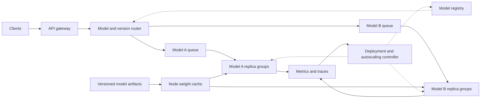

# Referral System (共同好友推荐系统)

[题目链接 / Problem Link](https://www.1point3acres.com/interview/thread/1189232)

## 1. 题目描述 / Problem Statement

### 中文

给定一个无向用户关系图，节点表示用户，边表示两个用户互为好友。为目标用户 `u` 生成好友推荐列表。

候选用户 `v` 必须满足以下条件：

- `v != u`，不能推荐用户本人。
- `v` 不是 `u` 的直接好友。
- `u` 和 `v` 至少有一个共同好友。

以共同好友数量作为排序分数，按共同好友数降序排列；数量相同时，按用户 ID 升序排列。没有候选人时返回空列表。

页面整理版题目的约束为：用户 ID 是 `0` 到 `n - 1`，`2 <= n <= 2 * 10^5`，`0 <= m <= 5 * 10^5`，没有自环或重复边。

原帖还提到第二部分：给推荐结果提供 `[0, 1]` 范围内的分数，并提到了 NDCG。面试时需要确认要求的是每个候选人的推荐分数，还是整份列表的排序质量指标；两者分别在代码实现和面试追问中讨论。

### English

Given an undirected friendship graph, where nodes represent users and edges represent mutual friendships, generate friend recommendations for a target user `u`.

A candidate user `v` must satisfy all of the following conditions:

- `v != u`: do not recommend the user to themselves.
- `v` is not already a direct friend of `u`.
- `u` and `v` share at least one mutual friend.

Rank candidates by their number of mutual friends in descending order. Break ties by user ID in ascending order. Return an empty list when no candidates exist.

The structured problem on the page specifies user IDs from `0` to `n - 1`, `2 <= n <= 2 * 10^5`, and `0 <= m <= 5 * 10^5`, with no self-loops or duplicate edges.

The original post also mentions bounded scores in `[0, 1]` and NDCG. Clarify whether the interviewer wants a score for each candidate or an evaluation metric for the entire ranked list. These are discussed separately below.

### 示例 / Example

```text
n = 6
edges = [(0, 1), (0, 2), (1, 3), (2, 3), (1, 4), (2, 5)]
u = 0
```

| 候选人 / Candidate | 共同好友 / Mutual Friends | 数量 / Count | 顺序 / Rank |
| --- | --- | --- | --- |
| 3 | 1, 2 | 2 | 1 |
| 4 | 1 | 1 | 2 |
| 5 | 2 | 1 | 3 |

```text
Recommended user IDs: [3, 4, 5]
```

## 2. 核心思路 / Core Approach

### 中文

使用集合形式的邻接表 `graph[u]` 存储用户 `u` 的直接好友，使用哈希计数器记录候选人的共同好友数。

1. 读取目标用户的好友集合 `friends = graph[u]`。
2. 遍历每个 `friend`，再遍历 `graph[friend]` 中的用户 `candidate`。
3. 排除目标用户本人和已经是直接好友的用户。
4. 对剩余候选人执行 `counts[candidate] += 1`。
5. 用 `(-counts[v], v)` 作为排序键。

每条有效的两跳路径 `u -> friend -> candidate` 对应一个共同好友。集合邻接表确保同一个中间好友不会因重复边被重复计算。

遍历完所有直接好友后的不变量为：

$$
\operatorname{counts}[v] = |N(u) \cap N(v)|
$$

这里 `N(x)` 是用户 `x` 的直接好友集合，`v` 是满足推荐条件的候选人。在遍历过程中，计数等于已经处理的直接好友中，同时也是 `v` 好友的人数。

### English

Store the graph as an adjacency list of sets and use a hash counter to count mutual friends for each candidate.

1. Read the target user's direct friends: `friends = graph[u]`.
2. For each `friend`, traverse every `candidate` in `graph[friend]`.
3. Exclude the target user and existing direct friends.
4. Increment `counts[candidate]` for each remaining candidate.
5. Sort candidates using the key `(-counts[v], v)`.

Each valid two-hop path `u -> friend -> candidate` contributes one mutual friend. Set-based adjacency lists prevent duplicate edges from counting the same intermediary twice.

After processing all direct friends, the invariant is `counts[v] = |N(u) intersect N(v)|` for every eligible candidate `v`. During traversal, the count equals the number of processed direct friends who are also friends with `v`.

## 3. 代码实现 / Code Implementation

图只需构建一次，随后可以查询多个用户。默认返回 `(用户 ID, 共同好友数)`；`normalize=True` 时返回 `(用户 ID, 归一化分数)`。只需要题目的 ID 列表时，提取每个元组的第一个元素即可。

Build the graph once and reuse it for multiple users. By default, return `(user_id, mutual_friend_count)` pairs. With `normalize=True`, return `(user_id, normalized_score)` pairs. Extract the first element of each pair when only user IDs are required.

```python
from collections import Counter


def build_graph(n, edges):
    graph = [set() for _ in range(n)]
    for a, b in edges:
        graph[a].add(b)
        graph[b].add(a)
    return graph


def recommend(graph, u, normalize=False):
    friends = graph[u]
    if not friends:
        return []

    counts = Counter()
    for friend in friends:
        for candidate in graph[friend]:
            if candidate != u and candidate not in friends:
                counts[candidate] += 1

    ranked = sorted(counts, key=lambda v: (-counts[v], v))
    if normalize:
        return [(v, counts[v] / len(friends)) for v in ranked]
    return [(v, counts[v]) for v in ranked]


edges = [(0, 1), (0, 2), (1, 3), (2, 3), (1, 4), (2, 5)]
graph = build_graph(6, edges)

print(recommend(graph, 0))
# [(3, 2), (4, 1), (5, 1)]

print([v for v, _ in recommend(graph, 0)])
# [3, 4, 5]

print(recommend(graph, 0, normalize=True))
# [(3, 1.0), (4, 0.5), (5, 0.5)]
```

可选的归一化定义为：

$$
\operatorname{score}(u, v)
= \frac{|N(u) \cap N(v)|}{|N(u)|}
$$

共同好友数不超过目标用户的好友数，所以分数在 `[0, 1]` 内。对于同一目标用户，分母固定，因此不会改变原排序。这个值表示目标用户的好友中，有多少比例也认识候选人，不是经过校准的交友概率。没有好友时直接返回空列表，避免除以零。

The mutual-friend count cannot exceed the target user's degree, so the score lies in `[0, 1]`. For a fixed target user, the denominator is constant and preserves the original ranking. The score measures the fraction of the target user's friends who also know the candidate; it is not a calibrated probability of becoming friends. An isolated user returns an empty list without division.

## 4. 复杂度与易错点 / Complexity and Pitfalls

### 中文

设 `n` 是用户数，`m` 是边数，`c` 是候选人数，`deg(x)` 是用户 `x` 的度数。令：

$$
S = \sum_{f \in N(u)} \deg(f)
$$

- 建图：期望时间 `O(n + m)`，存储空间 `O(n + m)`。
- 单用户查询：期望时间 `O(deg(u) + S + c log c)`；无自环的无向图中 `deg(u) <= S <= 2m`，因此通常写为 `O(S + c log c)`。
- 查询额外空间：计数器、排序结果和返回列表均为 `O(c)`，不包含已经构建的图。

易错点：

- 必须排除用户本人：`u -> friend -> u` 也是两跳路径。
- 必须排除已有好友：三角形中的直接好友也会通过两跳路径被遇到。
- 不能对候选人使用全局 `visited` 去重；同一个候选人通过不同好友出现，需要分别计数。
- 邻接表用集合去重边，但计数器保留不同共同好友的贡献。
- 排序键是 `(-counts[v], v)`，两个排序方向不同。
- 不能只根据目标用户的度数断言查询是 `O(deg(u)^2)`；他的朋友可能有很高的度数。
- 孤立用户或没有候选人的用户返回空列表；如果外部接口要求打印 ID，则打印空行。

### English

Let `n` be the number of users, `m` the number of edges, `c` the number of candidates, and `deg(x)` the degree of user `x`. Define `S = sum(deg(f) for f in N(u))`.

- Graph construction takes expected `O(n + m)` time and `O(n + m)` space.
- A single-user query takes expected `O(deg(u) + S + c log c)` time. In a loop-free undirected graph, `deg(u) <= S <= 2m`, so this is usually written as `O(S + c log c)`.
- Query auxiliary space is `O(c)` for counting and ranking, excluding the existing graph.

Common pitfalls:

- Exclude the target user because `u -> friend -> u` is a two-hop path.
- Exclude direct friends because triangles can also produce two-hop paths to them.
- Do not globally deduplicate candidates with a `visited` set. Different intermediate friends must contribute separately.
- Deduplicate edges in adjacency sets while retaining contributions from distinct mutual friends.
- Use `(-counts[v], v)` to implement descending counts and ascending IDs.
- Do not claim `O(deg(u)^2)` based only on the target user's degree; their friends can have much higher degrees.
- Return an empty list for isolated users or users without eligible candidates. Print an empty line if the external interface requires IDs on one line.

## 5. 最小测试集 / Minimal Test Cases

| 场景 / Scenario | 验证内容 / Expected Behavior |
| --- | --- |
| 正常推荐 / Standard recommendation | 共同好友多的排在前面 / More mutual friends rank first |
| 同分排序 / Tie-breaking | 共同好友数相同，ID 小的优先 / Smaller IDs rank first on ties |
| 没有好友 / Isolated user | 返回空列表 / Return an empty list |
| 全部候选人已经是好友 / All reachable users are friends | 排除本人和直接好友，返回空列表 / Exclude self and direct friends |

以下测试在代码实现之后运行，复用上面的 `build_graph` 和 `recommend`。

Run these tests after the implementation, reusing `build_graph` and `recommend` above.

```python
def test_recommend():
    # Standard recommendation and multiple mutual friends.
    edges = [(0, 1), (0, 2), (1, 3), (2, 3), (1, 4), (2, 5)]
    graph = build_graph(6, edges)
    assert recommend(graph, 0) == [(3, 2), (4, 1), (5, 1)]
    assert recommend(graph, 0, normalize=True) == [
        (3, 1.0), (4, 0.5), (5, 0.5)
    ]

    # Tie-breaking must not depend on insertion or traversal order.
    graph = build_graph(5, [(0, 1), (1, 4), (1, 2)])
    assert recommend(graph, 0) == [(2, 1), (4, 1)]

    # Isolated user, including normalized output.
    graph = build_graph(3, [])
    assert recommend(graph, 0) == []
    assert recommend(graph, 0, normalize=True) == []

    # A triangle reaches only the user and existing direct friends.
    graph = build_graph(3, [(0, 1), (0, 2), (1, 2)])
    assert recommend(graph, 0) == []


test_recommend()
```

## 6. 面试追问 / Interview Follow-Ups

### 6.1 推荐分数与 NDCG / Candidate Scores vs. NDCG

**中文：** 推荐分数用于给候选人排序，可以使用共同好友数或上面的归一化定义。NDCG 是整份推荐列表的排序质量指标，不是每个候选人的独立分数。仅有推荐列表和预测分数，没有真实相关性标签时，无法计算有意义的 NDCG。

**English:** Candidate scores are used to rank users and can be mutual-friend counts or normalized scores. NDCG evaluates the quality of the entire ranking; it is not an independent score for each candidate. A recommendation list and predicted scores alone are insufficient without ground-truth relevance labels.

采用线性 gain 时，定义如下，其中 `rel(v_i)` 是第 `i` 个推荐用户的非负真实相关性：

Using linear gain, define the metric as follows, where `rel(v_i)` is the nonnegative ground-truth relevance of the user at rank `i`:

$$
DCG@k = \sum_{i=1}^{k} \frac{rel(v_i)}{\log_2(i+1)}
$$

$$
NDCG@k = \frac{DCG@k}{IDCG@k}
$$

**中文：** `IDCG@k` 是全部参与评估的候选人按真实相关性降序排列后，前 `k` 个的 DCG，不能只排序实际返回的推荐结果。非负标签下 NDCG 在 `[0, 1]` 内；理想排序为 `1`。当所有标签为零时，本文约定返回 `0`。也有使用 `2^rel - 1` 作为 gain 的版本，面试时应确认采用哪一种定义。

**English:** `IDCG@k` is the DCG of the top `k` users after sorting the entire evaluation candidate set by true relevance, not merely the returned recommendations. With nonnegative labels, NDCG lies in `[0, 1]`, and an ideal ranking scores `1`. This implementation returns `0` when all labels are zero. Another convention uses `2^rel - 1` as gain; clarify which definition is expected.

[参考 / Reference: scikit-learn NDCG documentation](https://scikit-learn.org/stable/modules/generated/sklearn.metrics.ndcg_score.html)

```python
from math import log2


def ndcg_at_k(ranked, relevance, k):
    # relevance contains labels for the entire evaluation candidate set.
    if k <= 0:
        return 0.0
    if len(set(ranked)) != len(ranked):
        raise ValueError("Ranked user IDs must be unique")
    if any(v not in relevance for v in ranked):
        raise ValueError("Every ranked user must have a relevance label")
    if any(r < 0 for r in relevance.values()):
        raise ValueError("Relevance labels must be nonnegative")

    def dcg(labels):
        return sum(r / log2(i + 2) for i, r in enumerate(labels))

    actual = dcg([relevance[v] for v in ranked[:k]])
    ideal = dcg(sorted(relevance.values(), reverse=True)[:k])
    return actual / ideal if ideal > 0 else 0.0


relevance = {3: 0, 4: 1, 5: 1}
print(ndcg_at_k([3, 4, 5], relevance, 3))
# Approximately 0.6934264036

print(ndcg_at_k([4, 5, 3], relevance, 3))
# 1.0
```

### 6.2 真实标签从哪里来 / Where Ground-Truth Labels Come From

**中文：** 一个可解释的二元标签是：目标用户是否在评估窗口内与候选人成为好友，成为好友记为 `1`，否则记为 `0`。离线评估可以在时刻 `t` 的图上生成推荐，再用 `(t, t + delta]` 内新增的好友关系构造标签。标签对应的用户对必须处于明确的评估候选集合中；没有曝光或没有足够观察时间的用户，不能轻易视为确定的负例。

**English:** An interpretable binary label is whether the target user becomes friends with a candidate during the evaluation window: `1` for a new friendship and `0` otherwise. For offline evaluation, generate recommendations from the graph at time `t` and derive labels from new friendships during `(t, t + delta]`. Define the evaluation candidate set explicitly, and do not automatically treat users without exposure or sufficient observation time as confirmed negatives.

**中文：** 生成推荐时不能使用未来的边，否则会发生数据泄漏。也不要直接拿用于排序的共同好友数当真实标签：按同一分数正确排序的完整候选列表，其 NDCG 会恒为 `1`，无法评价真正的交友效果。

**English:** Do not use future edges when generating recommendations, because that leaks evaluation data. Using the same mutual-friend counts as both ranking scores and relevance labels gives a correctly sorted complete candidate list an NDCG of `1`, which does not evaluate actual friendship outcomes.

### 6.3 只返回 Top-K / Returning Only Top-K

**中文：** 计数步骤不变，完成计数后用堆选择前 `k` 个候选人，无需对全部 `c` 个候选人排序。Python 可以使用以下代码，排序规则仍是共同好友数降序、ID 升序：

**English:** Keep the counting step unchanged, then use a heap to select the top `k` candidates instead of sorting all `c` candidates. The same count-descending and ID-ascending ordering applies:

```python
import heapq

# counts is the counter produced by the recommendation traversal.
top_ids = heapq.nsmallest(k, counts, key=lambda v: (-counts[v], v))
```

**中文：** 当 `1 <= k < c` 时，查询时间可写为 `O(S + c log(k + 1))`；只取一个候选人时可线性扫描。当 `k >= c` 时使用全排序即可。堆选择阶段需要 `O(k)` 额外空间，但共同好友计数字典仍需要 `O(c)` 空间。

**English:** For `1 <= k < c`, query time can be written as `O(S + c log(k + 1))`; selecting a single candidate can use a linear scan. For `k >= c`, a full sort is appropriate. Heap selection needs `O(k)` additional space, while the mutual-friend counter still requires `O(c)` space.

# GPU Idle Times (GPU 空闲时间：批量计算与流式更新)

[题目链接 / Problem Link](https://www.1point3acres.com/interview/thread/1159979)

## 1. 题目描述 / Problem Statement

### 中文

给定 GPU 任务列表，每个任务表示为 `(start, end, node_id)`，表示对应节点在时间区间 `[start, end)` 内运行任务。

- Q1：一次性给出所有任务，找出所有空闲时间区间。
- Q2：任务不断以流的方式到达，支持添加任务，并高效查询当前已知任务对应的空闲时间区间。

原帖使用全局任务计数器，因此本解法采用“整个集群没有任何任务运行”的空闲定义。`node_id` 不影响这个定义；按节点分别计算空闲时间属于另一种接口，见面试追问。

原帖没有明确时间窗口。为了定义第一个任务之前、最后一个任务之后以及没有任务时的空闲时间，本笔记显式增加固定查询窗口 `[window_start, window_end)`。

- 时间戳是可比较的有限数值，`window_start <= window_end`。
- 任务满足 `start <= end`，零长度任务不占用时间。
- 超出窗口的部分被裁剪，完全在窗口外的任务被忽略。
- 返回按开始时间排序的、长度大于零的最大空闲区间列表。
- 流式版本允许任务乱序到达，查询结果基于目前已经收到的任务。

### English

Given GPU tasks represented as `(start, end, node_id)`, each task occupies its node during the half-open interval `[start, end)`.

- Q1: Given all tasks at once, return every idle interval.
- Q2: Tasks arrive continuously. Support adding a task and efficiently querying idle intervals based on the tasks received so far.

The original post uses a global task counter, so this solution defines idle time as periods when no task runs anywhere in the cluster. Node IDs do not affect this definition. Per-node idle time is a separate interpretation discussed in the follow-ups.

The post does not specify a time window. This note introduces a fixed window `[window_start, window_end)` to define idle periods before the first task, after the last task, and when no tasks exist.

- Timestamps are comparable finite numeric values, with `window_start <= window_end`.
- Tasks satisfy `start <= end`; zero-duration tasks occupy no time.
- Clip tasks to the window and ignore tasks entirely outside it.
- Return sorted, maximal idle intervals with positive duration.
- The streaming version accepts out-of-order tasks and answers using all tasks received so far.

### 输入输出 / Input and Output

```python
tasks = [(1, 4, "gpu0"), (3, 6, "gpu1"), (8, 10, "gpu0")]
window_start = 0
window_end = 12
```

```text
Busy interval union: [(1, 6), (8, 10)]
Idle intervals:      [(0, 1), (6, 8), (10, 12)]
```

| 接口 / Interface | 输入 / Input | 输出 / Output |
| --- | --- | --- |
| `gpu_idle_times(tasks, window_start, window_end)` | 任务列表和查询窗口 / Tasks and query window | 空闲区间列表 / List of idle intervals |
| `GPUIdleTracker(window_start, window_end)` | 固定查询窗口 / Fixed query window | 流式跟踪对象 / Streaming tracker |
| `tracker.add_task(start, end, node_id)` | 一个新任务 / One incoming task | `None`；更新内部忙碌区间 / Update stored busy intervals |
| `tracker.get_idle_times()` | 无参数 / No arguments | 当前已知任务对应的空闲区间 / Idle intervals for received tasks |

## 2. 核心思路 / Core Approach

### 中文

空闲时间等于查询窗口减去所有任务占用时间的并集。重叠任务只能算作一段连续忙碌时间，不能直接对原始任务两两寻找间隙。

Q1 使用扫描线：

1. 对裁剪后的每个有效任务，在开始时刻记录 `+1`，结束时刻记录 `-1`。
2. 将同一时间戳的事件合并，再按时间排序。
3. 维护运行中任务数 `active`。处理时刻 `t` 的事件之前，`active` 表示前一个时刻 `previous` 到 `t` 之间的任务数量。
4. 如果 `active == 0` 且 `previous < t`，输出 `[previous, t)`。
5. 最后应用时刻 `t` 的全部变化，继续扫描。

同一时间戳必须整体处理。例如一个任务在 `3` 结束，另一个任务在 `3` 开始，中间没有正长度空闲区间。

Q2 维护按开始时间排序、互不重叠且互不接触的忙碌区间：

1. 二分查找新任务的插入位置，检查前一个区间是否重叠或接触。
2. 向右合并所有开始时间不大于当前结束时间的区间，并不断扩展结束时间。
3. 用合并后的一个区间替换这些旧区间。
4. 查询时，输出忙碌区间之间以及窗口两端的空隙。

流式不变量：内部区间始终是目前收到的有效任务在窗口内的最大忙碌区间并集，相邻区间满足 `previous_end < next_start`。

### English

Idle time is the query window minus the union of all occupied intervals. Overlapping tasks form a continuous busy period; gaps between raw, unmerged tasks are not necessarily idle.

For Q1, use a sweep line:

1. Add `+1` at each clipped task start and `-1` at its end.
2. Aggregate events at equal timestamps and sort the timestamps.
3. Before applying the events at `t`, `active` counts tasks running between `previous` and `t`.
4. Emit `[previous, t)` when `active == 0` and `previous < t`.
5. Apply all changes at `t` and continue.

Process equal timestamps together. A task ending at `3` and another starting at `3` do not create a positive-duration idle interval.

For Q2, maintain sorted, disjoint, non-touching busy intervals:

1. Binary-search the insertion position and check the predecessor for overlap or contact.
2. Merge every interval to the right whose start is no later than the expanding end.
3. Replace the affected intervals with one merged interval.
4. Answer queries by returning the gaps between busy intervals and at the window boundaries.

The invariant is that the stored intervals are the maximal union of all received tasks within the window. Adjacent intervals satisfy `previous_end < next_start`.

## 3. 代码实现 / Code Implementation

### 3.1 批量计算：扫描线 / Batch Processing: Sweep Line

```python
from collections import defaultdict


def gpu_idle_times(tasks, window_start, window_end):
    if window_start > window_end:
        raise ValueError("Window start must not exceed window end")
    if window_start == window_end:
        return []

    events = defaultdict(int)
    events[window_start] = 0
    events[window_end] = 0

    for start, end, _node_id in tasks:
        if start > end:
            raise ValueError("Task start must not exceed task end")
        start = max(start, window_start)
        end = min(end, window_end)
        if start < end:
            events[start] += 1
            events[end] -= 1

    idle = []
    active = 0
    previous = window_start
    for timestamp in sorted(events):
        # Inspect the preceding span before applying this timestamp's events.
        if active == 0 and previous < timestamp:
            idle.append((previous, timestamp))
        active += events[timestamp]
        previous = timestamp

    return idle


tasks = [(1, 4, "gpu0"), (3, 6, "gpu1"), (8, 10, "gpu0")]
print(gpu_idle_times(tasks, 0, 12))
# [(0, 1), (6, 8), (10, 12)]
```

### 3.2 流式更新：动态合并区间 / Streaming Updates: Dynamic Interval Merging

实现采用标准库 `bisect` 和 Python 列表，无需第三方依赖。二分查找位置不意味着整个更新操作是对数时间；列表替换需要移动元素，复杂度见下一节。

This implementation uses standard-library `bisect` and a Python list. Binary search does not make the entire update logarithmic: replacing list elements can require shifting the remaining entries.

```python
from bisect import bisect_left


class GPUIdleTracker:
    def __init__(self, window_start, window_end):
        if window_start > window_end:
            raise ValueError("Window start must not exceed window end")
        self._window_start = window_start
        self._window_end = window_end
        self._busy = []

    def add_task(self, start, end, node_id=None):
        if start > end:
            raise ValueError("Task start must not exceed task end")
        start = max(start, self._window_start)
        end = min(end, self._window_end)
        if start >= end:
            return

        left = bisect_left(self._busy, (start,))
        if left > 0 and self._busy[left - 1][1] >= start:
            left -= 1

        right = left
        while right < len(self._busy) and self._busy[right][0] <= end:
            start = min(start, self._busy[right][0])
            end = max(end, self._busy[right][1])
            right += 1

        self._busy[left:right] = [(start, end)]

    def get_idle_times(self):
        idle = []
        previous = self._window_start
        for start, end in self._busy:
            if previous < start:
                idle.append((previous, start))
            previous = end
        if previous < self._window_end:
            idle.append((previous, self._window_end))
        return idle


tracker = GPUIdleTracker(0, 12)
tracker.add_task(8, 10, "gpu0")
tracker.add_task(1, 4, "gpu0")
tracker.add_task(3, 6, "gpu1")
print(tracker.get_idle_times())
# [(0, 1), (6, 8), (10, 12)]

tracker.add_task(6, 8, "gpu2")
print(tracker.get_idle_times())
# [(0, 1), (10, 12)]
```

## 4. 复杂度与易错点 / Complexity and Pitfalls

### 中文

设 `n` 是任务数，`b` 是一次更新前已经合并的忙碌区间数，`g` 是返回的空闲区间数。

| 操作 | 时间复杂度 | 空间复杂度 |
| --- | --- | --- |
| Q1 批量扫描线 | `O(n + n log(n + 1))` | `O(n)` 辅助空间，另加返回结果 |
| Q2 列表版添加任务 | 最坏 `O(b + 1)` | 最坏 `O(b + 1)` 更新临时空间 |
| Q2 查询全部空闲区间 | `O(b + 1)` | 返回结果 `O(g)` |
| Q2 保存忙碌区间 | 不适用 | `O(b)` 持久存储 |

批量版通常简写为 `O(n log n)` 时间；窗口边界增加常数个事件。流式版的定位是 `O(log(b + 1))`，但合并扫描和列表元素移动使一次更新仍可能达到线性时间。由于内部区间已经最大化合并，窗口内部每两个忙碌区间之间都有一个空闲区间，枚举全部结果需要至少 `Omega(g)` 时间。

易错点：

- 先确认全局空闲还是每个节点分别空闲；二者不能混用。
- 使用半开区间 `[start, end)`；接触区间应合并，不能输出零长度空闲。
- 扫描线先判断上一段，再应用当前时刻的全部事件。
- 动态合并必须检查前驱，并用扩展后的 `end` 继续向右合并，否则会漏掉桥接多个区间的任务。
- 没有任务时，非空查询窗口全部空闲；空查询窗口返回 `[]`。
- 仅增加 busy 区间的并集不支持任意任务删除，因为合并后丢失了任务重叠次数和来源。
- 原帖没有提供明确的任务数量和时间戳范围，不应自行补成原题约束。

### English

Let `n` be the task count, `b` the number of merged busy intervals before an update, and `g` the number of returned idle intervals.

- Batch sweep line: `O(n + n log(n + 1))` time, commonly written as `O(n log n)`, and `O(n)` auxiliary space plus the result.
- List-based streaming insertion: worst-case `O(b + 1)` time and temporary space, including merging and list element movement.
- Enumerating idle intervals: `O(b + 1)` time and `O(g)` result space. Producing every result requires at least `Omega(g)` time.
- Persistent streaming storage: `O(b)` for the merged busy intervals.

Common pitfalls:

- Clarify global idle time versus per-node idle time.
- Use half-open intervals and merge touching intervals without emitting zero-length gaps.
- Inspect the preceding span before applying all events at the current timestamp.
- Check the predecessor and continue merging with the expanding end, especially when a task bridges several intervals.
- No tasks means the entire nonempty window is idle; an empty window returns `[]`.
- A busy-interval union alone cannot support arbitrary task deletion because it loses overlap counts and task identities.
- Do not invent task-count or timestamp constraints absent from the original post.

[参考 / Reference: Python bisect performance notes](https://docs.python.org/3/library/bisect.html#performance-notes)

## 5. 最小测试集 / Minimal Test Cases

| 场景 / Scenario | 预期结果 / Expected Behavior |
| --- | --- |
| 重叠任务 / Overlapping tasks | 对并集取补集 / Return gaps in the busy union |
| 接触区间 / Touching intervals | 没有零长度空闲 / No zero-length idle interval |
| 相同开始时间与包含 / Same starts and nesting | 合并为最大忙碌区间 / Keep the maximal busy interval |
| 没有任务 / No tasks | 整个非空窗口空闲 / Entire nonempty window is idle |
| 覆盖完整窗口 / Full coverage | 返回空列表 / Return an empty list |
| 零长度、窗口外任务 / Zero-length and outside tasks | 忽略不占用窗口的任务 / Ignore tasks that occupy no window time |
| 乱序到达、跨区间桥接 / Out-of-order arrivals and bridging | 动态结果与批量结果相同 / Streaming matches batch processing |

以下测试复用上面的批量函数和流式类。

The following tests reuse the batch function and streaming class above.

```python
def test_gpu_idle_times():
    cases = [
        (
            [(1, 4, "a"), (3, 6, "b"), (8, 10, "a")],
            [(0, 1), (6, 8), (10, 12)],
        ),
        ([(1, 3, "a"), (3, 5, "b")], [(0, 1), (5, 12)]),
        ([(1, 4, "a"), (1, 6, "b"), (2, 3, "c")], [(0, 1), (6, 12)]),
        ([], [(0, 12)]),
        ([(-1, 13, "a")], []),
        ([(-3, -1, "a"), (13, 15, "b"), (5, 5, "c")], [(0, 12)]),
        ([(-1, 2, "a"), (10, 15, "b")], [(2, 10)]),
    ]

    for tasks, expected in cases:
        assert gpu_idle_times(tasks, 0, 12) == expected
        tracker = GPUIdleTracker(0, 12)
        for task in reversed(tasks):
            tracker.add_task(*task)
        assert tracker.get_idle_times() == expected

    tracker = GPUIdleTracker(0, 12)
    tasks = [(8, 10, "a"), (1, 4, "a"), (3, 6, "b"), (6, 8, "c")]
    received = []
    for task in tasks:
        tracker.add_task(*task)
        received.append(task)
        assert tracker.get_idle_times() == gpu_idle_times(received, 0, 12)
    assert tracker.get_idle_times() == [(0, 1), (10, 12)]

    tracker.add_task(1, 10, "duplicate")
    assert tracker.get_idle_times() == [(0, 1), (10, 12)]
    assert gpu_idle_times([], 5, 5) == []
    assert GPUIdleTracker(5, 5).get_idle_times() == []


test_gpu_idle_times()
```

## 6. 面试追问 / Interview Follow-Ups

### 6.1 全局空闲还是每个节点空闲 / Global vs. Per-Node Idle Time

**中文：** 全局空闲意味着所有节点上都没有任务运行，因此只需对全部任务求并集。如果要返回每个节点各自的空闲时间，按 `node_id` 分组，在同一个窗口内分别调用批量函数，或为每个节点维护一个流式 tracker。还要提供完整节点集合，才能把从未收到任务的节点记为整个窗口空闲。

**English:** Global idle time means no task runs on any node, so take the union across all tasks. For per-node idle time, group by `node_id` and run the batch function for each group, or maintain one streaming tracker per node. Supply the complete node set to report nodes with no tasks as idle for the whole window.

### 6.2 如何加快流式插入 / Faster Streaming Insertion

**中文：** 当前列表版已经避免每次查询重新排序所有原始任务。如果插入频繁且忙碌区间很多，可以用按开始时间索引的平衡有序树：定位前驱、遍历并删除相交或接触的区间、插入合并结果。若逐个删除被合并的 `r` 个区间，保守时间界是 `O((r + 1) log(b + 1))`。二分查找加 Python 列表不等于平衡树，不能声称本实现更新是 `O(log b)`。

**English:** The list implementation avoids re-sorting all raw tasks on each query. For frequent insertions and many busy intervals, use a balanced ordered tree keyed by start time: locate the predecessor, remove intersecting or touching intervals, and insert the merged result. With individual deletions of `r` merged intervals, a conservative bound is `O((r + 1) log(b + 1))`. Binary search on a Python list does not give this implementation logarithmic updates.

### 6.3 查询全部区间能否是 O(1) / Can Returning All Intervals Be O(1)?

**中文：** 返回 `g` 个区间至少需要 `Omega(g)` 的输出时间。如果接口只返回总空闲时长，可以在更新时维护忙碌并集的总长度，查询时用窗口长度减去忙碌长度，达到 `O(1)` 查询。查询全部空闲区间与查询一个统计值是不同的接口。

**English:** Returning `g` intervals requires at least `Omega(g)` output time. If the API only returns total idle duration, maintain the total length of the busy union during updates and subtract it from the window length for an `O(1)` query. Returning all intervals and returning one aggregate are different APIs.

### 6.4 迟到任务和删除 / Late Tasks and Deletions

**中文：** 本实现允许迟到任务修改过去的空闲结果，答案是基于当前已知数据的快照。如果要求已经发出的历史结果不可更改，需要规定迟到容忍范围或 watermark。若要删除任务或取消预约，需要保存任务身份和覆盖次数，不能只从合并并集中直接扣除被删除任务的区间。

**English:** Late tasks may change previously reported idle periods; this implementation returns a snapshot based on currently known data. Immutable historical results require a lateness policy or watermark. Task deletion or cancellation requires task identities and coverage counts; subtracting an interval directly from the busy union is insufficient.

### 6.5 没有查询窗口怎么办 / What If No Window Is Specified?

**中文：** 需要先确认是否只返回最早任务开始与最晚任务结束之间的内部空隙。若是，可以以这两个端点作为窗口；外部无限时间不计入结果。没有有效任务时，这种接口没有可推导的有限窗口，需要另行约定返回空列表或要求调用方提供窗口。

**English:** Clarify whether only gaps between the earliest task start and latest task end are required. If so, use those endpoints as the window and exclude the unbounded exterior. With no positive-duration tasks, no finite window can be inferred; define an empty result or require an explicit window.

# K-th Largest or Smallest Element (第 K 大 / 小元素)

[题目链接 / Problem Link](https://www.1point3acres.com/interview/thread/1147172)

## 1. 题目描述 / Problem Statement

### 中文

这是原帖 Coding 面的堆算法热身题。原帖没有贴出当时的代码，页面整理版将其定义为：给定非空整数数组 `arr`、从 `1` 开始计数的 `k` 和布尔参数 `is_largest`，返回第 `k` 大或第 `k` 小的元素，要求时间复杂度 `O(n log k)`。

重复元素按出现次数参与排名，不是第 `k` 个不同的值。题目保证 `1 <= k <= len(arr)`；下方函数额外检查非法 `k`。

### English

This is the heap warm-up from the original coding interview. The exact code shown in the interview is unavailable. The structured version asks for the k-th largest or smallest element of a nonempty integer array, controlled by `is_largest`, in `O(n log k)` time. Ranking is 1-based, duplicates count separately, and `1 <= k <= len(arr)`.

### 输入输出 / Input and Output

```text
Input:  arr = [3, 2, 1, 5, 6, 4], k = 2, is_largest = True
Output: 5

Input:  arr = [3, 2, 1, 5, 6, 4], k = 2, is_largest = False
Output: 2
```

## 2. 核心思路 / Core Approach

### 中文

读堆代码时，先看它保留哪 `k` 个元素，再判断堆顶的含义。

| 目标 / Goal | 保留的元素 / Retained Values | 堆顶 / Root |
| --- | --- | --- |
| 第 `k` 大 / k-th largest | 最大的 `k` 个，使用最小堆 / Top k in a min-heap | 保留元素中最小的 / Smallest retained value |
| 第 `k` 小 / k-th smallest | 最小的 `k` 个，使用最大堆 / Bottom k in a max-heap | 保留元素中最大的 / Largest retained value |

求第 `k` 大时，先将前 `k` 个元素建成最小堆。对剩余元素 `x`，只有 `x > heap[0]` 才替换堆顶。处理任意前缀后，堆中始终保留已见元素中最大的 `k` 个，最终堆顶就是第 `k` 大。

求第 `k` 小时，对所有元素取负数，复用同一个最小堆逻辑，最后将答案取负。实现用 `direction = 1` 或 `-1` 统一两种模式。

### English

To understand heap code, identify which k values it retains before interpreting the root. A size-k min-heap retaining the largest k values exposes the k-th largest at its root. A size-k max-heap retaining the smallest k values exposes the k-th smallest.

For the k-th largest, heapify the first k values and replace the root only when an incoming value is larger. The heap always retains the largest k values of the processed prefix. For the k-th smallest, negate all values, apply the same min-heap algorithm, and negate the answer.

### 示例推演 / Example Walkthrough

对于 `arr = [3, 2, 1, 5, 6, 4]`、`k = 2`，求第 `2` 大。下表展示保留值的集合，不代表堆内部数组的排列。

For the second-largest value, the table shows retained values, not the heap's internal array order.

| 步骤 / Step | 保留值 / Retained Values | 堆顶 / Root |
| --- | --- | --- |
| 用 `3, 2` 初始化 / Initialize | `2, 3` | `2` |
| 读取 `1`，忽略 / Ignore 1 | `2, 3` | `2` |
| 读取 `5`，替换 / Replace with 5 | `3, 5` | `3` |
| 读取 `6`，替换 / Replace with 6 | `5, 6` | `5` |
| 读取 `4`，忽略 / Ignore 4 | `5, 6` | `5` |

## 3. 代码实现 / Code Implementation

```python
import heapq


def find_kth_element(arr, k, is_largest=True):
    if not 1 <= k <= len(arr):
        raise ValueError("k must be between 1 and the array length")

    direction = 1 if is_largest else -1
    heap = [direction * value for value in arr[:k]]
    heapq.heapify(heap)

    for index in range(k, len(arr)):
        value = direction * arr[index]
        if value > heap[0]:
            heapq.heapreplace(heap, value)

    return direction * heap[0]


arr = [3, 2, 1, 5, 6, 4]
print(find_kth_element(arr, 2, True))
# 5
print(find_kth_element(arr, 2, False))
# 2
```

## 4. 复杂度与易错点 / Complexity and Pitfalls

### 中文

- 初始建堆 `O(k)`，其余最多 `n - k` 次替换，每次 `O(log k)`。统一写为 `O(k + (n - k) log(k + 1))`，通常简写为 `O(n log k)`；`k = 1` 时是 `O(n)`。
- 辅助空间 `O(k)`。代码通过下标读取剩余元素，没有创建 `arr[k:]` 这个可能占用 `O(n)` 空间的切片。
- 不能看到“最小堆”就判断是求第 `k` 小；还要看堆的大小限制和元素淘汰规则。
- 求第 `k` 大时，堆顶应是保留集合里最小的元素，不是整个输入里最小的元素。
- `k` 从 `1` 开始计数，重复值占据多个排名；不要先去重。
- Python 用负数模拟最大堆时，输入和返回值都需要取负。

### English

Heap construction takes `O(k)` time, followed by at most `n - k` replacements costing `O(log k)` each. A bound covering `k = 1` is `O(k + (n - k) log(k + 1))`; the usual shorthand is `O(n log k)`. Auxiliary space is `O(k)`.

Heap type alone does not identify the ranking direction. Examine which values are evicted. The root is a boundary of the retained set, not necessarily an extremum of the entire input. Respect 1-based ranking, count duplicates, and restore the sign when using negated values.

[参考 / Reference: Python heapq](https://docs.python.org/3/library/heapq.html)

## 5. 最小测试集 / Minimal Test Cases

```python
def test_find_kth_element():
    cases = [
        ([3, 2, 1, 5, 6, 4], 2, 5, 2),
        ([3, 2, 3, 1, 2, 4, 5, 5, 6], 4, 4, 3),
        ([-4, -1, -3, -2], 2, -2, -3),
        ([7], 1, 7, 7),
        ([2, 8, 4], 1, 8, 2),
        ([2, 8, 4], 3, 2, 8),
        ([5, 5, 5], 2, 5, 5),
    ]
    for arr, k, largest, smallest in cases:
        assert find_kth_element(arr, k, True) == largest
        assert find_kth_element(arr, k, False) == smallest

    for arr, k in [([], 1), ([1], 0), ([1], 2)]:
        try:
            find_kth_element(arr, k)
        except ValueError:
            pass
        else:
            raise AssertionError("Invalid k was accepted")


test_find_kth_element()
```

## 6. 面试追问 / Interview Follow-Ups

### 6.1 数据流 / Streaming Values

**中文：** 固定 `k` 时，维持同一个大小不超过 `k` 的堆，每次插入最多 `O(log(k + 1))`，空间 `O(k)`。收到至少 `k` 个值后，堆顶可以随时给出第 `k` 大或小。若以后允许任意增大 `k`，已经淘汰的元素无法恢复，需要保存更多历史数据。

**English:** For a fixed k, maintain one bounded heap with `O(log(k + 1))` updates and `O(k)` space. Once at least k values arrive, the root gives the requested rank. Arbitrarily increasing k later requires more history because evicted values cannot be recovered.

### 6.2 Quickselect 与排序 / Quickselect and Sorting

**中文：** 一次性查询可以讨论 Quickselect：随机枢轴的期望时间为 `O(n)`，最坏 `O(n^2)`，通常会修改数组。全排序是 `O(n log n)`。本页整理版明确要求堆式 `O(n log k)`，因此主解法使用堆。

**English:** For a one-off query, randomized Quickselect has expected `O(n)` and worst-case `O(n^2)` time and typically mutates the array. Full sorting costs `O(n log n)`. The structured problem requests the heap-style `O(n log k)` approach.

### 6.3 第 K 个不同的值 / K-th Distinct Value

**中文：** 若要求第 `k` 个不同的值，需要明确去重语义，并检查不同值数量是否至少为 `k`。直接对全部输入使用集合去重会增加与不同值数量相关的空间，不能沿用原题的重复值测试和空间结论。

**English:** A distinct-value interpretation requires deduplication and validation that at least k unique values exist. A set of all distinct inputs introduces additional space and changes the original duplicate-handling contract.

# Fraction to Recurring Decimal (LeetCode 166：分数到循环小数)

[题目链接 / Problem Link](https://www.1point3acres.com/interview/thread/1147172)

[原题 / Original Problem: LeetCode 166](https://leetcode.com/problems/fraction-to-recurring-decimal/description/)

## 1. 题目描述 / Problem Statement

### 中文

原帖将 Coding 正题写作“力扣要溜溜”，这里按 LeetCode 166 整理。给定整数分子 `numerator` 和非零整数分母 `denominator`，返回精确的小数字符串。

- 能表示为有限小数时，必须返回有限小数。
- 无限循环小数需要用括号包住循环部分。
- 结果需要正确处理正负号、整数部分和小数部分，不能使用浮点近似替代精确结果。

官方约束：输入在有符号 32 位整数范围内，分母非零，答案字符串长度小于 `10^4`。

### English

The post refers to its main coding problem as LeetCode 166. Given an integer numerator and a nonzero integer denominator, return the exact decimal representation as a string. Return a finite decimal when possible; otherwise enclose the repeating fractional part in parentheses. Handle signs and integer parts without floating-point approximation.

Official constraints use signed 32-bit inputs, a nonzero denominator, and an answer shorter than `10^4` characters. See the original problem linked above.

### 输入输出 / Input and Output

| 分子 / Numerator | 分母 / Denominator | 输出 / Output |
| --- | --- | --- |
| `1` | `2` | `"0.5"` |
| `2` | `1` | `"2"` |
| `1` | `3` | `"0.(3)"` |
| `1` | `6` | `"0.1(6)"` |
| `4` | `333` | `"0.(012)"` |
| `-50` | `8` | `"-6.25"` |

输出是字符串，括号表示无限重复的数字，而不是数学运算。

The output is a string. Parentheses identify digits that repeat forever.

## 2. 核心思路 / Core Approach

### 中文

模拟小学竖式除法，用哈希表检测重复余数。

1. 分子为零时直接返回 `"0"`，避免产生 `"-0"`。
2. 正负号由 `(numerator < 0) != (denominator < 0)` 决定，然后将两个数取绝对值。
3. 用 `divmod(numerator, denominator)` 得到整数部分和余数；余数为零时直接返回整数部分。
4. 每产生一位小数之前，将当前余数映射到这一位在 `digits` 中的下标。
5. 用 `divmod(remainder * 10, denominator)` 得到下一位数字和下一次余数。
6. 余数归零则结束；余数重复则从其第一次出现的位置插入左括号，在末尾加右括号。

核心不变量：`seen[r]` 是从余数 `r` 开始产生下一位小数的位置。相同余数面对同一个分母，会产生相同的后续数字，因此余数重复意味着进入循环。

### English

Simulate long division and detect repeated remainders with a hash map. Handle zero and the sign first, then use absolute values. Extract the integer part with `divmod`. Before generating each fractional digit, record the current remainder's digit index. Compute the next digit and remainder from `remainder * 10`.

A zero remainder ends a finite decimal. A repeated remainder identifies the cycle beginning at its first recorded position. The invariant is that `seen[r]` points to the next digit generated from remainder r. Equal remainders with the same denominator produce identical continuations.

### 示例推演：1 / 6 / Walkthrough: 1 / 6

| 当前余数 / Remainder | 记录位置 / Recorded Index | 乘 10 后商 / Next Digit | 下一余数 / Next Remainder |
| --- | --- | --- | --- |
| `1` | `0` | `1` | `4` |
| `4` | `1` | `6` | `4` |

余数 `4` 再次出现，第一次记录的位置为 `1`。已生成 `"16"`，因此只将下标 `1` 开始的 `"6"` 包住，得到 `"0.1(6)"`。

Remainder 4 repeats at digit index 1. The generated digits are `"16"`, so only the suffix `"6"` repeats, producing `"0.1(6)"`.

## 3. 代码实现 / Code Implementation

```python
def fraction_to_decimal(numerator, denominator):
    if denominator == 0:
        raise ZeroDivisionError("Denominator must not be zero")
    if numerator == 0:
        return "0"

    negative = (numerator < 0) != (denominator < 0)
    numerator, denominator = abs(numerator), abs(denominator)
    integer, remainder = divmod(numerator, denominator)
    prefix = ("-" if negative else "") + str(integer)
    if remainder == 0:
        return prefix

    digits = []
    seen = {}
    while remainder and remainder not in seen:
        # Record the position before generating the next digit.
        seen[remainder] = len(digits)
        digit, remainder = divmod(remainder * 10, denominator)
        digits.append(str(digit))

    if remainder:
        digits.insert(seen[remainder], "(")
        digits.append(")")
    return prefix + "." + "".join(digits)


print(fraction_to_decimal(1, 6))
# 0.1(6)
print(fraction_to_decimal(4, 333))
# 0.(012)
print(fraction_to_decimal(-50, 8))
# -6.25
```

## 4. 复杂度与易错点 / Complexity and Pitfalls

### 中文

令 `L` 为输出长度。在题目的固定整数范围内，哈希表操作按期望 `O(1)` 计算，时间和空间均为 `O(L)`。括号只插入一次，最后统一 `join`，不会反复复制整个字符串。

- 必须记录余数，不是记录商或小数位数字。相同数字可能出现在循环节的不同位置。
- 记录位置应发生在生成这一位之前；否则括号容易错一位。
- 余数为零时应结束，不能将零视为循环节。
- 循环节前可以有非循环小数，例如 `1 / 6 = "0.1(6)"`。
- 小数位中的前导零不能丢失，例如 `4 / 333 = "0.(012)"`。
- 正负号是异或关系：两个负数相除为正数，零分子不带负号。
- Python 整数支持扩展精度；C++/Java 需要先转为更宽的整数，再对最小负整数取绝对值，也要避免 `remainder * 10` 溢出。
- 原题保证分母非零，函数仍明确拒绝非法输入。

### English

Let L be the output length. With the problem's fixed-width inputs and expected constant-time hash operations, time and space are `O(L)`. Parentheses are inserted once and digits are joined once.

Track remainders, not quotient digits. Record positions before generating digits, stop at remainder zero, preserve leading zeros, and allow a non-repeating prefix before the cycle. Compute the sign with XOR and normalize a zero numerator. In fixed-width languages, widen before taking the absolute value of the minimum negative integer and before multiplying the remainder by ten.

## 5. 最小测试集 / Minimal Test Cases

```python
def test_fraction_to_decimal():
    cases = [
        (1, 2, "0.5"),
        (2, 1, "2"),
        (4, 333, "0.(012)"),
        (1, 3, "0.(3)"),
        (1, 6, "0.1(6)"),
        (1, 12, "0.08(3)"),
        (1, 90, "0.0(1)"),
        (22, 7, "3.(142857)"),
        (-50, 8, "-6.25"),
        (7, -12, "-0.58(3)"),
        (-1, -6, "0.1(6)"),
        (0, -7, "0"),
        (-2147483648, -1, "2147483648"),
        (-2147483648, 1, "-2147483648"),
        (-1, -2147483648, "0.0000000004656612873077392578125"),
    ]
    for numerator, denominator, expected in cases:
        assert fraction_to_decimal(numerator, denominator) == expected

    try:
        fraction_to_decimal(1, 0)
    except ZeroDivisionError:
        pass
    else:
        raise AssertionError("Zero denominator was accepted")


test_fraction_to_decimal()
```

## 6. 面试追问 / Interview Follow-Ups

### 6.1 为什么一定会结束或循环 / Why Division Terminates or Repeats

**中文：** 绝对值分母为 `d` 时，余数只能是 `0` 到 `d - 1`。如果没有遇到零，有限个非零余数中必然出现重复。约分后的分母可以给出更紧的状态数量上界，但实现不必先约分。

**English:** With positive denominator d, remainders are limited to `0` through `d - 1`. If zero never occurs, a nonzero remainder must repeat. Reducing the fraction gives a tighter state-count bound, but reduction is unnecessary for correctness.

### 6.2 如何判断有限小数 / Detecting a Terminating Decimal

**中文：** 将分数约分后，如果正分母的质因数只有 `2` 和 `5`，十进制展开就是有限小数。这个条件可以用于校验，但主算法自然会通过余数归零来结束，无需单独分解质因数。

**English:** After reducing the fraction, its decimal expansion terminates exactly when the positive denominator has no prime factors other than 2 and 5. This is useful for validation; long division already detects termination through a zero remainder.

### 6.3 为什么不能用 float / Why Floating Point Is Insufficient

**中文：** 浮点数会舍入，无法可靠找到精确循环节及其起点。格式化 `numerator / denominator` 也不能生成原题要求的括号表示。

**English:** Floating-point rounding cannot reliably identify the exact repeating cycle or its start, and formatting a division result does not produce the required parenthesized representation.

# Large-Scale LLM Serving (大规模 LLM 推理服务系统设计)

[题目链接 / Problem Link](https://www.1point3acres.com/interview/thread/1147172)

## 1. 题目描述 / Problem Statement

### 中文

设计一个大规模 LLM Serving 系统，支持多个模型和不同类型的请求。原帖明确讨论了高效推理、快速更新集群中的模型权重、负载均衡，以及容错、监控和自动扩缩容。

面试开始时，需要明确模型大小、模型数量、流量峰值、输入输出长度分布、流式输出、租户隔离、硬件和网络条件。原帖没有提供具体规模、硬件或 SLO，以下是设计方案，不是公司实际架构。

可以与面试官约定示例目标：在线请求优先，支持流式输出；模型版本可回滚；分别为 TTFT、TPOT 和可用性定义 SLO，目标数值依据模型和真实负载制定。

### English

Design a large-scale LLM serving system for multiple models and heterogeneous requests. The post highlights efficient inference, fast model-weight updates across a cluster, load balancing, fault tolerance, monitoring, and autoscaling.

Clarify model sizes, model count, peak traffic, prompt and output distributions, streaming, tenant isolation, hardware, and networking. The post provides no concrete capacity or SLO values. The following is a proposed interview design, not a description of the company's production architecture.

Prioritize online requests, support streaming and version rollback, and define model-specific SLOs for time to first token, time per output token, and availability.

### 输入输出 / Input and Output

输入是带模型标识、生成参数和请求标识的 API 请求。例如以下自定义接口 `POST /v1/generate`：

The input is an API request with a model identifier, generation parameters, and a request ID. An illustrative custom `POST /v1/generate` request is:

```json
{
  "request_id": "req-123",
  "model": "model-a",
  "version": "v2",
  "messages": [{"role": "user", "content": "Explain paged attention."}],
  "max_output_tokens": 128,
  "stream": true
}
```

输出是生成结果或带序号的 token 流，包含实际使用的模型版本、结束原因和 token 用量。鉴权从网关获得，不能直接信任请求体里声明的租户身份。未指定版本时，入口把模型别名解析成具体版本，并固定到请求结束。

The output is generated text or a sequenced token stream, with the resolved model version, finish reason, and token usage. Tenant identity comes from gateway authentication, not an untrusted request field. Resolve an unspecified model version at admission and pin that version for the request's lifetime.

## 2. 核心思路 / Core Approach

### 2.1 架构与请求路径 / Architecture and Request Path



**中文：** 网关负责鉴权、token 配额、请求长度校验和取消；模型注册表记录不可变版本、权重 manifest、tokenizer、配置和兼容的推理引擎。路由器选择正确的模型版本池，再选择有容量的副本组；一个副本组可以由多个 GPU 或多个节点共同承载。引擎生成 token 后，经网关流式返回客户端。

**English:** The gateway handles authentication, token quotas, length validation, and cancellation. The registry stores immutable model versions, weight manifests, tokenizers, configuration, and compatible runtimes. The router selects the correct model-version pool and an available replica group, potentially spanning multiple GPUs or nodes. Generated tokens stream back through the gateway.

**中文：** 控制面负责模型发布和容量管理，数据面负责请求处理。热路径依赖本地版本化注册表缓存，避免每个 token 都访问控制面。逻辑上的模型池不要求每个模型只有一个进程或每个进程永远只能加载一个模型；应根据显存、流量和隔离需求决定实际部署粒度。

**English:** The control plane manages releases and capacity; the data plane serves requests. Cache versioned registry state locally instead of querying the control plane per token. Logical model pools need not map one-to-one to processes; placement depends on memory, traffic, and isolation requirements.

### 2.2 多模型推理与调度 / Multi-Model Inference and Scheduling

**中文：** 热门模型保留常驻 GPU 副本；冷门模型使用有限的共享或按需加载池，并明确冷启动延迟。在线交互请求与离线批处理设置不同队列和配额，避免长任务无限阻塞短任务。单模型副本放得下时优先简化部署；放不下时选择 TP/PP 等并行方式，并按完整副本组扩缩容。[vLLM 并行部署文档](https://docs.vllm.ai/en/latest/serving/parallelism_scaling/)

**English:** Keep hot-model replicas resident and use bounded shared or on-demand capacity for cold models, accounting for startup latency. Separate interactive and offline queues with fair quotas. Use a simple replica when the model fits; otherwise choose suitable tensor or pipeline parallelism and scale whole replica groups. [vLLM parallelism documentation](https://docs.vllm.ai/en/latest/serving/parallelism_scaling/)

**中文：** 引擎使用按生成步调度的连续 batching，完成的请求及时退出，新请求按 token 预算进入；长 prefill 可以切块，降低对 decode 的干扰。KV cache 用分页块管理，准入同时检查权重、KV 和运行时显存。共享前缀可复用 KV 来减少 prefill，但不能消除生成新 token 的 decode 成本。[Paged Attention](https://docs.vllm.ai/en/latest/design/paged_attention/)、[Prefix Caching](https://docs.vllm.ai/en/latest/features/automatic_prefix_caching/)

**English:** Schedule batches at generation-step boundaries, removing completed requests and admitting new work within token budgets. Chunk long prefills to limit interference with decoding. Manage KV cache in blocks and admit work within memory limits. Shared-prefix KV reuse reduces prefill work but does not eliminate decode cost. [Paged Attention](https://docs.vllm.ai/en/latest/design/paged_attention/), [Prefix Caching](https://docs.vllm.ai/en/latest/features/automatic_prefix_caching/)

### 2.3 快速更新模型权重 / Fast Model-Weight Updates

**中文：** 推荐版本化发布，而不是在正在生成的请求中间直接替换权重。一次发布流程如下：

1. 生成不可变版本 manifest，绑定权重分片、校验和、tokenizer、配置和引擎版本。
2. 后台预分发到节点缓存：分片并行下载、分批限速，复用已存在的内容块，避免全部节点同时打满对象存储出口。
3. 新副本组加载权重、校验所有 TP/PP 分片版本一致，完成 warm-up 和模型级 readiness 检查。
4. 灰度切换一小部分新请求，观察质量、错误率、TTFT、TPOT 和显存。
5. 逐步扩大新版本流量；已有请求继续固定在旧版本。
6. 旧版本停止接收新请求，等待流式请求排空后回收；异常时路由回滚至仍可用的旧版本。

**English:** Publish immutable manifests binding weight shards, checksums, tokenizers, configuration, and runtimes. Pre-stage artifacts into node caches with parallel shard transfers and bounded rollout concurrency. Load and warm a new replica group, requiring every TP/PP rank to agree on the version. Canary new traffic, observe quality and latency, then increase the new-version share. Pin existing requests to the old version, drain old replicas, and retain rollback capacity.

**中文：** 容器进程启动不代表模型 ready；双版本同时驻留需要额外 GPU 和显存预算。Kubernetes 的滚动更新限制用于控制新旧 Pod 数量，但完整模型副本组的原子版本切换仍需要发布控制器协调。[Kubernetes Deployments](https://kubernetes.io/docs/concepts/workloads/controllers/deployment/)

**English:** Process startup is not model readiness. Overlapping versions require GPU and memory headroom. Kubernetes rollout limits control Pod availability and surge, but a model-aware controller must coordinate consistent versions across an entire distributed replica group. [Kubernetes Deployments](https://kubernetes.io/docs/concepts/workloads/controllers/deployment/)

### 2.4 负载均衡、容错和扩缩容 / Routing, Resilience, and Autoscaling

**中文：** 先过滤模型、版本、健康状态和容量，再根据排队 token 工作量和服务速率选择副本。相同请求数可能对应完全不同的工作量；前缀 cache 命中可以影响路由，但不能把新请求持续压到已过载的副本。队列必须有上限和 deadline，无容量时执行限流或负载拒绝。

**English:** Filter by model, version, health, and capacity before balancing predicted token work against service rates. Equal request counts can represent very different loads. Cache affinity is useful but must not override overload protection. Use bounded queues and deadlines, with explicit backpressure when no capacity exists.

**中文：** 副本跨故障域部署；副本组内任何关键 rank 失效时，整个组停止接收新请求并重建。流式输出尚未发送时，可受控重试；已输出部分文本后，不能无声重跑并拼接另一份生成结果。请求取消、超时和断连应传播到引擎，释放 KV 和租户配额。

**English:** Spread replicas across failure domains. A critical rank failure invalidates its replica group for new admissions. Retry under a bounded policy before output begins; after partial streaming output, do not silently rerun and splice unrelated text. Propagate cancellations and disconnects to release KV allocations and quotas.

**中文：** 扩容依据模型池的队列等待、输入输出 token 工作量、TTFT/TPOT 和容量余量，考虑权重下载与预热时延，保留常驻余量。缩容先停止接收新任务并排空，设置稳定窗口避免震荡；不能只根据 CPU 或 GPU 利用率决策。

**English:** Scale model pools using queue delay, token workload, latency SLOs, and capacity headroom. Account for model download and warm-up latency with warm capacity. Drain before scale-in and use stabilization windows rather than relying solely on CPU or GPU utilization.

## 3. 代码实现 / Implementation Sketch

### 模型感知路由示例 / Model-Aware Routing Example

这是一个可在 CPU 上运行的路由逻辑示例，不会加载模型或执行推理。输入是已固定版本的请求和副本状态快照；输出是副本 ID，无候选时返回 `None`。token 容量按“输入加最大输出”保守预留，未计算前缀 cache 复用。

This CPU-only sketch selects a replica without loading a model. It takes a version-pinned request and replica snapshots, returning a replica ID or `None`. It conservatively budgets prompt plus maximum output tokens without prefix-cache reuse.

```python
from dataclasses import dataclass


@dataclass(frozen=True)
class ServingRequest:
    model: str
    version: str
    prompt_tokens: int
    max_output_tokens: int


@dataclass(frozen=True)
class ReplicaSnapshot:
    replica_id: str
    model: str
    version: str
    queued_prefill_tokens: int
    queued_decode_tokens: int
    prefill_tokens_per_second: float
    decode_tokens_per_second: float
    free_kv_tokens: int
    ready: bool = True
    draining: bool = False


def choose_replica(request, replicas):
    if request.prompt_tokens < 0 or request.max_output_tokens <= 0:
        raise ValueError("Invalid request token budget")
    required_tokens = request.prompt_tokens + request.max_output_tokens

    eligible = (
        replica for replica in replicas
        if replica.model == request.model
        and replica.version == request.version
        and replica.ready
        and not replica.draining
        and replica.free_kv_tokens >= required_tokens
        and replica.prefill_tokens_per_second > 0
        and replica.decode_tokens_per_second > 0
    )

    def score(replica):
        # A work-based heuristic, not an exact latency prediction.
        prefill = (
            replica.queued_prefill_tokens + request.prompt_tokens
        ) / replica.prefill_tokens_per_second
        decode = (
            replica.queued_decode_tokens + request.max_output_tokens
        ) / replica.decode_tokens_per_second
        return prefill + decode, replica.replica_id

    selected = min(eligible, key=score, default=None)
    return selected.replica_id if selected is not None else None


request = ServingRequest("model-a", "v2", 256, 128)
replicas = [
    ReplicaSnapshot("worker-a", "model-a", "v2", 5000, 500, 1000, 500, 4096),
    ReplicaSnapshot("worker-b", "model-a", "v2", 100, 0, 1000, 500, 4096),
    ReplicaSnapshot("old-version", "model-a", "v1", 0, 0, 1000, 500, 4096),
]
print(choose_replica(request, replicas))
# worker-b
```

**中文：** 生产实现还要校验模型上下文上限、租户配额和 deadline，并在最终准入时原子预留资源；快照可能过期，选择副本不等于已经获得容量。容量预留失败时应重新选择或拒绝，并在取消/完成后释放。上面的服务速率是示例输入，打分启发式需要用真实 workload 校准。

**English:** Production admission also validates context limits, tenant quotas, and deadlines and atomically reserves capacity. Snapshots may be stale; selection is not a reservation. Re-select or reject failed reservations and release allocations on completion or cancellation. Calibrate the work-based score against the actual workload.

## 4. 复杂度与易错点 / Capacity and Pitfalls

### 中文

路由示例扫描 `r` 个副本，时间 `O(r)`，使用生成器时辅助空间 `O(1)`。大规模路由可以先按模型版本索引池，再在池内使用负载近似采样，但必须保留准入检查。

容量估算要分别看权重、KV、吞吐和网络：

$$
M_{GPU} \ge M_{weights} + M_{KV} + M_{workspace} + M_{headroom}
$$

标准 attention 的未分片 KV 估算为：

$$
M_{KV} \approx 2 \times L \times H_{KV} \times D_{head}
\times B_{KV} \times T_{resident}
$$

`L` 是层数，`H_KV` 是 KV head 数，`D_head` 是 head 维度，`B_KV` 是每个 KV 元素字节数，`T_resident` 是实际驻留的 token 总数。分页、共享前缀、并行分片或复制都会影响实际显存，应按引擎测量。权重量化不会自动让 KV cache 使用相同位宽。

设请求速率为 `lambda`，平均输入输出长度为 `T_in`、`T_out`，单副本阶段容量为 `C_prefill`、`C_decode`，目标占用比例为 `u`，可用下面的数量级下界开始估算副本数：

$$
R_{lower} = \max\left(
\left\lceil \frac{\lambda T_{in}}{u C_{prefill}} \right\rceil,
\left\lceil \frac{\lambda T_{out}}{u C_{decode}} \right\rceil
\right)
$$

这不是精确 GPU 数量公式：同一个副本中的两个阶段会竞争资源，必须用代表性的混合负载和 SLO 压测确定容量，并额外预算故障余量、长尾和滚动发布的双版本资源。

易错点：

- 用请求数做负载均衡，却忽略 prompt 和输出长度。
- 模型权重放得下，就认定并发请求的 KV 也放得下。
- 在一次流式请求中混用模型、tokenizer 或 adapter 版本。
- 把进程存活当作模型已加载、warm-up 完成且整个 TP/PP 组 ready。
- 中途更换权重却沿用旧版本 KV cache；cache 命名空间需要包含兼容的模型版本和访问隔离范围。
- 盲目重试已经输出 token 的请求，产生重复计费、重复输出或不一致结果。
- 模型冷启动很慢，却在突发流量到来后才开始下载权重。

### English

The routing sketch costs `O(r)` time and `O(1)` auxiliary space for r replicas. Index by model version before balancing large pools and preserve admission checks.

Budget GPU memory for weights, KV cache, workspace, and headroom. Standard-attention KV storage scales with layers, KV heads, head dimension, element width, and resident tokens; sharing and parallel placement change the physical footprint. Weight quantization does not automatically quantize KV cache.

Estimate token demand separately for prefill and decode, then validate with mixed-load benchmarks under the target SLOs. Independent stage throughput measurements do not directly give the final replica count. Include failure and rollout headroom.

Avoid request-count-only balancing, version mixing, stale-cache reuse after a weight change, readiness based only on process health, unbounded retries after partial output, and scale-out plans that ignore model startup time.

## 5. 最小测试集 / Minimal Tests and Acceptance Checks

### CPU 路由测试 / CPU Routing Tests

```python
from dataclasses import replace


def test_choose_replica():
    request = ServingRequest("model-a", "v2", 256, 128)
    base = ReplicaSnapshot("a", "model-a", "v2", 100, 0, 1000, 500, 4096)
    busy = replace(base, replica_id="busy", queued_prefill_tokens=10000)
    assert choose_replica(request, [busy, base]) == "a"

    unavailable = [
        replace(base, model="other-model"),
        replace(base, version="v1"),
        replace(base, ready=False),
        replace(base, draining=True),
        replace(base, free_kv_tokens=383),
        replace(base, prefill_tokens_per_second=0),
        replace(base, decode_tokens_per_second=0),
    ]
    assert choose_replica(request, unavailable) is None
    assert choose_replica(request, []) is None
    assert choose_replica(request, [replace(base, free_kv_tokens=384)]) == "a"

    tied = replace(base, replica_id="b")
    assert choose_replica(request, [tied, base]) == "a"

    for invalid in [
        replace(request, prompt_tokens=-1),
        replace(request, max_output_tokens=0),
    ]:
        try:
            choose_replica(invalid, [base])
        except ValueError:
            pass
        else:
            raise AssertionError("Invalid token budget was accepted")


test_choose_replica()
```

### GPU 集群验收清单 / GPU Cluster Acceptance Checklist

以下是上线前需要执行的集成和压测场景，不是 CPU 示例已经验证的结果。

These are proposed integration and load tests, not claims about the CPU sketch's validation.

| 场景 / Scenario | 验收要求 / Acceptance Criteria |
| --- | --- |
| 多模型并发 / Concurrent models | 请求只进入正确的模型版本池 / No cross-model or cross-version routing |
| 长短请求混合 / Mixed lengths | 对每种请求长度验证 TTFT/TPOT 和吞吐 / Validate latency and throughput by workload shape |
| 版本灰度与回滚 / Canary and rollback | 已有流固定版本，新流按发布策略路由 / Pin active streams and control new admissions |
| 权重校验失败或缺少分片 / Invalid or missing shards | 副本组不得 ready / Replica group stays unready |
| 单 GPU 或 rank 故障 / GPU or rank failure | 停止向整个故障组准入，按策略恢复 / Quarantine and recover the replica group |
| 快照竞争导致容量不足 / Stale capacity snapshots | 原子准入阻止超卖 / Atomic admission prevents overcommit |
| 客户端取消 / Client cancellation | 回收 KV、队列名额和租户配额 / Release allocations and quotas |
| 突发流量与缩容 / Traffic burst and scale-in | 有界队列、预热容量、排空后缩容 / Bounded queues, warm capacity, and draining |

## 6. 面试追问 / Interview Follow-Ups

### 6.1 Prefill / Decode 是否分离 / Should Prefill and Decode Be Disaggregated?

**中文：** 先给共置部署作为基线。若长 prefill 干扰 decode 的尾延迟，再评估分离，分别调度和扩容两个阶段；代价是 KV 传输、额外网络和故障恢复复杂度。不能默认分离一定提高吞吐；需要比较 KV 传输开销和实际 TTFT/ITL 收益。[vLLM Disaggregated Prefilling](https://docs.vllm.ai/en/latest/features/disagg_prefill/)

**English:** Start with a colocated baseline. Evaluate disaggregation when long prefills interfere with decode tail latency, balancing independently tunable stages against KV-transfer and recovery overhead. Do not assume throughput improves; benchmark latency gains and transfer costs. [vLLM Disaggregated Prefilling](https://docs.vllm.ai/en/latest/features/disagg_prefill/)

### 6.2 监控什么 / What Should Be Monitored?

**中文：** 按模型版本和请求类型统计 TTFT、ITL/TPOT、端到端时延、排队时间、输入输出 token 吞吐、错误和取消率，以及 GPU 显存、KV 使用、抢占次数、cache 命中和模型加载时间。用 Prometheus 采集、Grafana 展示，并用 request ID 串联网关、路由和引擎 tracing。[vLLM Production Metrics](https://docs.vllm.ai/en/latest/usage/metrics/)

**English:** Track TTFT, ITL/TPOT, end-to-end latency, queue delay, token throughput, failures, cancellations, GPU and KV memory, preemptions, cache hits, and startup time by model version and workload class. Collect metrics with Prometheus and visualize them with Grafana; correlate traces by request ID. [vLLM Production Metrics](https://docs.vllm.ai/en/latest/usage/metrics/)

### 6.3 权重热更新与 LoRA / Hot Weight Updates and LoRA

**中文：** 完整权重发布和小型 adapter 发布成本不同。adapter 可以在引擎支持的前提下单独版本化加载，但路由和 cache 仍需绑定 adapter 身份。完整模型若原地更新，需要停止准入、等待执行安全点、协调所有 rank、清理不兼容 KV 并验证后恢复。主方案选择版本化新副本，换取更清楚的一致性和回滚边界。

**English:** Full checkpoints and small adapters have different rollout costs. Version adapters separately when the runtime supports it, while binding routing and caches to adapter identity. In-place full-weight updates require admission pauses, safe execution boundaries, rank coordination, incompatible-KV invalidation, and validation. Versioned replacement replicas provide clearer consistency and rollback behavior.

### 6.4 面试时的回答顺序 / Interview Answer Order

**中文：** 先明确 workload 和 SLO，再估算 token 与显存容量，画出请求路径，然后逐步解释多模型调度、权重发布、负载均衡和故障场景。最后讨论 PD 分离等优化及其成本，用实际压测验证设计假设。

**English:** Clarify workload and SLOs, estimate token and memory demand, draw the request path, then explain model scheduling, releases, balancing, and failures. Finish with optimizations such as disaggregation and their costs, validating assumptions through benchmarks.
