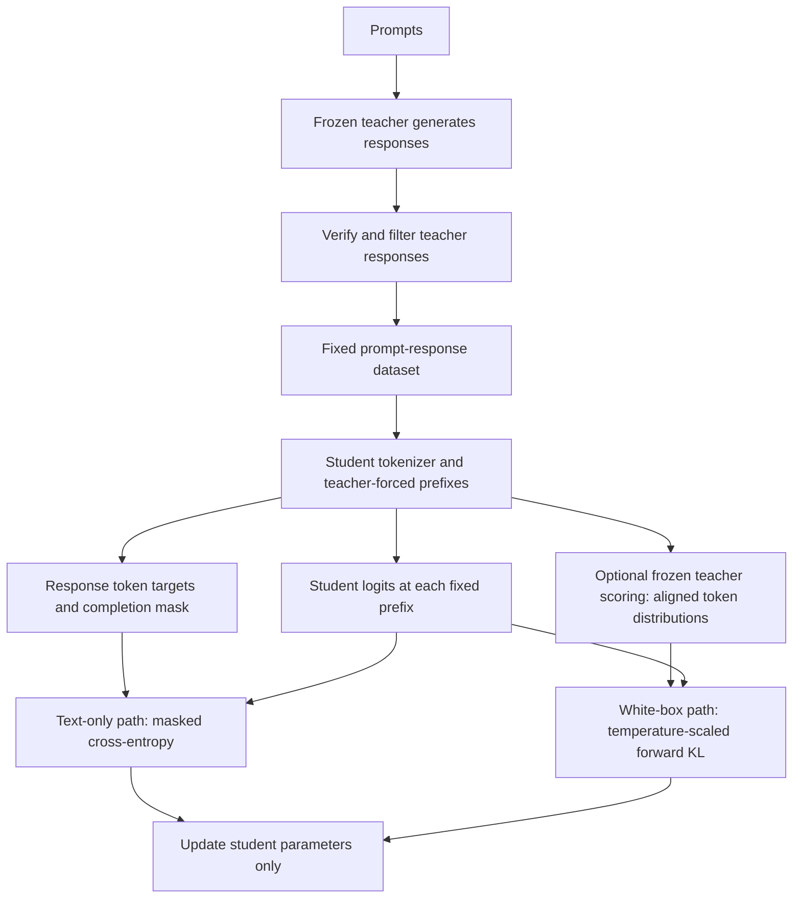
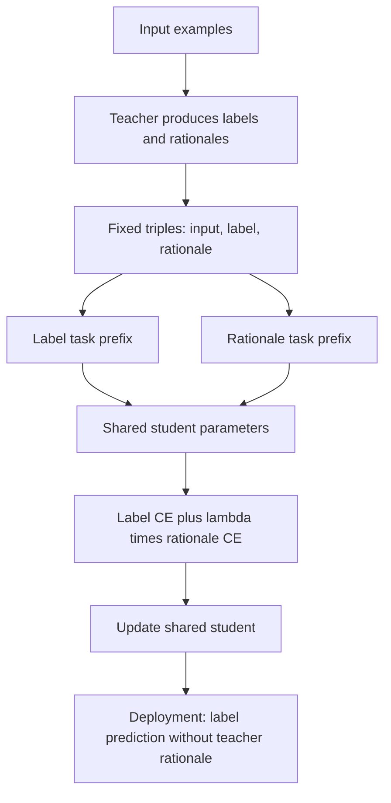
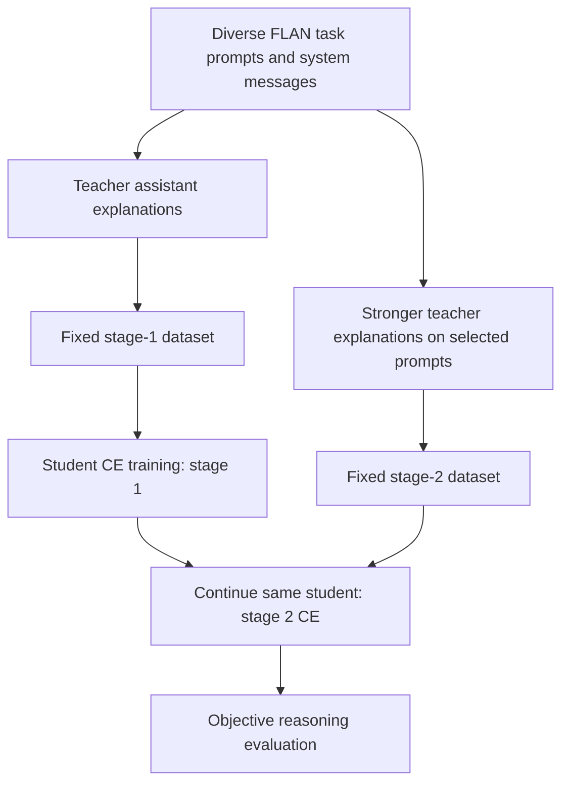
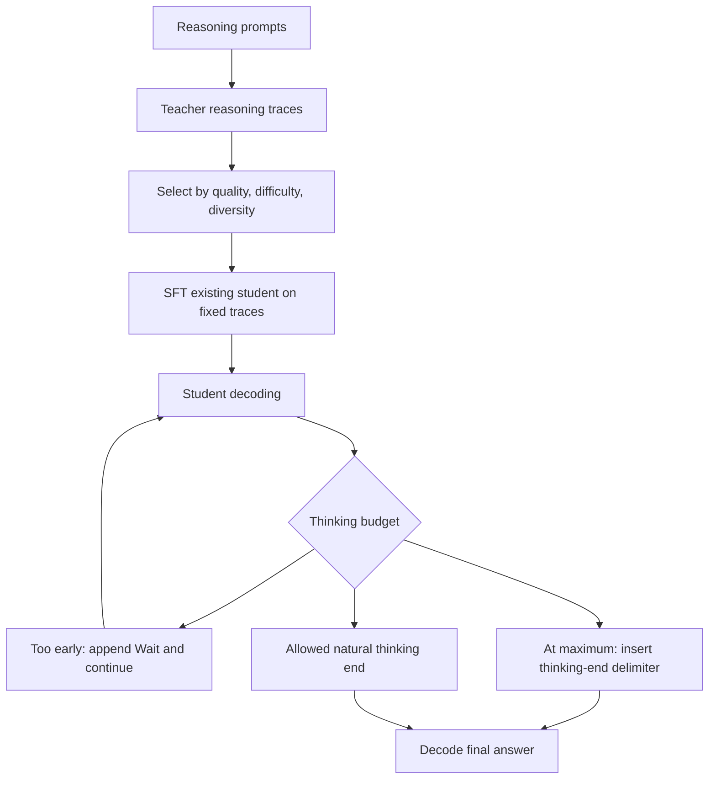
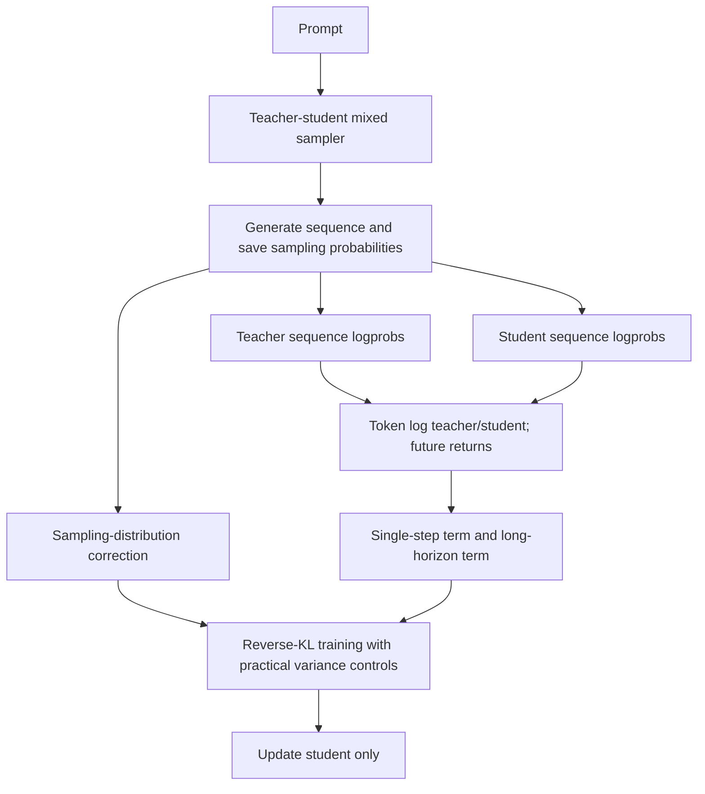
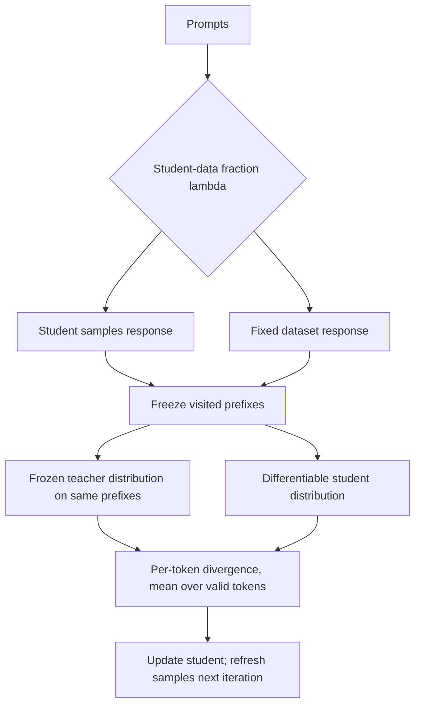
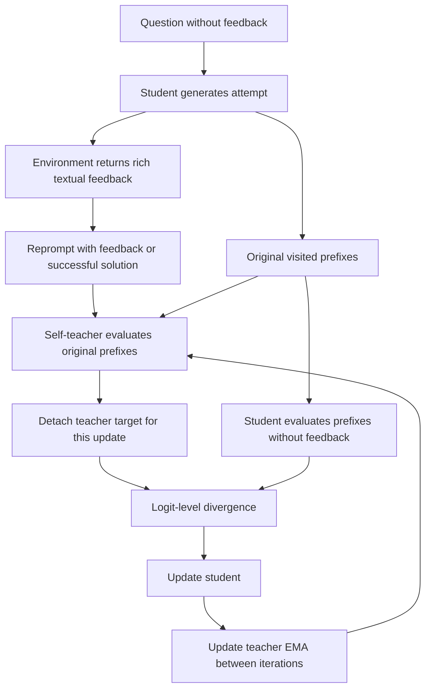
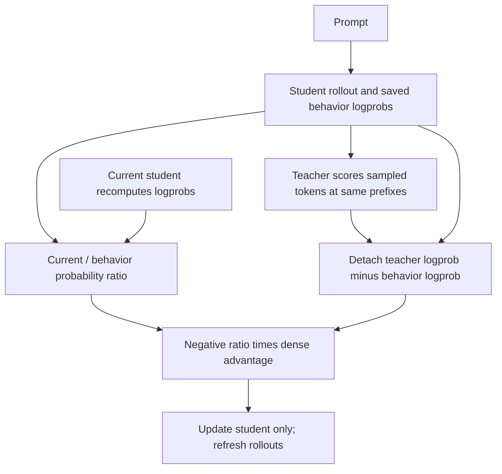

# 大模型蒸馏论文方案：面试回答、架构与数值推演

检索与关注度快照：**2026-10-04**。范围为 2023-2026 年自回归大模型的回答蒸馏、推理蒸馏、on-policy 蒸馏和自蒸馏，不把视觉蒸馏或早期 BERT 压缩混入本次候选池。RL 笔记已独立为 [大模型 RL 论文方案](./RL-Paper-Methods.md)。

## 如何理解“讨论度最高”

没有跨学术引用、社交媒体、模型下载与 GitHub 的统一实时榜单，因此本文给出**高影响优先阅读候选，不冒充全网绝对排名**。筛选依据是作者项目关注、后续论文明确采用、训练框架支持和方法代表性；不以搜索结果多少判定热度，也不把所有方法说成同样热门。

| 阅读优先级 | 论文 / 方案 | 年份 | 为什么入选、可核验的影响证据 | 类型 |
| --- | --- | --- | --- | --- |
| 优先 | [DeepSeek-R1 的 Distill 配方](https://arxiv.org/abs/2501.12948) | 2025 | [作者仓库](https://github.com/deepseek-ai/DeepSeek-R1)发布多种蒸馏模型，GitHub 91,935 stars | Off-policy 回答蒸馏 |
| 优先 | [s1: Simple Test-Time Scaling](https://arxiv.org/abs/2501.19393) | 2025 | [作者仓库](https://github.com/simplescaling/s1) 6,675 stars；小数据推理配方便于研究与复现 | Off-policy 推理蒸馏 + 解码控制 |
| 优先 | [GKD](https://arxiv.org/abs/2306.13649) | 2023 / ICLR 2024 | [TRL 提供实现](https://huggingface.co/docs/trl/gkd_trainer)，[2025 OPD 报告](https://thinkingmachines.ai/blog/on-policy-distillation/)明确承接该工作 | On-policy / 混合 |
| 优先 | [MiniLLM](https://arxiv.org/abs/2306.08543) | 2023 / ICLR 2024 | [2025 OPD 报告](https://thinkingmachines.ai/blog/on-policy-distillation/)明确承接其 reverse-KL 路线 | On-policy 目标 + 教师混合采样 |
| 基础必读 | [Orca](https://arxiv.org/abs/2306.02707) | 2023 | 作者延续为 [Orca 2](https://arxiv.org/abs/2311.11045)，代表解释轨迹与 teacher-assistant 路线 | Off-policy 解释蒸馏 |
| 基础必读 | [Distilling Step-by-Step](https://arxiv.org/abs/2305.02301) | 2023 | ACL 2023 工作，[作者代码](https://github.com/google-research/distilling-step-by-step) 596 stars，代表 rationale 多任务监督 | Off-policy 任务蒸馏 |
| 前沿补充 | [SDPO](https://arxiv.org/abs/2601.20802) | 2026 | [ICML 2026 论文](https://proceedings.mlr.press/v306/hubotter26a.html)，[作者仓库](https://github.com/lasgroup/SDPO) 1,108 stars | On-policy 自蒸馏 |

stars 通过 GitHub 仓库 API 在上述日期读取，只是**项目关注度代理**，不是论文引用数或讨论人数；R1 的关注也同时包含其 RL 与模型发布，不能全部归因于蒸馏。未列出 stars 的方法不等于热度为零；共享仓库也不能把整个仓库的 stars 算给单篇论文。

### 可核验的学术关注度快照

下面通过 Semantic Scholar Graph API，按各论文的 arXiv ID 查询 `citationCount`，按**本次返回记录**降序列出。这是候选池的引用快照，不是全网讨论热度榜，也不是全部蒸馏论文的穷尽检索：

| 论文 | 返回记录的引用数 | 查询来源 |
| --- | --- | --- |
| DeepSeek-R1 | 5,800 | [Semantic Scholar 记录](https://www.semanticscholar.org/paper/2eed1fad9bbf887d4395de40f20144c4fafefd7f) |
| s1 | 1,502 | [Semantic Scholar 记录](https://www.semanticscholar.org/paper/ef8a8bd193b1a0a5e2c834a7a28869a2ec85bab7) |
| Distilling Step-by-Step | 1,148 | [Semantic Scholar 记录](https://www.semanticscholar.org/paper/aad167be3c902388ea625da4117fcae4325b8b7d) |
| GKD | 959 | [Semantic Scholar 记录](https://www.semanticscholar.org/paper/a57ef1f5c3af185af79751855b8033b7fc6d89b3) |
| Orca | 449 | [Semantic Scholar 记录](https://www.semanticscholar.org/paper/0244aeb7c6927e2fb0c2e668687e160a00737dbe) |
| SDPO | 274 | [Semantic Scholar 记录](https://www.semanticscholar.org/paper/89e83ee3eb95843292b1f75f0e50b89e7667b828) |
| MiniLLM | 124 | [Semantic Scholar 记录](https://www.semanticscholar.org/paper/275d8bfe7d9c671d1cb4f525434d10a7dbd8778a) |

数据库可能拆分或合并预印本、会议版和改名后的记录；本文没有自行跨记录合并。引用具有时间积累偏差，项目 stars 与引用也不能直接相加。MiniLLM 入选还基于后续 OPD 报告明确采用的方法沿革，而不是声称其当前记录引用数最高。

另外，第 8 节保留 **Thinking Machines 的 On-Policy Distillation，2025-10-27**，作为重要技术报告单列，不计入以上 7 篇论文。新工作 SDPO 的观察期比 2023 年论文短，不能把“前沿”直接叫作“历史讨论度最高”。

**阅读建议：**先看 R1-Distill 与 s1 建立回答蒸馏直觉，再对照 GKD 与 MiniLLM 理解 on-policy；Orca 与 Step-by-Step 补齐解释监督；最后看 OPD 工程实现与 SDPO 自蒸馏。

## 0. 公共概念与可运行函数

### 0.1 四个维度不要混为一谈

| 维度 | 选项 | 判断方式 |
| --- | --- | --- |
| 轨迹来源 | Off-policy / On-policy / 混合 | 前缀是否由当前学生刷新生成 |
| 监督形式 | 回答文本 / logits / 选中 token 的 logprob | 教师接口能提供什么 |
| 对齐目标 | CE / forward KL / reverse KL / JSD | 用哪个 loss 匹配行为 |
| 更新实现 | Teacher forcing / 词表枚举梯度 / 策略梯度 | 梯度通过哪条计算路径 |

$p$ 始终表示教师，$q_\theta$ 表示学生，$q_b$ 表示实际 rollout 的行为策略。forward KL 是 $D_{\mathrm{KL}}(p\|q)$，reverse KL 是 $D_{\mathrm{KL}}(q\|p)$；**on-policy 不等于 reverse KL，off-policy 不等于 forward KL。**

固定教师数据的 SFT 在蒸馏语境中属于 off-policy，但不需要因此加上 off-policy RL 的重要性采样。教师被冻结通常指**本次更新不反传到监督目标**；SDPO 的 self-teacher 可以在训练轮次之间通过 EMA 更新，不能称为整个训练期间固定不动。

### 0.2 代码范围与公共函数

代码是 Python 标准库的**可运行核心教学实现**，不是完整 Transformer 训练器。按文件顺序执行全部 Python 代码块即可，**不依赖 RL 文件**。各节明确说明演示的核心、简化部分和实际实现入口。示例里的 logits、token ID、随机数和上下文特征均为构造数据；不能当作论文实验结果。

真实训练需要处理 tokenizer、causal shift、completion mask、padding / EOS、自动微分、优化器与分布式 rollout。文本蒸馏可以重新用学生 tokenizer 编码；逐 token 分布对齐则要求相同 token 事件与前缀，不能直接比较不兼容词表 ID。

```python
import math
import re
from itertools import product


def softmax(logits):
    # 减去最大值，避免 exp 的上溢；示例只使用有限、小幅 logits。
    shifted = [value - max(logits) for value in logits]
    weights = [math.exp(value) for value in shifted]
    return [weight / sum(weights) for weight in weights]


def log_rows(probability_rows):
    return [[math.log(value) for value in row] for row in probability_rows]


def integer_answer_reward(response, expected):
    # 玩具规则验证器只检查最终整数答案，不验证每一步推理。
    matched = re.search(r"<answer>\s*(-?\d+)\s*</answer>", response)
    return float(matched is not None and int(matched.group(1)) == expected)


def reverse_kd_exact(teacher_logits, student_logits):
    # 精确枚举一个固定前缀；teacher_logits 在本次更新中作为常量。
    assert len(teacher_logits) == len(student_logits) > 0
    teacher, student = softmax(teacher_logits), softmax(student_logits)
    log_ratios = [math.log(q) - math.log(p) for p, q in zip(teacher, student)]
    loss = sum(q * value for q, value in zip(student, log_ratios))
    gradient = [q * (value - loss) for q, value in zip(student, log_ratios)]
    return loss, gradient
```

对每个参数更新，本文采用 $z'=z-\eta\nabla_z L$。这些教学参数可以直接是 logits，也可以是共享标量参数；真实模型由自动微分继续计算对网络参数的梯度。

## 1. R1-Distill：筛选教师回答，再对学生做 SFT

代表实践：[DeepSeek-R1，§2.4，2025](https://arxiv.org/html/2501.12948v1)。方法背景：[GKD 的 SeqKD / Supervised KD 定义，2023 / ICLR 2024](https://arxiv.org/html/2306.13649v3)；logits KD 的经典基础为 [Distilling the Knowledge in a Neural Network，2015](https://arxiv.org/abs/1503.02531)。经典基础不是近年新方案。

R1 原论文中的学生使用约 80 万条整理后的样本进行 SFT，包含约 60 万推理样本和 20 万非推理样本；**该论文的 distill 学生训练没有另加 RL 阶段**。这不表示后续工作不能对蒸馏后的学生继续 RL。[原论文 §2.3.3 / §2.4](https://arxiv.org/html/2501.12948v1)

### 1.1 中文面试回答

> 我会把 off-policy 蒸馏解释为：训练回答或前缀来自教师、人工或固定数据集，而不是每一轮由当前学生策略生成。只有教师文本时，我把筛选后的回答作为标签，对学生做 teacher forcing 和交叉熵，这就是回答蒸馏；能拿到教师 logits 时，还能在同一个前缀下对齐教师和学生的 next-token 分布。R1-Distill 属于前者。它的优势是数据可复用，局限是学生推理时可能走到训练集没有覆盖的前缀。蒸馏是监督来源，SFT 是训练方式，两者并不矛盾。

### 1.2 English Interview Answer

> Off-policy distillation trains on responses or prefixes from a teacher, humans, or a fixed dataset rather than refreshing them from the current student policy. With teacher text, I use teacher-forced cross-entropy; with aligned teacher logits, I can match next-token distributions on those fixed prefixes. R1-Distill uses the text-based approach. The data is reusable, but it may not cover prefixes the student visits at inference. Distillation describes the source of supervision, while SFT describes the training procedure.

这里沿用自回归蒸馏中的相对学生策略定义；它**不是**把固定数据 SFT 改写成需要 importance sampling 的 off-policy RL。

### 1.3 架构图



两条 loss 路径是可选实现，不代表 R1 原论文同时使用了 logits KD。真实模型中 teacher forcing 指输入固定回答的前缀，预测下一个 token；需要正确执行 causal shift，并把 prompt 和 padding 从 loss 中屏蔽。

### 1.4 公式与代码实现

记 $p$ 为冻结教师，$q_\theta$ 为学生，$D_T$ 为筛选后的固定数据集。**文本回答蒸馏**采用有效 completion token 平均的交叉熵：

$$
L_{\mathrm{text}}=-\frac{1}{N}\sum_{(x,y)\in D_T}\sum_t
m_t\log q_\theta(y_t\mid x,y_{<t}),\qquad N=\sum_{(x,y)\in D_T}\sum_t m_t.
$$

这里采用 token 平均；不同框架也可能采用序列平均。过滤后的有限数据集不等于精确枚举教师分布，不能说二者数值完全相同。

对一个有效位置的原始学生 logits $z_j$：

$$
\frac{\partial L_{\mathrm{text}}}{\partial z_j}
=\frac{q_j-\mathbf{1}[j=y_t]}{N}.
$$

**Logits 蒸馏**先对双方使用相同温度 $\tau$，再计算 forward KL。下式是单个固定前缀的 loss：

$$
p^\tau=\operatorname{softmax}(z_T/\tau),\quad
q^\tau=\operatorname{softmax}(z_S/\tau),\quad
L_{\mathrm{soft}}=\tau^2\sum_j p_j^\tau\log\frac{p_j^\tau}{q_j^\tau}.
$$

$$
\frac{\partial L_{\mathrm{soft}}}{\partial z_{S,j}}
=\tau(q_j^\tau-p_j^\tau).
$$

教师被冻结，所以 soft-target 交叉熵与 forward KL 的**学生梯度**相同，但 loss 值相差教师熵。$\tau^2$ 是常用梯度尺度补偿，不是提升效果的保证。

```python
def masked_token_ce(logits_rows, target_ids, completion_mask):
    assert len(logits_rows) == len(target_ids) == len(completion_mask)
    valid_count = sum(bool(value) for value in completion_mask)
    assert valid_count > 0
    loss, gradients = 0.0, []
    for logits, target, valid in zip(logits_rows, target_ids, completion_mask):
        if not valid:
            # 必须在索引前跳过 ignored label，例如 prompt 对应的 -100。
            gradients.append([0.0] * len(logits))
            continue
        assert 0 <= target < len(logits)
        probabilities = softmax(logits)
        loss -= math.log(probabilities[target]) / valid_count
        gradients.append([
            (probability - float(index == target)) / valid_count
            for index, probability in enumerate(probabilities)
        ])
    return loss, gradients


def forward_kd(teacher_logits, student_logits, temperature=1.0):
    assert temperature > 0 and len(teacher_logits) == len(student_logits) > 0
    # 只求学生梯度；真实自动微分中教师 forward 应放在 no_grad 下。
    teacher = softmax([value / temperature for value in teacher_logits])
    student = softmax([value / temperature for value in student_logits])
    loss = temperature ** 2 * sum(
        p * (math.log(p) - math.log(q)) for p, q in zip(teacher, student)
    )
    gradient = [temperature * (q - p) for p, q in zip(teacher, student)]
    return loss, gradient


# 例 A：教师文本过滤。只检查最终答案，不声称证明了每一步推理正确。
off_records = [
    "23 * 17 = 391. <answer>391</answer>",
    "23 * 17 = 381. <answer>381</answer>",
]
off_kept = [text for text in off_records if integer_answer_reward(text, 391)]
assert len(off_kept) == 1
# 用三类玩具词表演示：两个有效目标分别代表推理 token 和答案 token。
# 它们是预先对齐的 next-token 标签，不是真实文本 tokenizer 的输出。
off_logits = log_rows([[1 / 3, 1 / 3, 1 / 3], [0.5, 0.3, 0.2], [0.2, 0.4, 0.4]])
off_targets, off_mask = [-100, 0, 1], [0, 1, 1]
off_ce_before, off_ce_grad = masked_token_ce(off_logits, off_targets, off_mask)
off_lr = 0.2
off_logits_after = [
    [value - off_lr * derivative for value, derivative in zip(row, gradient)]
    for row, gradient in zip(off_logits, off_ce_grad)
]
off_ce_after, _ = masked_token_ce(off_logits_after, off_targets, off_mask)
print(f"OFF-TEXT: kept={len(off_kept)}, loss_before={off_ce_before:.6f}, loss_after={off_ce_after:.6f}")
print(f"OFF-TEXT: logits_gradient={[[round(x, 6) for x in row] for row in off_ce_grad]}")
print(f"OFF-TEXT: target_probs_after={[round(softmax(off_logits_after[i])[off_targets[i]], 6) for i in (1, 2)]}")

# 例 B：另一个固定前缀上的白盒 logits KD，独立于例 A 的文本 SFT。
off_teacher_logits = [math.log(value) for value in [0.6, 0.3, 0.1]]
off_student_logits = [math.log(value) for value in [0.3, 0.4, 0.3]]
off_kd_before, off_kd_grad = forward_kd(off_teacher_logits, off_student_logits)
off_soft_after = [z - off_lr * g for z, g in zip(off_student_logits, off_kd_grad)]
off_kd_after, _ = forward_kd(off_teacher_logits, off_soft_after)
print(f"OFF-LOGITS: forward_KL={off_kd_before:.6f}, logits_gradient={[round(x, 6) for x in off_kd_grad]}")
print(f"OFF-LOGITS: probs_after={[round(x, 6) for x in softmax(off_soft_after)]}, loss_after={off_kd_after:.6f}")
```

### 1.5 代入数值计算

**例 A：文本过滤 → mask → CE → 梯度 → 一步更新。** 教师提供正确和错误的两条回答，过滤后仅保留最终答案为 $391$ 的那一条。

| 位置 | 学生概率 | target | completion mask | 对 loss 的贡献 |
| --- | --- | --- | --- | --- |
| prompt | $[1/3,1/3,1/3]$ | $-100$ | $0$ | 不计入 loss |
| 推理 token | $[0.5,0.3,0.2]$ | $0$ | $1$ | $-\log0.5/2$ |
| 答案 token | $[0.2,0.4,0.4]$ | $1$ | $1$ | $-\log0.4/2$ |

有效 token 数 $N=2$，因此：

$$
L_{\mathrm{text}}=-\frac{\log0.5+\log0.4}{2}=0.804719.
$$

推理位置梯度为 $([0.5,0.3,0.2]-[1,0,0])/2=[-0.25,0.15,0.10]$；答案位置梯度为 $([0.2,0.4,0.4]-[0,1,0])/2=[0.10,-0.30,0.20]$。prompt 的梯度为零。

学习率 $\eta=0.2$，使用 $z'=z-\eta g$。推理位置 logits 增量为 $[0.05,-0.03,-0.02]$，答案位置增量为 $[-0.02,0.06,-0.04]$。再次 softmax 后，两个目标的概率变为 $0.518988$ 与 $0.422584$，固定样本的 CE 下降到 $0.758621$。

**例 B：固定前缀 → 教师软标签 → forward KL → 一步更新。** 令 $\tau=1$，$p=[0.6,0.3,0.1]$，$q=[0.3,0.4,0.3]$：

$$
L_{\mathrm{soft}}=0.6\log2+0.3\log0.75+0.1\log(1/3)=0.219722.
$$

梯度 $q-p=[-0.3,0.1,0.2]$，所以 $\eta=0.2$ 时学生 logits 增量为 $[0.06,-0.02,-0.04]$。新概率为 $[0.318912,0.392524,0.288564]$，forward KL 下降到 $0.192589$。它不是把教师选中的单一 token 作为 one-hot 标签，而是使用整个词表分布。

```text
OFF-TEXT: kept=1, loss_before=0.804719, loss_after=0.758621
OFF-TEXT: logits_gradient=[[0.0, 0.0, 0.0], [-0.25, 0.15, 0.1], [0.1, -0.3, 0.2]]
OFF-TEXT: target_probs_after=[0.518988, 0.422584]
OFF-LOGITS: forward_KL=0.219722, logits_gradient=[-0.3, 0.1, 0.2]
OFF-LOGITS: probs_after=[0.318912, 0.392524, 0.288564], loss_after=0.192589
```

**面试追问：教师和学生的 tokenizer 可以不同吗？** 文本蒸馏可以先保存教师文本，再用学生 tokenizer 重新编码。逐 token logits KL 则需要对齐相同的 token 事件、词表和前缀；不同词表 ID 不能直接相减。只有 top-k 教师概率时，也不能把截断后重新归一化的 KL 当作精确完整词表 KL。

## 2. Distilling Step-by-Step：标签预测与 Rationale 生成的多任务蒸馏

论文：[Distilling Step-by-Step! Outperforming Larger Language Models with Less Training Data and Smaller Model Sizes](https://aclanthology.org/2023.findings-acl.507/)，2023。**演示范围：**两个带 task prefix 的监督任务、共享参数上的加权 CE 与一步更新；不复现完整 T5 或数据采集。

### 2.1 中文面试回答

> 这篇论文不只让学生学教师的标签，还把教师给出的 rationale 作为另一个监督任务。学生用 label 与 rationale 两种任务前缀，共享模型参数，分别预测标签和解释；总 loss 是标签 CE 加权叠加解释 CE。解释是训练目标，不是推理时必须由大模型提供的额外输入。它展示了特定任务的数据效率，不能据此说小模型的通用能力全面超过教师。

### 2.2 English Interview Answer

> Distilling Step-by-Step trains a shared student on label prediction and rationale generation, selected by task prefixes. A weighted rationale loss supplements the label loss. Rationales are supervision targets rather than required teacher-provided inputs at deployment. Its task-specific gains do not imply that the student universally outperforms the teacher.

### 2.3 架构图



### 2.4 公式与代码实现

论文采用 $L=L_{\mathrm{label}}+\lambda_r L_{\mathrm{rationale}}$。$\lambda_r$ 是解释任务的权重，不是 GKD 的学生数据比例。解释可以是多个 token；本例将每个任务压缩成一个二分类 token，并用一个共享参数 $\theta$ 展示两项梯度汇合：

$$
z_{\mathrm{label}}=[\theta,0],\qquad
z_{\mathrm{rationale}}=[2\theta,0].
$$

两项 target 都取 token $0$。第二个任务的系数 $2$ 是构造的特征，**不是论文规定的网络结构**。

```python
def step_by_step_loss(theta, rationale_weight=0.5):
    # 两个 task prefix 对应两种输入特征，但共享同一个 theta。
    label_loss, label_gradient = masked_token_ce([[theta, 0.0]], [0], [1])
    rationale_loss, rationale_gradient = masked_token_ce([[2.0 * theta, 0.0]], [0], [1])
    label_component = label_gradient[0][0]
    # 链式法则：rationale 的第一个 logit 对 theta 的导数是 2。
    rationale_component = rationale_weight * 2.0 * rationale_gradient[0][0]
    return (
        label_loss + rationale_weight * rationale_loss,
        label_component + rationale_component,
        [label_component, rationale_component],
    )


step_theta, step_lambda, step_lr = 0.0, 0.5, 0.2
step_before, step_gradient, step_components = step_by_step_loss(step_theta, step_lambda)
step_theta_after = step_theta - step_lr * step_gradient
step_after, _, _ = step_by_step_loss(step_theta_after, step_lambda)
print(f"STEP-BY-STEP: loss_before={step_before:.6f}, gradient={step_gradient:.6f}, components={step_components}")
print(f"STEP-BY-STEP: theta_after={step_theta_after:.6f}, loss_after={step_after:.6f}")
print(f"STEP-BY-STEP: label_target_prob={softmax([step_theta_after, 0.0])[0]:.6f}, rationale_target_prob={softmax([2 * step_theta_after, 0.0])[0]:.6f}")
```

### 2.5 代入数值计算

1. $\theta=0$ 时，两项任务的 target 概率都是 $0.5$，各自 CE 都是 $-\log0.5=0.693147$。
2. $\lambda_r=0.5$，所以 $L=0.693147+0.5(0.693147)=1.039721$。
3. 标签梯度为 $0.5-1=-0.5$；解释梯度经过特征系数和权重后为 $0.5\times2\times(0.5-1)=-0.5$。
4. 总梯度为 $-1$；学习率 $0.2$ 得到 $\theta'=0-0.2(-1)=0.2$。
5. 两种任务的 target 概率分别变为 $\operatorname{sigmoid}(0.2)=0.549834$ 与 $\operatorname{sigmoid}(0.4)=0.598688$，重新计算两个 CE，得到更新后的总 loss $0.854646$。

```text
STEP-BY-STEP: loss_before=1.039721, gradient=-1.000000, components=[-0.5, -0.5]
STEP-BY-STEP: theta_after=0.200000, loss_after=0.854646
STEP-BY-STEP: label_target_prob=0.549834, rationale_target_prob=0.598688
```

两个任务共享参数才能让解释监督影响学生的共同表示；本例只展示这一梯度关系，不能证明真实网络中每个 rationale 都有帮助。错误解释或不当任务权重也可能伤害效果。

## 3. Orca：解释轨迹与 Teacher Assistant 的渐进式蒸馏

论文：[Orca: Progressive Learning from Complex Explanation Traces of GPT-4](https://arxiv.org/abs/2306.02707)，2023。**演示范围：**先 assistant、后更强教师的两阶段固定文本 CE；不复现 FLAN 数据采样、完整 system-message 集合或 LLaMA 训练。

### 3.1 中文面试回答

> Orca 强调教师监督的内容，而不是只换一个 loss。它用多样化指令诱导教师给出解释轨迹，先用 ChatGPT 数据训练学生，再用 GPT-4 数据继续训练，形成 teacher-assistant 的渐进过程。优化核心仍是固定回答上的 next-token CE。评估要看客观推理任务，因为学得像教师说话，并不等于学会同等推理。

### 3.2 English Interview Answer

> Orca enriches the supervision with explanation traces and uses progressive training: ChatGPT acts as an intermediate teacher before further training on GPT-4 outputs. The core optimizer is still next-token cross-entropy on fixed responses. Objective reasoning evaluation matters because stylistic imitation alone does not establish equivalent reasoning capability.

### 3.3 架构图



### 3.4 公式与代码实现

原论文先使用约 500 万条 ChatGPT 样本，再使用约 100 万条 GPT-4 样本。这里只保留两阶段**先后顺序**，不把样本量比例误写成两个同时混合的 loss 权重。[原论文 §3.1.3](https://arxiv.org/html/2306.02707v1)

第一个数据集优化完成后，第二阶段继承相同学生参数：

$$
\theta_A=\operatorname{TrainCE}(\theta_0,D_A),\qquad
\theta_T=\operatorname{TrainCE}(\theta_A,D_T).
$$

示例用共享的三类 logits 代替网络，每个阶段取一个小 batch。多个位置复用同一组教学参数，因此必须将各位置的梯度相加。

```python
def explanation_stage(shared_logits, response_token_ids, learning_rate):
    rows = [shared_logits.copy() for _ in response_token_ids]
    before, token_gradients = masked_token_ce(
        rows, response_token_ids, [1] * len(response_token_ids),
    )
    # 所有位置复用同一组参数；不能分别更新后再随意平均 logits。
    shared_gradient = [
        sum(row[index] for row in token_gradients)
        for index in range(len(shared_logits))
    ]
    updated = [
        value - learning_rate * derivative
        for value, derivative in zip(shared_logits, shared_gradient)
    ]
    after, _ = masked_token_ce(
        [updated.copy() for _ in response_token_ids],
        response_token_ids, [1] * len(response_token_ids),
    )
    return updated, before, after, shared_gradient


orca_logits = [math.log(value) for value in [0.4, 0.35, 0.25]]
# token ID 是构造的解释轨迹标签，不是真实教师输出或实际长度比例。
orca_assistant_after, orca_a_before, orca_a_after, orca_a_grad = explanation_stage(
    orca_logits, [0, 1], 0.2,
)
orca_teacher_after, orca_t_before, orca_t_after, orca_t_grad = explanation_stage(
    orca_assistant_after, [0, 1, 1], 0.2,
)
print(f"ORCA: assistant_CE_before={orca_a_before:.6f}, after={orca_a_after:.6f}, gradient={[round(x, 6) for x in orca_a_grad]}")
print(f"ORCA: teacher_CE_before={orca_t_before:.6f}, after={orca_t_after:.6f}, gradient={[round(x, 6) for x in orca_t_grad]}")
print(f"ORCA: final_probs={[round(x, 6) for x in softmax(orca_teacher_after)]}")
```

### 3.5 代入数值计算

第一阶段的目标频率是 $[1/2,1/2,0]$，初始概率为 $[0.4,0.35,0.25]$：

$$
L_A=-\frac{\log0.4+\log0.35}{2}=0.983056,\qquad
g_A=[-0.1,-0.15,0.25].
$$

学习率 $0.2$ 时 logits 增量为 $[0.02,0.03,-0.05]$。第二阶段继承更新后的 logits，其 target 频率变为 $[1/3,2/3,0]$：

$$
L_T=-\frac{\log q_{A,0}+2\log q_{A,1}}{3},\qquad
g_T=q_A-[1/3,2/3,0].
$$

再次使用 $z'=z-0.2g_T$，得到两阶段后的概率。两阶段使用不同标签分布，**不能比较它们的 loss 大小来判定哪个教师更强**；可比较同一阶段更新前后的 CE。

第一阶段后 $q_A\approx[0.405426,0.358314,0.236261]$，第二阶段梯度约为 $[0.072093,-0.308353,0.236261]$。第二阶段后概率为 $[0.397205,0.378801,0.223993]$。token $0$ 在第二阶段概率略降，是因为该阶段的监督频率发生了变化，不是程序错误。

```text
ORCA: assistant_CE_before=0.983056, after=0.964582, gradient=[-0.1, -0.15, 0.25]
ORCA: teacher_CE_before=0.985171, after=0.954930, gradient=[0.072093, -0.308353, 0.236261]
ORCA: final_probs=[0.397205, 0.378801, 0.223993]
```

## 4. s1：少量高质量推理轨迹蒸馏与 Budget Forcing

论文：[s1: Simple Test-Time Scaling](https://arxiv.org/abs/2501.19393)，2025。**演示范围：**固定轨迹的 SFT 核心更新与 thinking-budget 控制器；控制器用构造 logits，不调用真实模型或宣称复现性能。

### 4.1 中文面试回答

> s1 包含两个独立环节：训练时精选约一千条教师推理轨迹，对已有底模做 SFT；推理时用 budget forcing 控制思考时长，包括过早结束时加入 Wait、达到上限时结束 thinking。它的蒸馏部分是 off-policy 文本监督，不是学生在线向教师请求反馈。论文说明数据筛选和推理预算的重要性，但不能说一千条数据从零创造了模型全部推理能力。

### 4.2 English Interview Answer

> s1 combines supervised training on a small curated set of teacher reasoning traces with decoding-time budget forcing. The training data is off-policy; the decoding controller is not an on-policy teacher update. Its results highlight data selection and test-time compute, not the creation of a reasoning model from scratch using only one thousand examples.

### 4.3 架构图



### 4.4 公式与代码实现

原始 s1 使用 Gemini 的推理轨迹；作者后续 s1.1 使用 R1 轨迹。二者不要混成同一个实验设置。[原论文](https://arxiv.org/html/2501.19393v3)、[作者仓库更新](https://github.com/simplescaling/s1)

SFT 的 loss 仍是第 1 节的 masked CE。推理控制则改变 decoding，不做参数更新：

$$
\text{end early and } n<B_{\min}\Rightarrow\text{append Wait},\qquad
n\ge B_{\max}\Rightarrow\text{force thinking end}.
$$

下面令 WORK、END、WAIT 各占一个玩具 token。真实模型的 delimiter 和字符串 Wait 可能由多个 token 构成，需要按实际 tokenizer 计数，且 thinking end 不等于整个回答的 EOS。

```python
def budget_forcing_toy(logits_schedule, min_thinking_tokens, max_thinking_tokens):
    assert 0 <= min_thinking_tokens <= max_thinking_tokens
    work, end_thinking, wait = 0, 1, 2
    generated, thinking_tokens, forced_waits = [], 0, 0
    while True:
        if thinking_tokens >= max_thinking_tokens:
            # 达上限时强制结束 thinking；真实实现随后继续生成 final answer。
            generated.append(end_thinking)
            return generated, thinking_tokens, forced_waits, "maximum"
        logits = logits_schedule[len(generated)]
        next_token = max(range(len(logits)), key=lambda index: logits[index])
        if next_token == end_thinking and thinking_tokens < min_thinking_tokens:
            generated.append(wait)  # 压缩成一个 token 的 Wait 注入。
            thinking_tokens += 1
            forced_waits += 1
        elif next_token == end_thinking:
            generated.append(end_thinking)
            return generated, thinking_tokens, forced_waits, "natural"
        else:
            generated.append(next_token)
            thinking_tokens += 1


s1_logits = [math.log(value) for value in [0.4, 0.3, 0.3]]
s1_ce_before, s1_ce_grad = masked_token_ce([s1_logits], [0], [1])
s1_logits_after = [z - 0.1 * g for z, g in zip(s1_logits, s1_ce_grad[0])]
s1_ce_after, _ = masked_token_ce([s1_logits_after], [0], [1])
# 首次试图结束，之后产生 WORK；这个 schedule 不是被训练出的真实模型。
s1_schedule = log_rows([[0.1, 0.8, 0.1]] + [[0.7, 0.2, 0.1]] * 3)
s1_tokens, s1_count, s1_waits, s1_reason = budget_forcing_toy(s1_schedule, 2, 4)
print(f"S1: CE_before={s1_ce_before:.6f}, CE_after={s1_ce_after:.6f}, target_prob_after={softmax(s1_logits_after)[0]:.6f}")
print(f"S1: thinking_tokens={s1_count}, forced_Waits={s1_waits}, token_ids={s1_tokens}, stop={s1_reason}")
```

### 4.5 代入数值计算

SFT 示例 target 为 token $0$，$q=[0.4,0.3,0.3]$：

$$
L=-\log0.4=0.916291,\qquad
g=[-0.6,0.3,0.3].
$$

学习率 $0.1$ 产生 logits 增量 $[0.06,-0.03,-0.03]$。新 target 概率由重新 softmax 得到 $0.421781$，CE 从 $0.916291$ 降到 $0.863268$。

预算例子设 $B_{\min}=2$、$B_{\max}=4$。初次模型希望 END，但尚未达到下限，注入 WAIT，计数变成 $1$；随后三次 WORK，把计数依次变成 $2,3,4$；最后强制 END。最终 thinking token 数为 $4$，end delimiter 不计入 thinking。

这个例子验证的是预算流程，**没有模拟“Wait 后一定答对”**。更多思考也可能导致重复或错误，必须以真实模型的 accuracy / token-cost 曲线判断。

```text
S1: CE_before=0.916291, CE_after=0.863268, target_prob_after=0.421781
S1: thinking_tokens=4, forced_Waits=1, token_ids=[2, 0, 0, 0, 1], stop=maximum
```

## 5. MiniLLM：序列 Reverse KL、未来回报与教师混合采样

论文：[MiniLLM: Knowledge Distillation of Large Language Models](https://arxiv.org/abs/2306.08543)，2023 / ICLR 2024。**演示范围：**两 token 序列的精确 reverse-KL 梯度、一步更新与混合采样权重核对。完整论文还含 single-step decomposition、长度处理、预训练语言模型目标及训练稳定机制；本例不是完整 MiniLLM trainer。

### 5.1 中文面试回答

> MiniLLM 从学生容量有限的角度改用序列 reverse KL，让学生倾向教师认可的行为，而不是要求覆盖所有教师输出。因为序列由学生生成，优化涉及策略梯度和未来 token 的回报。论文用单步分解、教师混合采样和长度处理减少训练问题。面试时我会特别区分：完整序列目标会考虑当前 token 对后续前缀的影响，而固定前缀上的即时 KL 不包含全部这类影响。

### 5.2 English Interview Answer

> MiniLLM optimizes sequence-level reverse KL to focus the limited-capacity student on teacher-preferred behavior. Student-generated sequences introduce policy-gradient and future-return terms. The full method adds single-step decomposition, teacher-mixed sampling, and length handling. A full sequence objective must not be conflated with an immediate-token divergence evaluated on frozen prefixes.

### 5.3 架构图



### 5.4 公式与代码实现

固定长度的序列目标为：

$$
L_{\mathrm{seq}}=\sum_yq_\theta(y)\log\frac{q_\theta(y)}{p(y)},\qquad
R_t=\sum_{s=t}^{T}\log\frac{p(y_s\mid h_s)}{q_\theta(y_s\mid h_s)}.
$$

最小化梯度可写成 $-\mathbb{E}_q[\sum_tR_t\nabla_\theta\log q_\theta(y_t\mid h_t)]$；推导中的常数项在 score-function 期望中消失。示例通过枚举所有四条两 token 序列来核对精确结果，不在生产中指数级枚举。

混合采样设 $m(\cdot\mid h)=\alpha_m p(\cdot\mid h)+(1-\alpha_m)q(\cdot\mid h)$。若想在这个 toy 里**精确**恢复 $q$ 下的期望，完整轨迹权重为：

$$
w(y)=\frac{q(y)}{m(y)}=\prod_t\frac{q(y_t\mid h_t)}{m(y_t\mid h_t)}.
$$

论文实际训练包含近似与稳定措施；这里使用完整权重仅为验证基础重要性采样恒等式，**不是宣称论文的所有近似估计都无偏**。

```python
def minillm_sequence_exact(student_table, teacher_table, length=2, teacher_mix=0.25):
    vocab_size = len(student_table[()])
    assert length > 0 and 0.0 <= teacher_mix <= 1.0
    gradient = {prefix: [0.0] * len(row) for prefix, row in student_table.items()}
    loss, mixed_expectation, records = 0.0, 0.0, []
    for sequence in product(range(vocab_size), repeat=length):
        q_sequence, p_sequence, m_sequence = 1.0, 1.0, 1.0
        prefix, visited = (), []
        for token in sequence:
            q = softmax(student_table[prefix])
            p = softmax(teacher_table[prefix])
            mixed = [teacher_mix * pt + (1 - teacher_mix) * qt
                     for pt, qt in zip(p, q)]
            q_sequence *= q[token]
            p_sequence *= p[token]
            m_sequence *= mixed[token]
            visited.append((prefix, token, q))
            prefix = prefix + (token,)
        log_ratio = math.log(q_sequence / p_sequence)
        loss += q_sequence * log_ratio
        weight = q_sequence / m_sequence
        mixed_expectation += m_sequence * weight * log_ratio
        for prefix, token, q in visited:
            # 对完整序列 logprob 求 score，包含该动作对未来访问路径的影响。
            # +1 项在枚举所有序列后的 score 期望中为零。
            for index, probability in enumerate(q):
                gradient[prefix][index] += (
                    q_sequence * log_ratio * (float(index == token) - probability)
                )
        records.append((sequence, q_sequence, p_sequence, weight))
    return loss, gradient, mixed_expectation, records


mini_student = {
    (): [math.log(0.5), math.log(0.5)],
    (0,): [math.log(0.5), math.log(0.5)],
    (1,): [math.log(0.8), math.log(0.2)],
}
mini_teacher = {
    (): [math.log(0.7), math.log(0.3)],
    (0,): [math.log(0.8), math.log(0.2)],
    (1,): [math.log(0.1), math.log(0.9)],
}
mini_before, mini_grad, mini_mixed, mini_records = minillm_sequence_exact(
    mini_student, mini_teacher,
)
assert math.isclose(mini_before, mini_mixed, abs_tol=1e-12)
mini_student_after = {
    prefix: [value - 0.2 * g for value, g in zip(row, mini_grad[prefix])]
    for prefix, row in mini_student.items()
}
mini_after, _, _, _ = minillm_sequence_exact(mini_student_after, mini_teacher)
print(f"MINILLM: sequence_reverse_KL={mini_before:.6f}, corrected_mixed_expectation={mini_mixed:.6f}")
print(f"MINILLM: root_gradient={[round(x, 6) for x in mini_grad[()]]}, loss_after={mini_after:.6f}")
print(f"MINILLM: root_probs_after={[round(x, 6) for x in softmax(mini_student_after[()])]}")
print(f"MINILLM: sequence_weights={[round(row[3], 6) for row in mini_records]}")
```

### 5.5 代入数值计算

两类 token 为 A / B。根节点的学生分布 $[0.5,0.5]$、教师分布 $[0.7,0.3]$；A 前缀下学生 $[0.5,0.5]$、教师 $[0.8,0.2]$；B 前缀下学生 $[0.8,0.2]$、教师 $[0.1,0.9]$。

| 序列 | 学生 $q(y)$ | 教师 $p(y)$ | $\log(q/p)$ |
| --- | --- | --- | --- |
| AA | $0.5(0.5)=0.25$ | $0.7(0.8)=0.56$ | $\log(0.25/0.56)$ |
| AB | $0.25$ | $0.7(0.2)=0.14$ | $\log(0.25/0.14)$ |
| BA | $0.5(0.8)=0.4$ | $0.3(0.1)=0.03$ | $\log(0.4/0.03)$ |
| BB | $0.5(0.2)=0.1$ | $0.3(0.9)=0.27$ | $\log(0.1/0.27)$ |

$$
L_{\mathrm{seq}}=
0.25\log(0.25/0.56)+0.25\log(0.25/0.14)
+0.4\log(0.4/0.03)+0.1\log(0.1/0.27)=0.880117.
$$

设 $\alpha_m=0.25$，混合根分布为 $[0.55,0.45]$，A 前缀分布为 $[0.575,0.425]$，B 前缀分布为 $[0.625,0.375]$。因此 AA 的混合概率 $m(AA)=0.55(0.575)=0.31625$，权重 $w(AA)=0.25/0.31625=0.790514$；其他序列同理。

完整求和 $\sum_y m(y)w(y)\log(q(y)/p(y))$ 与上述 $L_{\mathrm{seq}}$ 相等。根梯度为 $[-0.496723,0.496723]$，所以根 logits 增量为 $[0.099345,-0.099345]$，根概率变为 $[0.549510,0.450490]$。代码同时更新 A / B 前缀参数，再重新计算全部序列概率，得到新的序列 KL $0.743648$。

**关键差别：**选择 A / B 会进入质量不同的后续前缀，完整序列目标的根梯度因此不仅由根节点的单 token KL 决定。这也是本例使用两 token，而不是只计算一个 token 的原因。

```text
MINILLM: sequence_reverse_KL=0.880117, corrected_mixed_expectation=0.880117
MINILLM: root_gradient=[-0.496723, 0.496723], loss_after=0.743648
MINILLM: root_probs_after=[0.54951, 0.45049]
MINILLM: sequence_weights=[0.790514, 1.069519, 1.422222, 0.592593]
```

## 6. GKD：在学生自己生成的前缀上匹配教师分布

论文：[On-Policy Distillation of Language Models: Learning from Self-Generated Mistakes](https://arxiv.org/abs/2306.13649)，首次提交 2023，ICLR 2024。实现入口：[TRL GKD Trainer](https://huggingface.co/docs/trl/gkd_trainer)。**演示范围：**学生采样、固定访问前缀、forward-KL loss 与一步更新；原框架还允许其他 divergence 和混合数据。

### 6.1 中文面试回答

> GKD 针对学生训练时看到教师前缀、推理时却走自己前缀的分布差异。它先让学生生成，再由教师评价这些实际访问的前缀，用词表分布的 divergence 更新学生。数据可以混合固定样本和学生样本；这个比例与 KL 方向是独立的。它不通过采样过程反传，所以 on-policy 不代表必须使用 RL loss。

### 6.2 English Interview Answer

> GKD addresses the mismatch between fixed training prefixes and student-generated inference prefixes. The student generates trajectories, and the teacher supplies next-token distributions on those visited prefixes. The framework separates the student-data fraction from the divergence choice. Its update treats sampled trajectories as fixed and does not backpropagate through sampling.

### 6.3 架构图



### 6.4 公式与代码实现

对当前学生采样的回答 $\hat y$，取生成各 token 前的前缀 $h_t=(x,\hat y_{<t})$。教师与学生都在**同一个** $h_t$ 下计算分布：

$$
L_{\mathrm{on}}=\mathbb{E}_{x}\mathbb{E}_{\hat y\sim q_{\mathrm{rollout}}(\cdot\mid x)}
\left[\frac1{T}\sum_{t=1}^{T}
D_{\mathrm{KL}}\big(p(\cdot\mid h_t)\|q_\theta(\cdot\mid h_t)\big)\right].
$$

$q_{\mathrm{rollout}}$ 在采样时等于当时的学生，生成结果在本次更新中视为固定数据。**不对离散采样过程反传，也不额外对前缀分布做 REINFORCE**；这里只对访问到的前缀上的 KL 反传。这是 GKD 的训练更新规则，不是上式全部 $\theta$ 依赖的全梯度。[GKD §3.1](https://arxiv.org/html/2306.13649v3)

GKD 还能以 student data fraction $\lambda$ 混合固定数据与学生生成数据：

$$
L_{\mathrm{GKD}}=(1-\lambda)L_{\mathrm{fixed}}+\lambda L_{\mathrm{on}}.
$$

$\lambda=0$ 是固定数据 logits KD，$\lambda=1$ 是纯 on-policy，$0<\lambda<1$ 是混合；这里 $L_{\mathrm{fixed}}$ 与 $L_{\mathrm{on}}$ 使用同一种 divergence，而不是把第 1 节的文本 CE 与 KL 不加区分地混起来。

```python
def sample_categorical(probabilities, uniform_draw):
    assert 0.0 <= uniform_draw < 1.0
    cumulative = 0.0
    for index, probability in enumerate(probabilities):
        cumulative += probability
        if uniform_draw < cumulative:
            return index
    return len(probabilities) - 1  # 兜底处理浮点求和误差。


def rollout_prefix_table(student_table, uniform_draws):
    # prefix -> logits 的表格代替 Transformer；固定随机数便于重现手算。
    # 一次 rollout 内不更新学生；返回的 token ID / prefix 不参与求导。
    prefix, tokens, prefixes = (), [], []
    for uniform_draw in uniform_draws:
        prefixes.append(prefix)
        token = sample_categorical(softmax(student_table[prefix]), uniform_draw)
        tokens.append(token)
        prefix = prefix + (token,)
    return tokens, prefixes


def kd_on_fixed_prefixes(teacher_table, student_table, prefixes):
    assert len(prefixes) > 0
    loss, gradients = 0.0, {}
    for prefix in prefixes:
        value, gradient = forward_kd(teacher_table[prefix], student_table[prefix])
        loss += value / len(prefixes)
        row = gradients.setdefault(prefix, [0.0] * len(gradient))
        # 同一个 prefix 重复出现时累加，不覆盖其已有梯度。
        for index, derivative in enumerate(gradient):
            row[index] += derivative / len(prefixes)
    return loss, gradients


# 两类玩具 token：0=A，1=B。各 prefix 的参数独立，仅用于展示流程。
gkd_student = {
    (): [math.log(0.5), math.log(0.5)],
    (0,): [math.log(0.5), math.log(0.5)],
    (1,): [math.log(0.8), math.log(0.2)],
}
gkd_teacher = {
    (): [math.log(0.7), math.log(0.3)],
    (0,): [math.log(0.8), math.log(0.2)],
    (1,): [math.log(0.1), math.log(0.9)],
}
gkd_tokens, gkd_prefixes = rollout_prefix_table(gkd_student, [0.8, 0.1])
gkd_before, gkd_grad = kd_on_fixed_prefixes(gkd_teacher, gkd_student, gkd_prefixes)
gkd_student_after = {prefix: row.copy() for prefix, row in gkd_student.items()}
for prefix, gradient in gkd_grad.items():
    gkd_student_after[prefix] = [
        value - 0.2 * derivative for value, derivative in zip(gkd_student[prefix], gradient)
    ]
# 更新后只在相同的、冻结的已采样前缀上重算 loss，下一轮应重新 rollout。
gkd_after, _ = kd_on_fixed_prefixes(gkd_teacher, gkd_student_after, gkd_prefixes)
print(f"ON-GKD: sampled_tokens={gkd_tokens}, visited_prefixes={gkd_prefixes}")
print(f"ON-GKD: loss_before={gkd_before:.6f}, loss_on_same_prefixes_after={gkd_after:.6f}")
print(f"ON-GKD: root_grad={[round(x, 6) for x in gkd_grad[()]]}, B_prefix_grad={[round(x, 6) for x in gkd_grad[(1,)]]}")
print(f"ON-GKD: P_next_B_at_B_prefix={softmax(gkd_student_after[(1,)])[1]:.6f}")
```

### 6.5 代入数值计算

**第一步，学生 rollout。** 初始前缀的学生概率为 $[0.5,0.5]$，均匀随机数 $u_1=0.8$ 落在第二个 token 的区间，采样到 B。B 前缀下学生概率为 $[0.8,0.2]$，$u_2=0.1$ 采样到 A。所以回答为 `[B, A]`，访问的前缀为 `()` 和 `(B,)`。

**第二步，教师评价学生实际前缀。** 教师自己更倾向先输出 A，但本次必须评价学生的 B 前缀，不能拿教师 A 前缀的 logits 替代：

| 前缀 | 教师 $p$ | 学生 $q$ | forward KL | 对整条回答平均 loss 的 logits 梯度 |
| --- | --- | --- | --- | --- |
| 空前缀 | $[0.7,0.3]$ | $[0.5,0.5]$ | $0.7\log1.4+0.3\log0.6=0.082283$ | $(q-p)/2=[-0.1,0.1]$ |
| B | $[0.1,0.9]$ | $[0.8,0.2]$ | $0.1\log0.125+0.9\log4.5=1.145726$ | $(q-p)/2=[0.35,-0.35]$ |

**第三步，求 loss 并更新。**

$$
L_{\mathrm{on}}=\frac{0.082283+1.145726}{2}=0.614004.
$$

$\eta=0.2$ 时，空前缀 logits 增量为 $[0.02,-0.02]$，B 前缀增量为 $[-0.07,0.07]$。因此：

$$
q'(B\mid B)=\frac{0.2e^{0.07}}{0.8e^{-0.07}+0.2e^{0.07}}=0.223342>0.2.
$$

学生虽然采样到 A，但 GKD 使用的是教师在该前缀上的**整个 next-token 分布**，并不是无条件把学生采样的 A 当作正确标签。玩具表中没有访问的 A 前缀不更新；真实 Transformer 共享参数，不能据此断言未访问前缀的输出完全不变。

在本次冻结的相同前缀上，更新后的平均 KL 为 $0.561910$。这不直接等于重新生成回答的准确率变化。

```text
ON-GKD: sampled_tokens=[1, 0], visited_prefixes=[(), (1,)]
ON-GKD: loss_before=0.614004, loss_on_same_prefixes_after=0.561910
ON-GKD: root_grad=[-0.1, 0.1], B_prefix_grad=[0.35, -0.35]
ON-GKD: P_next_B_at_B_prefix=0.223342
```

## 7. SDPO：利用环境反馈构造更有信息的 Self-Teacher

论文：[Reinforcement Learning via Self-Distillation](https://arxiv.org/abs/2601.20802)，2026；[ICML 2026 版本](https://proceedings.mlr.press/v306/hubotter26a.html)。**演示范围：**学生尝试、环境反馈、同权重不同上下文的自教师、固定 target 的 reverse-KL 更新、teacher EMA。这里选论文允许的 reverse-KL 核心形式，不复现不同任务的 JSD、top-k 加 tail、clipping 与分布式环境。

### 7.1 中文面试回答

> SDPO 的教师不一定是更大的外部模型，而是看到环境反馈或成功示例后的学生自己。学生先尝试，环境返回文本反馈；self-teacher 在更有信息的上下文中重新评价原轨迹，再把这些 next-token 信号蒸馏回没有反馈的学生。教师目标在本次反传时停止梯度，但可跨轮次用 EMA 更新。没有外部大教师，不等于没有外部信息；效果取决于反馈质量和模型利用反馈的能力。

### 7.2 English Interview Answer

> SDPO constructs a self-teacher by giving the model richer context, such as environment feedback or a successful attempt. It distills the feedback-informed next-token predictions into the policy that acts without that feedback. Teacher targets are detached within an update, while the teacher may evolve through EMA across iterations. Removing a larger external teacher does not remove the need for informative feedback.

### 7.3 架构图



### 7.4 公式与代码实现

teacher 与 student 的上下文不同，但要评价相同的 next-token 事件：

$$
q_\theta(\cdot\mid x,h),\qquad
p_{\bar\theta}(\cdot\mid x,f,h).
$$

本例采用固定前缀上的 reverse KL：

$$
L_{\mathrm{SDPO}}=
D_{\mathrm{KL}}\big(q_\theta(\cdot\mid x,h)\|
\operatorname{stopgrad}(p_{\bar\theta}(\cdot\mid x,f,h))\big).
$$

teacher EMA 在学生更新后进行，更新的是**参数**而不是输出概率：

$$
\bar\theta'\leftarrow(1-\alpha_{\mathrm{EMA}})\bar\theta
+\alpha_{\mathrm{EMA}}\theta'.
$$

原论文包含用于稳定训练的 teacher 正则化、JSD 与 top-k 近似；不同实验配置不必采用相同 divergence。不能把这个简化 reverse-KL 例子称作全部最终默认配方。[原论文 §2 / 附录 A](https://arxiv.org/html/2601.20802v2)

```python
sdpo_attempt = "<answer>381</answer>"
sdpo_feedback = (
    "Incorrect product: reconsider the multiplication."
    if not integer_answer_reward(sdpo_attempt, 391)
    else "The attempt is correct."
)
# 二分类 token：0=更合适的下一步，1=当前错误方向。
# logits 代替模型参数，feedback_feature 代替真实模型对反馈上下文的编码。
sdpo_student_logits = [math.log(0.4), math.log(0.6)]
sdpo_teacher_parameters = sdpo_student_logits.copy()
sdpo_feedback_feature = [math.log(6.0), 0.0]
sdpo_frozen_teacher_logits = [
    parameter + feature
    for parameter, feature in zip(sdpo_teacher_parameters, sdpo_feedback_feature)
]
# self-teacher 的权重初始相同，但多出的上下文令 target 分布不同。
sdpo_before, sdpo_grad = reverse_kd_exact(
    sdpo_frozen_teacher_logits, sdpo_student_logits,
)
sdpo_student_after = [
    parameter - 0.2 * derivative
    for parameter, derivative in zip(sdpo_student_logits, sdpo_grad)
]
# 先核对固定教师 target 下的 loss，不拿移动后的 target 冒充同一个目标。
sdpo_after, _ = reverse_kd_exact(sdpo_frozen_teacher_logits, sdpo_student_after)
sdpo_ema_rate = 0.1
sdpo_teacher_parameters_after = [
    (1 - sdpo_ema_rate) * old + sdpo_ema_rate * new
    for old, new in zip(sdpo_teacher_parameters, sdpo_student_after)
]
sdpo_next_teacher_logits = [
    parameter + feature
    for parameter, feature in zip(sdpo_teacher_parameters_after, sdpo_feedback_feature)
]
print(f"SDPO: feedback={sdpo_feedback}, teacher_probs={[round(x, 6) for x in softmax(sdpo_frozen_teacher_logits)]}")
print(f"SDPO: reverse_KL_before={sdpo_before:.6f}, logits_gradient={[round(x, 6) for x in sdpo_grad]}, after_fixed_target={sdpo_after:.6f}")
print(f"SDPO: student_probs_after={[round(x, 6) for x in softmax(sdpo_student_after)]}")
print(f"SDPO: EMA_parameter_delta={[round(new - old, 6) for old, new in zip(sdpo_teacher_parameters, sdpo_teacher_parameters_after)]}")
```

### 7.5 代入数值计算

1. 学生原尝试 $381$ 错误，环境给出文字反馈。此处反馈与上下文编码为教学构造，不是实际代码执行环境。
2. 初始学生 $q=[0.4,0.6]$；相同参数加上反馈特征 $[\log6,0]$ 后，自教师概率为 $p=[0.4(6),0.6]/3=[0.8,0.2]$。
3. 冻结本次 teacher target，计算 $K=0.4\log0.5+0.6\log3=0.381909$。
4. 第一个 logit 的梯度 $g_0=0.4(\log0.5-K)=-0.430022$，第二个为 $g_1=0.430022$；代入 $z'=z-0.2g$，logits 增量为 $[0.086004,-0.086004]$，重新 softmax 得到 $[0.441900,0.558100]$。
5. 在原 target 上重算 KL，得到 $0.310454$；再以 $\alpha_{\mathrm{EMA}}=0.1$ 更新 teacher 参数，其增量为学生增量的 $0.1$ 倍，即 $[0.008600,-0.008600]$。下一轮 teacher 才使用新参数，不通过本次目标回传。

这个流程中更强的监督来自额外上下文，不是把同一模型在**完全相同条件**下的输出当教师；后者如果逐项相同，KL 与蒸馏梯度都会是零。

```text
SDPO: feedback=Incorrect product: reconsider the multiplication., teacher_probs=[0.8, 0.2]
SDPO: reverse_KL_before=0.381909, logits_gradient=[-0.430022, 0.430022], after_fixed_target=0.310454
SDPO: student_probs_after=[0.4419, 0.5581]
SDPO: EMA_parameter_delta=[0.0086, -0.0086]
```

## 8. OPD 技术报告：教师 Logprob 构造逐 Token 稠密反馈

研究团队报告：[Thinking Machines, On-Policy Distillation](https://thinkingmachines.ai/blog/on-policy-distillation/)，2025-10-27。**不是另计的一篇同行评审论文。**其文内链接提供工程实现；本文只演示 immediate-token、discount $\gamma=0$ 的无裁剪核心 surrogate，不实现完整服务调度或分布式训练。

### 8.1 中文面试回答

> 这个 OPD 配方让学生先 rollout，教师再给已采样 token 打 logprob。我用教师与行为学生的 logprob 差作为冻结的逐 token advantage，再通过 current / behavior 比率做策略更新。fresh rollout 时，它的期望方向对应固定前缀上的 reverse KL。它提供的是教师行为反馈，不是数学正确性奖励；也没有自动包含完整序列的未来回报。

### 8.2 English Interview Answer

> This OPD recipe samples from the student and asks the teacher for log probabilities of the sampled tokens. The detached teacher-minus-behavior log-probability difference supplies dense advantages for a policy-gradient update. At a fresh rollout, the expected update matches a fixed-prefix reverse-KL gradient. Immediate feedback is not a full-horizon return or a correctness guarantee.

### 8.3 架构图



### 8.4 公式与代码实现

这个分支不要求完整教师词表 logits，但需要教师对**学生已采样 token、同一前缀**的 logprob。令 $q_b$ 是本批 rollout 的学生行为策略，保存：

$$
a_t=\operatorname{stopgrad}\left(\log p(\hat y_t\mid h_t)-\log q_b(\hat y_t\mid h_t)\right),\qquad
\rho_t=\frac{q_\theta(\hat y_t\mid h_t)}{q_b(\hat y_t\mid h_t)}.
$$

示例采用无裁剪的 importance-sampling surrogate，单个 token 的最小化 loss 为：

$$
L_{\mathrm{PG},t}=-\rho_t a_t,\qquad
\frac{\partial L_{\mathrm{PG},t}}{\partial z_j}
=-\rho_t a_t\big(\mathbf{1}[j=\hat y_t]-q_{\theta,j}\big).
$$

fresh rollout 时 $q_\theta=q_b$，所以 $\rho_t=1$。它们数值相等，但 denominator 和 advantage 都被冻结；若把 denominator 也接入当前学生计算图，比率会恒为 $1$ 并丢失所需梯度。这里 $a_t$ 是稠密模仿反馈，不是 GRPO 的组中心化 advantage。[Thinking Machines OPD 实现](https://thinkingmachines.ai/blog/on-policy-distillation/)

为何它关联 **reverse KL**？在一个固定前缀上，枚举所有 token 时：

$$
K=D_{\mathrm{KL}}(q\|p)=\sum_jq_j\log\frac{q_j}{p_j},\qquad
\frac{\partial K}{\partial z_j}=q_j\left(\log\frac{q_j}{p_j}-K\right).
$$

对上述采样梯度按 $q_b=q$ 求期望，正好得到这条梯度。单个 token 的 $\log(q_j/p_j)$ **可以为负**，它只是 KL 的采样项，不是一个独立的非负 KL。即时更新也没有包含前缀分布的梯度或未来 token 的回报，因此不要称其为完整序列 reverse-KL 的无偏全梯度。

```python
def reverse_kd_exact(teacher_logits, student_logits):
    # 精确枚举单个固定前缀的词表，用于核对采样策略梯度的期望。
    assert len(teacher_logits) == len(student_logits) > 0
    teacher, student = softmax(teacher_logits), softmax(student_logits)
    log_ratios = [math.log(q) - math.log(p) for p, q in zip(teacher, student)]
    loss = sum(q * value for q, value in zip(student, log_ratios))
    gradient = [q * (value - loss) for q, value in zip(student, log_ratios)]
    return loss, gradient


def opd_sample_loss(current_logits, behavior_probs, teacher_probs, token_id):
    assert len(current_logits) == len(behavior_probs) == len(teacher_probs) > 0
    assert 0 <= token_id < len(current_logits)
    current = softmax(current_logits)
    # behavior_probs 和 teacher_probs 是冻结的 rollout / teacher 记录。
    # advantage 不对当前学生反传；真实实现可从保存的 logprob 直接计算。
    # 此处数组便于枚举测试；采样更新只读取教师对 token_id 的概率。
    advantage = math.log(teacher_probs[token_id]) - math.log(behavior_probs[token_id])
    ratio = current[token_id] / behavior_probs[token_id]
    loss = -ratio * advantage
    gradient = [
        -ratio * advantage * (float(index == token_id) - probability)
        for index, probability in enumerate(current)
    ]
    return loss, gradient, advantage, ratio


opd_teacher, opd_behavior = [0.6, 0.3, 0.1], [0.3, 0.4, 0.3]
opd_logits = [math.log(value) for value in opd_behavior]
opd_teacher_logits = [math.log(value) for value in opd_teacher]
opd_reverse_before, opd_exact_grad = reverse_kd_exact(opd_teacher_logits, opd_logits)
# uniform=0.9 采样到第三个 token；教师认为它的概率只有 0.1。
opd_token = sample_categorical(opd_behavior, 0.9)
opd_loss, opd_grad, opd_adv, opd_ratio = opd_sample_loss(
    opd_logits, opd_behavior, opd_teacher, opd_token,
)
opd_expected_grad = [0.0] * len(opd_behavior)
for token_id, sample_probability in enumerate(opd_behavior):
    _, gradient, _, _ = opd_sample_loss(opd_logits, opd_behavior, opd_teacher, token_id)
    for index, derivative in enumerate(gradient):
        opd_expected_grad[index] += sample_probability * derivative
assert all(math.isclose(a, b, abs_tol=1e-12)
           for a, b in zip(opd_expected_grad, opd_exact_grad))
opd_logits_after = [value - 0.1 * derivative for value, derivative in zip(opd_logits, opd_grad)]
opd_reverse_after, _ = reverse_kd_exact(opd_teacher_logits, opd_logits_after)
print(f"ON-OPD: sampled_token={opd_token}, advantage={opd_adv:.6f}, ratio={opd_ratio:.6f}, sample_loss={opd_loss:.6f}")
print(f"ON-OPD: sampled_logits_gradient={[round(x, 6) for x in opd_grad]}")
print(f"ON-OPD: expected_gradient={[round(x, 6) for x in opd_expected_grad]}, exact_reverse_KL={opd_reverse_before:.6f}")
print(f"ON-OPD: probs_after={[round(x, 6) for x in softmax(opd_logits_after)]}, exact_reverse_KL_after={opd_reverse_after:.6f}")
```

### 8.5 代入数值计算

**第一步，rollout 并保存行为概率。** 同样取 $p=[0.6,0.3,0.1]$，$q_b=q=[0.3,0.4,0.3]$。$u=0.9$ 采样到 token $2$。教师在同一前缀上给该 token 的概率是 $0.1$。

**第二步，计算反馈与 loss。**

$$
a=\log0.1-\log0.3=\log(1/3)=-1.098612,\quad
\rho=0.3/0.3=1,\quad L_{\mathrm{PG}}=-\rho a=1.098612.
$$

**第三步，计算 logits 梯度并更新。**

$$
g=-1(-1.098612)\big([0,0,1]-[0.3,0.4,0.3]\big)
=[-0.329584,-0.439445,0.769029].
$$

学习率 $\eta=0.1$ 时，logits 增量为 $[0.032958,0.043944,-0.076903]$。再次 softmax 后，概率变为 $[0.308259,0.415553,0.276188]$，教师不认可的 token $2$ 的概率从 $0.3$ 下降到 $0.276188$。该固定前缀的精确 reverse KL 从 $0.236712$ 降至 $0.210683$。这个单样本更新有采样噪声；不能保证每一步或每个任务都改善。

**第四步，验证期望梯度的方向。** 精确 reverse KL 是：

$$
K=0.3\log0.5+0.4\log(4/3)+0.3\log3=0.236712.
$$

不同 token 被采样时的梯度不同。对所有采样情况用 $q_b$ 加权，得到：

$$
\mathbb{E}[g]=[-0.278958,0.020388,0.258570]
=\nabla_zD_{\mathrm{KL}}(q\|p).
$$

对比第 1 节 forward KL 的梯度 $[-0.3,0.1,0.2]$，可以看出 **KL 方向改变更新，而 on/off 决定访问哪些前缀**；这两个维度不能互相替代。

```text
ON-OPD: sampled_token=2, advantage=-1.098612, ratio=1.000000, sample_loss=1.098612
ON-OPD: sampled_logits_gradient=[-0.329584, -0.439445, 0.769029]
ON-OPD: expected_gradient=[-0.278958, 0.020388, 0.25857], exact_reverse_KL=0.236712
ON-OPD: probs_after=[0.308259, 0.415553, 0.276188], exact_reverse_KL_after=0.210683
```

**面试追问：学生还很弱时直接 on-policy 会怎样？** 可能几乎只生成无效前缀，教师监督难以转化为任务收益。先用高质量固定数据做 SFT / off-policy 蒸馏，再刷新学生 rollout，是值得验证的训练路径；GKD 原论文也以经过 SFT 的学生初始化。要同时检查教师质量、轨迹长度、探索、多样性与教师评分成本，而不是只看 KL 下降。[GKD 初始化说明](https://arxiv.org/html/2306.13649v3)

## 9. On / Off 蒸馏比较与面试总结

| 维度 | Off-policy 文本蒸馏 | Off-policy logits KD | On-policy GKD | On-policy OPD，即时反馈示例 |
| --- | --- | --- | --- | --- |
| 轨迹 / 前缀来源 | 固定教师回答 | 固定回答或人工数据 | 当前学生生成 | 当前学生生成 |
| 教师提供什么 | 文本，之后可不再调用教师 | 同一固定前缀上的完整词表分布 | 同一学生前缀上的完整词表分布 | 同一学生前缀上，已采样 token 的 logprob |
| 本文 loss | completion CE | forward KL | forward KL；框架可选其他 divergence | 冻结 logprob 差 + importance-sampling surrogate |
| 是否对 rollout 求导 | 无学生 rollout | 无学生 rollout | 不对采样过程求导 | 通过策略 logprob 求导，不通过离散采样求导 |
| 是否必须用 RL 更新 | 否，SFT | 否 | 否 | 本文用策略梯度式更新 |
| 教师评分的代价 | 制作数据时生成回答 | 固定数据 scoring，可视条件缓存 | 学生生成，教师评分，每轮刷新 | 学生生成，教师对选中 token 评分，每轮刷新 |
| 主要风险 | 数据质量、前缀覆盖不足 | 前缀分布差异、词表未对齐 | 弱学生生成的前缀、教师质量 | 采样方差、教师偏差、旧 feedback 过时 |

**一句话中文面试总结：** off-policy 是「在固定轨迹上学老师」，on-policy 是「在学生实际走到的轨迹上请老师指导」；文本 / logits 决定监督形式，forward / reverse KL 决定对齐目标，SFT / policy gradient 决定更新实现。

**One-sentence interview summary:** Off-policy distillation learns on fixed trajectories; on-policy distillation asks the teacher for feedback on student-visited trajectories. Supervision format, divergence direction, and optimization rule are separate choices.

蒸馏、RL 和量化也要分清：蒸馏是能力迁移的训练过程，RL 使用 reward 优化策略，量化改变数值表示以降低部署成本。可采用「RL 训练教师 → off-policy 蒸馏初始化学生 → on-policy 蒸馏 / 学生 RL → 量化部署」的组合，但这不是每篇论文都使用的固定流程。

判断哪种蒸馏更有效时，应对齐学生初始化、教师、prompt 数据、最大生成长度与总预算，把**教师生成 / 评分成本**也计入；再比较未见任务的准确率、pass@k、多样性与部署延迟。on-policy 并不自动优于 off-policy，教师与学生越不匹配，越需要具体对照实验。


### 9.1 逐篇回答“方案有效吗”

| 方案 | 首先检查的对照 / 消融 | 不应推出的结论 |
| --- | --- | --- |
| R1-Distill | 同学生底模，教师数据与学生直接 RL 的预算、评估采样设置 | 教师用过 RL，所以学生也用过 RL |
| Step-by-Step | 同小模型下 label-only 与 label+rationale | 小模型在特定任务赢教师，意味着通用能力全面超越 |
| Orca | 解释监督、teacher-assistant、客观推理评估 | 聊天风格相似就是同等推理能力 |
| s1 | 数据质量 / 难度 / 多样性消融；有无 budget forcing | 1,000 样本从零创造全部推理能力，或 Wait 总能纠错 |
| MiniLLM | reverse-KL 目标与方差降低、长度处理的分别消融 | 最小 KL 必然对应最高任务准确率 |
| GKD | 固定 / 混合 / 学生数据，同 divergence、同预算 | on-policy 的提升必然来自 reverse KL |
| SDPO | rich feedback、dense feedback、teacher 正则化、遗忘评估 | 没有外部教师就没有外部信息 |
| OPD 报告 | 同初始化、教师评分成本、rollout 长度、后训练预算 | 报告中的节省倍数对任意底模与领域都成立 |

### 9.2 阅读顺序与追问

1. 先说明教师是谁，教师比学生多了什么能力或信息。
2. 再说明前缀来自固定数据、当前学生，还是混合采样。
3. 区分文本标签、完整 logits 与已采样 token 的 logprob。
4. 写清 loss 方向、归一化、哪些量冻结、是否包含未来回报。
5. 用一个实际数值例子算出 loss、梯度、参数和概率变化。
6. 最后用同预算、未见任务与消融判断效果；不要用本文 toy loss 排名。

推荐主线：**R1-Distill → s1 → GKD → MiniLLM → OPD → SDPO**。补充数据监督：**Step-by-Step → Orca**。如果只准备 on/off 面试，先读第 0、1、6、8、9 节。

## 10. 原论文与实现入口

- [R1 原论文](https://arxiv.org/abs/2501.12948)与[作者模型仓库](https://github.com/deepseek-ai/DeepSeek-R1)
- [Step-by-Step 原论文](https://aclanthology.org/2023.findings-acl.507/)与[作者代码](https://github.com/google-research/distilling-step-by-step)
- [Orca 原论文](https://arxiv.org/abs/2306.02707)与[后续 Orca 2](https://arxiv.org/abs/2311.11045)
- [s1 原论文](https://arxiv.org/abs/2501.19393)与[作者代码 / 数据 / 模型](https://github.com/simplescaling/s1)
- [MiniLLM 原论文](https://arxiv.org/abs/2306.08543)与[作者实现](https://github.com/microsoft/LMOps/tree/main/minillm)
- [GKD 原论文](https://arxiv.org/abs/2306.13649)与[TRL 文档](https://huggingface.co/docs/trl/gkd_trainer)
- [SDPO 原论文](https://arxiv.org/abs/2601.20802)、[ICML 2026 版本](https://proceedings.mlr.press/v306/hubotter26a.html)与[作者代码](https://github.com/lasgroup/SDPO)
- [OPD 团队报告与文内代码链接](https://thinkingmachines.ai/blog/on-policy-distillation/)
- [经典 KD，2015](https://arxiv.org/abs/1503.02531)，只作温度与软标签基础，不参与近年候选排序

接口、模型可用性与框架默认 loss 会随版本变化。本文教学公式不等于某个框架版本的全部默认配置，真实实验应固定版本与配置。
