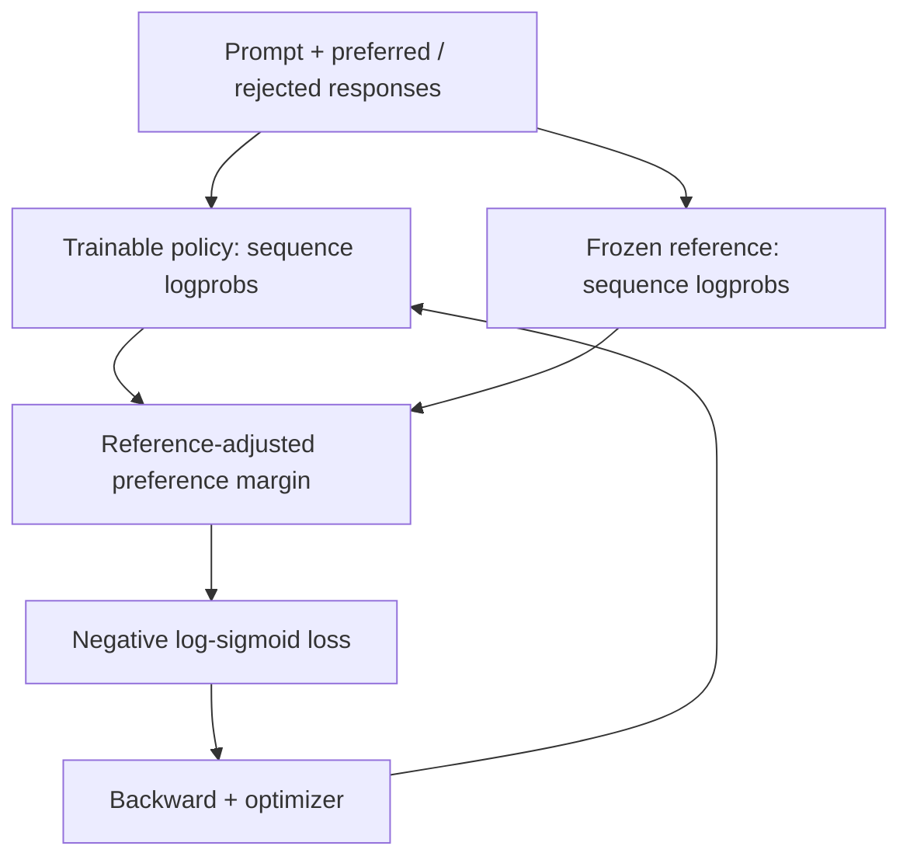
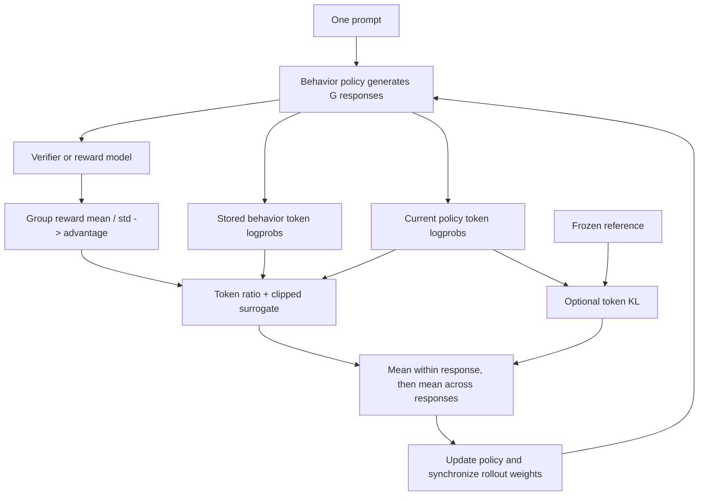
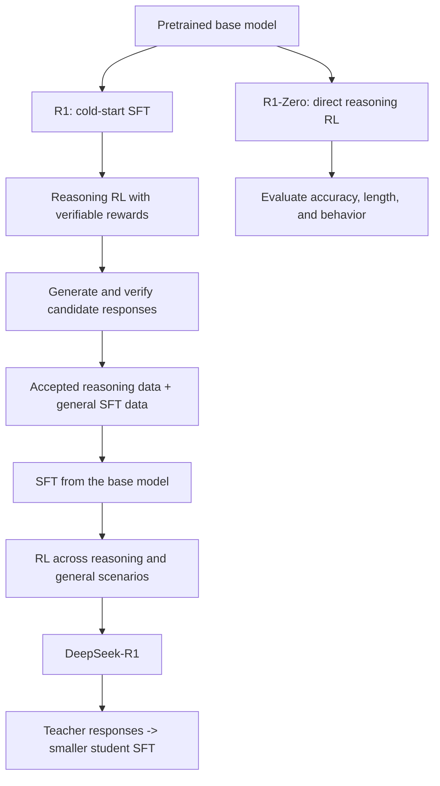
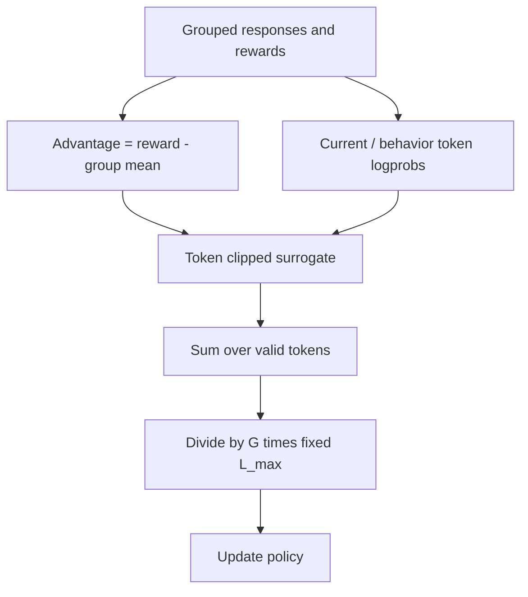
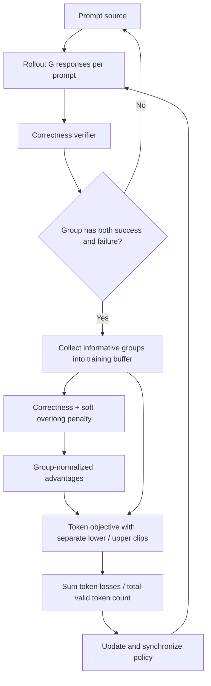
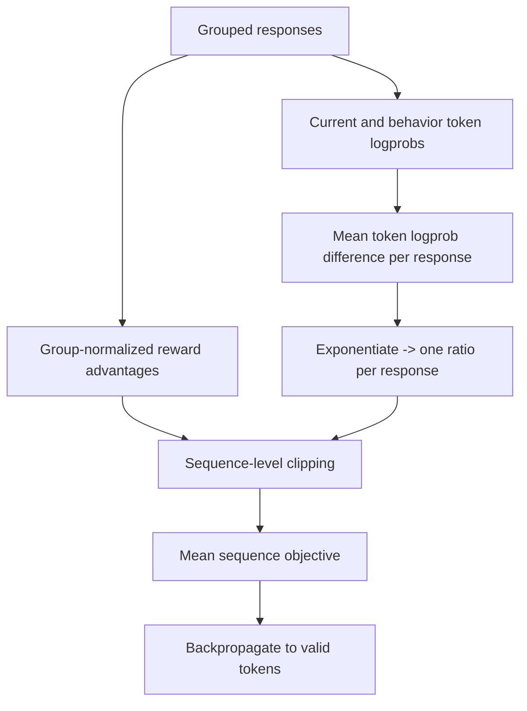
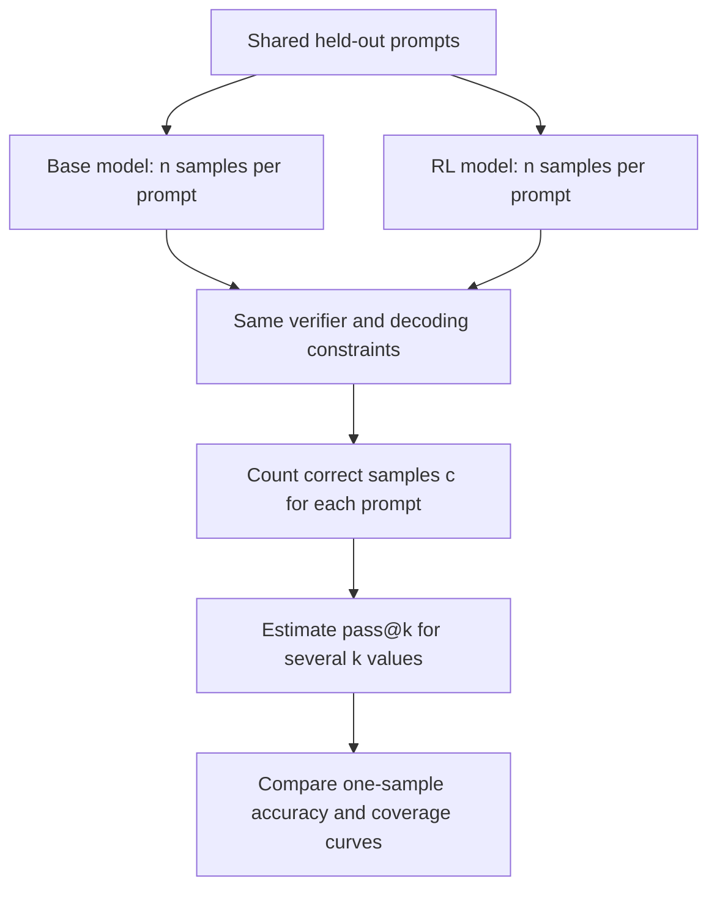
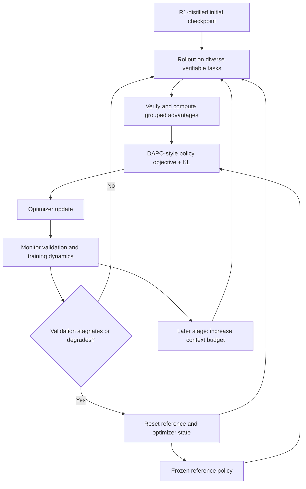
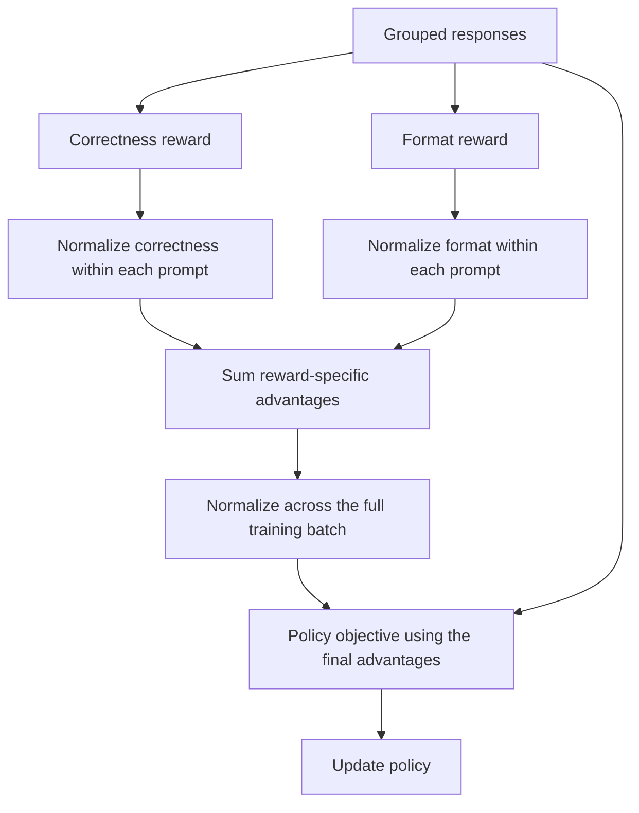
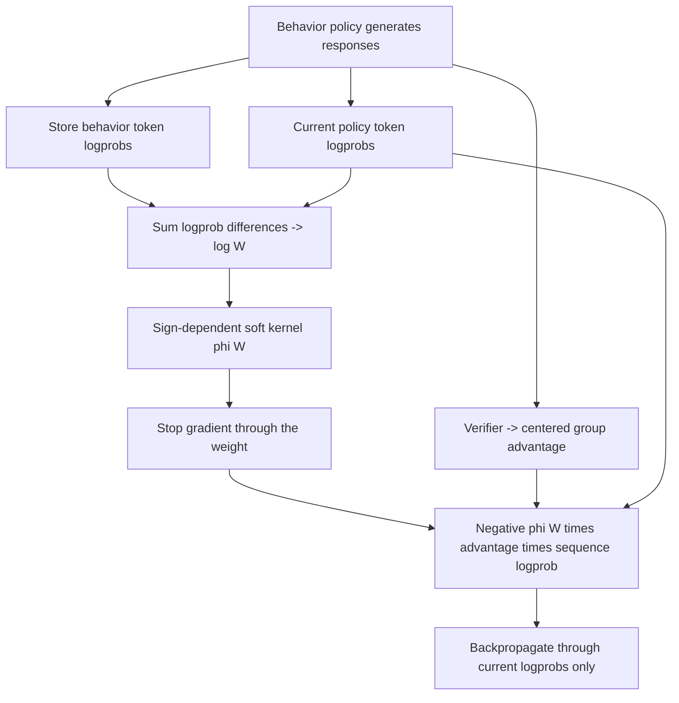

# 大模型 RL 论文方案：面试回答、架构与数值推演

整理范围：2023-2026 年的 10 篇 RL 代表论文。每个方案按照「中英文面试回答 → 架构 → 公式 → 注释代码 → 数值计算」展开。年份按首次发表时间记录，论文链接可查看更新版本。蒸馏论文已拆到独立笔记：[大模型蒸馏论文方案](./Distillation-Paper-Methods.md)。

本文代码是**可运行的核心算法教学实现**，使用 Python 标准库计算 loss 和解析梯度；R1 示例还会通过 softmax 完成参数更新。完整 LLM 训练需要接入 Transformer、自动微分、rollout 引擎和分布式训练。数值例子是本文构造的小样本，不能当作论文的实验结果。

按顺序执行下文的 Python 代码块即可；各方案复用第 0 节的公共函数。与已有笔记的关系见 [RL](./RL.md) 和 [PPO / GRPO 概念关系](./PPO%7CGRPO%20Core%20Concepts%20and%20Relationships.md)。

| 方案 | 年份 | 解决的主要问题 | 代码演示的范围 |
| --- | --- | --- | --- |
| DPO | 2023 | 从偏好对直接训练策略 | 偏好 loss、梯度、一步更新 |
| GRPO / DeepSeekMath | 2024 | 无独立 critic 的组内相对优化 | advantage、token clipping、KL |
| DeepSeek-R1 | 2025 | 可验证奖励驱动推理训练 | R1-Zero 的奖励到策略更新 |
| Dr. GRPO | 2025 | 长度与组标准差归一化偏置 | 归一化方式与 token 梯度 |
| DAPO | 2025 | 长推理训练的采样和稳定性 | 四项核心改动 |
| GSPO | 2025 | 序列奖励与序列级优化 | 几何平均比率、序列 clipping |
| RLVR 能力边界评估 | 2025 | 区分采样效率与解题覆盖面 | pass@k 估计和曲线 |
| ProRL | 2025 | 持续 RL 的探索与稳定性 | KL、参考策略与优化器重置 |
| GDPO | 2026 | 多奖励归一化的信息损失 | 分奖励归一化与 batch 归一化 |
| VESPO | 2026 | 旧策略样本的序列权重方差 | 权重重塑和停止梯度 |

## 0. 公共记号与可运行函数

### 0.1 必须区分的三个策略

| 记号 | 含义 | 是否参与本次更新 |
| --- | --- | --- |
| $\pi_\theta$ | 正在训练的当前策略 | 是 |
| $\mu$ 或 $\pi_{\mathrm{old}}$ | 实际生成这一批回答的行为策略 | 否，保存它生成时的 logprob |
| $\pi_{\mathrm{ref}}$ | 用于 KL 或偏好比较的参考策略 | 否，除非方案明确执行 reference reset |

behavior policy 和 reference policy 可以在某一步相同，但用途不同。重置 reference 不会改变旧回答当初来自哪个 behavior policy。

本文用变长列表保存回答，只包含 completion 的有效 token，不包含 prompt 或 padding。实际张量实现需要用 completion mask 排除这些位置。整条回答的 logprob 是有效 token 的 logprob **之和**：

$$
\ell_\theta(y\mid x)=\sum_{t=1}^{T}\log\pi_\theta(y_t\mid x,y_{<t}).
$$

示例统一使用总体标准差，即 `ddof=0`；零方差组返回全零 advantage。生产框架可能使用样本标准差、不同 epsilon 或分布式归一化，因此应核对具体实现。

### 0.2 公共代码

`token_surrogate` 返回最大化目标及其对当前 token logprob 的导数。`policy_loss` 在外层取负号，得到可用梯度下降最小化的 loss。

```python
import math


def mean(values):
    return sum(values) / len(values)


def std_pop(values):
    # 使用总体标准差，便于手算；避免无意混入 ddof=1。
    center = mean(values)
    return math.sqrt(mean([(value - center) ** 2 for value in values]))


def group_advantages(rewards, scale=True):
    # reward 和 advantage 都作为固定训练信号，不对它们求导。
    center = mean(rewards)
    centered = [reward - center for reward in rewards]
    if not scale:
        return centered
    deviation = std_pop(rewards)
    if deviation < 1e-12:
        return [0.0] * len(rewards)
    return [value / deviation for value in centered]


def token_surrogate(logp, old_logp, advantage, low=0.2, high=0.2):
    ratio = math.exp(logp - old_logp)
    clipped = min(max(ratio, 1.0 - low), 1.0 + high)
    value = min(ratio * advantage, clipped * advantage)
    # 正 advantage 只在上界外停止梯度；负 advantage 只在下界外停止。
    active = not (
        (advantage > 0 and ratio > 1.0 + high)
        or (advantage < 0 and ratio < 1.0 - low)
    )
    derivative = ratio * advantage if active else 0.0
    return value, derivative


def kl_k3(logp, ref_logp):
    # k3 是常见的逐 token KL 估计项，不是完整词表 KL 的精确枚举。
    delta = ref_logp - logp
    value = math.expm1(delta) - delta
    derivative = 1.0 - math.exp(delta)
    return value, derivative


def policy_loss(
    new_rows, old_rows, advantages, *, low=0.2, high=0.2,
    reduction="sequence", max_tokens=None, ref_rows=None, beta=0.0,
):
    # 每一行是一条回答的有效 token logprob，行长可以不同。
    group_size = len(new_rows)
    assert group_size == len(old_rows) == len(advantages) and group_size > 0
    assert all(len(new) == len(old) > 0 for new, old in zip(new_rows, old_rows))
    if ref_rows is not None:
        assert len(ref_rows) == group_size
        assert all(len(ref) == len(new) for ref, new in zip(ref_rows, new_rows))
    assert beta == 0.0 or ref_rows is not None
    token_count = sum(len(row) for row in new_rows)
    if reduction == "constant":
        assert max_tokens is not None and max_tokens >= max(map(len, new_rows))

    loss = 0.0
    gradients = []
    for index, (new, old, advantage) in enumerate(zip(new_rows, old_rows, advantages)):
        if reduction == "sequence":
            factor = 1.0 / (group_size * len(new))
        elif reduction == "token":
            factor = 1.0 / token_count
        elif reduction == "constant":
            factor = 1.0 / (group_size * max_tokens)
        else:
            raise ValueError("unknown reduction")

        row_gradients = []
        for position, (logp, old_logp) in enumerate(zip(new, old)):
            value, derivative = token_surrogate(logp, old_logp, advantage, low, high)
            penalty, penalty_gradient = 0.0, 0.0
            if ref_rows is not None:
                penalty, penalty_gradient = kl_k3(logp, ref_rows[index][position])
            loss += factor * (-value + beta * penalty)
            row_gradients.append(factor * (-derivative + beta * penalty_gradient))
        gradients.append(row_gradients)
    return loss, gradients


def log_rows(probability_rows):
    # 这些概率是实际 token 在其各自条件分布下的概率，不要求每行加起来为 1。
    return [[math.log(probability) for probability in row] for row in probability_rows]


def softmax(logits):
    shifted = [value - max(logits) for value in logits]
    weights = [math.exp(value) for value in shifted]
    return [weight / sum(weights) for weight in weights]


def logprob_to_logits_gradient(probabilities, grad_logp):
    # d log softmax(z)_i / dz_j = 1[i=j] - p_j。
    total = sum(grad_logp)
    return [gradient - probability * total
            for probability, gradient in zip(probabilities, grad_logp)]
```

`gradients[i][t]` 是 $\partial L/\partial\log\pi_\theta(y_{i,t})$。接入真实模型后，自动微分继续应用链式法则：

$$
\nabla_\theta L=\sum_{i,t}\frac{\partial L}{\partial\log\pi_\theta(y_{i,t})}
\nabla_\theta\log\pi_\theta(y_{i,t}).
$$

裁剪边界处不可微；本文在恰好位于边界时选取未裁剪分支的导数。数值梯度检查应避开这些点。

## 1. DPO：直接偏好优化

论文：[Direct Preference Optimization: Your Language Model is Secretly a Reward Model](https://arxiv.org/abs/2305.18290)，2023。

### 1.1 中文面试回答

> 我会把 DPO 解释为从「同一个问题下，哪个回答更好」直接训练策略的方法。它用当前模型和固定参考模型计算 preferred / rejected 回答的相对 logprob，再通过一个 logistic loss 拉大偏好差距。它不需要在训练循环里在线采样或显式训练 reward model。优势是流程简单；效果依赖偏好数据的质量和覆盖范围。

### 1.2 English Interview Answer

> I would describe DPO as learning directly from preferred and rejected responses. It compares their log-probability margins against a frozen reference policy and optimizes a logistic loss. This removes the explicit reward-model and online-rollout stages during training. The main trade-off is dependence on the quality and coverage of the preference dataset.

### 1.3 架构图



### 1.4 公式与代码实现

令 $y_w$ 为 preferred、$y_l$ 为 rejected：

$$
z=\beta\left[(\ell_\theta(y_w)-\ell_\theta(y_l))
-(\ell_{\mathrm{ref}}(y_w)-\ell_{\mathrm{ref}}(y_l))\right],
\qquad L=-\log\sigma(z).
$$

下面用只有两个完整回答的策略演示真实的一步更新：$p_w=\sigma(\theta)$、$p_l=1-p_w$。在这个特殊模型里，$\log p_w-\log p_l=\theta$，因此能手算整个链式求导。

```python
def sigmoid(value):
    # 分支写法避免大负数导致 exp 溢出。
    if value >= 0:
        return 1.0 / (1.0 + math.exp(-value))
    exponential = math.exp(value)
    return exponential / (1.0 + exponential)


def dpo_loss(policy_win, policy_lose, reference_win, reference_lose, beta):
    margin = (policy_win - policy_lose) - (reference_win - reference_lose)
    z = beta * margin
    # softplus(-z) 等于 -log(sigmoid(z))，该写法数值稳定。
    loss = max(-z, 0.0) + math.log1p(math.exp(-abs(z)))
    grad_win = beta * (sigmoid(z) - 1.0)
    grad_lose = -grad_win
    return loss, z, grad_win, grad_lose


theta, reference_theta = 0.4, 0.0
beta, learning_rate = 0.5, 0.1
prob_win, ref_win = sigmoid(theta), sigmoid(reference_theta)
loss, z, grad_win, grad_lose = dpo_loss(
    math.log(prob_win), math.log1p(-prob_win),
    math.log(ref_win), math.log1p(-ref_win), beta,
)
# 对参数 theta 应用链式法则，不能把两个 logprob 当作独立概率更新。
grad_theta = grad_win * (1.0 - prob_win) + grad_lose * (-prob_win)
theta_after = theta - learning_rate * grad_theta
print(f"DPO: z={z:.6f}, loss={loss:.6f}, grad_theta={grad_theta:.6f}")
print(f"DPO: theta_after={theta_after:.6f}, preferred_probability={sigmoid(theta_after):.6f}")
```

### 1.5 代入数值计算

1. 当前 $\theta=0.4$，所以 $p_w=0.598688$、$p_l=0.401312$；reference 两个回答的概率都是 $0.5$。
2. 当前 logprob margin 为 $0.4$，reference margin 为 $0$；$z=0.5(0.4-0)=0.2$。
3. $\sigma(0.2)=0.549834$；$L=-\log(0.549834)=0.598139$。
4. $\partial L/\partial\theta=0.5(0.549834-1)=-0.225083$。
5. $\theta'=0.4-0.1(-0.225083)=0.422508$，preferred 概率增加到约 $0.604083$。

输出：

```text
DPO: z=0.200000, loss=0.598139, grad_theta=-0.225083
DPO: theta_after=0.422508, preferred_probability=0.604083
```

**面试追问：为什么需要 reference？** 它让目标比较「相对参考策略的偏好变化」，并对应 KL 正则化的偏好优化推导。reference margin 在一次更新内固定。

## 2. GRPO：组内相对策略优化

论文：[DeepSeekMath: Pushing the Limits of Mathematical Reasoning in Open Language Models](https://arxiv.org/abs/2402.03300)，2024。

### 2.1 中文面试回答

> 我会把 GRPO 解释为不用独立 critic 的策略优化方法。同一个 prompt 生成多个回答，用组内 reward 的均值和标准差构造 advantage，再通过 PPO 风格的 token 比率与裁剪更新策略。它用同组回答提供相对 baseline，减少价值模型的显存开销。需要注意，全组同分时奖励梯度为零，组归一化和回答长度也会影响更新权重。

### 2.2 English Interview Answer

> GRPO estimates advantages from a group of responses to the same prompt, rather than from a separate critic. It normalizes group rewards and applies a PPO-style clipped objective at the token level. This reduces the memory cost of value-model training. Important limitations include zero reward gradients for uniform-reward groups and sensitivity to normalization choices.

### 2.3 架构图



### 2.4 公式与代码实现

$$
A_i=\frac{R_i-\bar R}{\operatorname{std}(R)},\qquad
\rho_{i,t}=\exp(\ell_{\theta,i,t}-\ell_{\mu,i,t}),
$$

$$
L=-\frac1G\sum_i\frac1{T_i}\sum_t
\min\left(\rho_{i,t}A_i,\operatorname{clip}(\rho_{i,t},1-\epsilon,1+\epsilon)A_i\right)
+\beta\,\overline{K}.
$$

`old_rows` 和 `advantages` 是固定值；求导经过当前策略的 `new_rows`。这里演示 outcome reward，即同一回答所有 token 共用一个 advantage。

```python
grpo_rewards = [1.0, 0.0, 1.0, 0.0]
grpo_adv = group_advantages(grpo_rewards)
grpo_old = log_rows([[0.2, 0.2]] * 4)
grpo_new = log_rows([
    [0.24, 0.30], [0.18, 0.10], [0.22, 0.26], [0.24, 0.16],
])
# 先关闭 KL，清晰观察 advantage 与 clipping。
grpo_loss, grpo_grad = policy_loss(grpo_new, grpo_old, grpo_adv)
# 再独立加入 KL；reference 在这里恰好等于 behavior policy。
grpo_kl_loss, _ = policy_loss(
    grpo_new, grpo_old, grpo_adv, ref_rows=grpo_old, beta=0.04,
)
print(f"GRPO: advantages={grpo_adv}, loss={grpo_loss:.6f}")
print(f"GRPO: first_response_grad={[round(x, 6) for x in grpo_grad[0]]}")
print(f"GRPO: loss_with_KL={grpo_kl_loss:.6f}")
```

### 2.5 代入数值计算

奖励均值为 $0.5$，总体标准差为 $0.5$，因此 $A=[1,-1,1,-1]$。设 $\epsilon=0.2$，比率范围为 $[0.8,1.2]$：

| 回答 | token 比率 | advantage | 两个 token 的裁剪目标 | 回答平均目标 |
| --- | --- | --- | --- | --- |
| 1 | $[1.2,1.5]$ | $1$ | $[1.2,1.2]$ | $1.2$ |
| 2 | $[0.9,0.5]$ | $-1$ | $[-0.9,-0.8]$ | $-0.85$ |
| 3 | $[1.1,1.3]$ | $1$ | $[1.1,1.2]$ | $1.15$ |
| 4 | $[1.2,0.8]$ | $-1$ | $[-1.2,-0.8]$ | $-1$ |

$$
L=-\frac{1.2-0.85+1.15-1}{4}=-0.125.
$$

回答 1 的第二个 token 已超过正 advantage 的上界，因此梯度为 $0$；第一个 token 的 loss 梯度为 $-1.2/(4\times2)=-0.15$。

KL 示例中，回答 1 第二个 token 有 $p_{\mathrm{ref}}=0.2$、$p_\theta=0.3$：

$$
K=\frac{0.2}{0.3}-\log\frac{0.2}{0.3}-1=0.072132.
$$

所有 token 的 $K$ 平均值为 $0.059862$：$L=-0.125+0.04\times0.059862=-0.122606$。即使策略奖励分支被裁剪，KL 分支仍然可以有梯度。

```text
GRPO: advantages=[1.0, -1.0, 1.0, -1.0], loss=-0.125000
GRPO: first_response_grad=[-0.15, 0.0]
GRPO: loss_with_KL=-0.122606
```

**面试追问：loss 为负是否异常？** 不异常。这里最小化的是负的策略收益 surrogate，不是必须非负的分类交叉熵。

## 3. DeepSeek-R1：可验证奖励驱动的推理训练

论文：[DeepSeek-R1: Incentivizing Reasoning Capability in LLMs via Reinforcement Learning](https://arxiv.org/abs/2501.12948)，2025。

### 3.1 中文面试回答

> 我会先区分 R1-Zero 和 R1。R1-Zero 从预训练底模直接做 RL，用数学答案或代码执行等可验证奖励强化成功回答。R1 则加入冷启动 SFT、推理 RL、拒绝采样构造 SFT 数据，以及后续综合 RL。它的关键价值是展示这套训练能明显提高推理任务表现；回答中出现反思文字，还需要结合评估判断实际作用。

### 3.2 English Interview Answer

> I would distinguish R1-Zero from R1. R1-Zero applies reinforcement learning directly to a pretrained model using verifiable rewards. R1 adds cold-start supervised fine-tuning, reasoning RL, rejection-sampled SFT data, and a later general RL stage. The important result is improved reasoning performance through this training pipeline; verbal self-reflection alone is insufficient evidence of better reasoning.

### 3.3 架构图



### 3.4 代码实现：R1-Zero 的一次策略更新

为了完整展示 `reward → advantage → loss → gradient → optimizer`，把四条完整回答视为四个离散动作。真实 LLM 会把一个动作展开成许多 token；这里的更新遵循相同的策略梯度与链式法则。

```python
import re


def integer_answer_reward(response, expected):
    # 只解析显式 final answer，不执行模型输出的代码。
    matched = re.search(r"<answer>\s*(-?\d+)\s*</answer>", response)
    return float(matched is not None and int(matched.group(1)) == expected)


r1_responses = [
    "<answer>391</answer>", "<answer>381</answer>",
    "<answer>391</answer>", "<answer>401</answer>",
]
r1_rewards = [integer_answer_reward(response, 23 * 17) for response in r1_responses]
r1_adv = group_advantages(r1_rewards)
r1_logits = [0.0] * 4
r1_before = softmax(r1_logits)
r1_rows = [[math.log(probability)] for probability in r1_before]
# 初始 current、behavior、reference 相同；KL 此时的值和梯度都为零。
r1_loss, r1_grad_rows = policy_loss(
    r1_rows, r1_rows, r1_adv, ref_rows=r1_rows, beta=0.04,
)
r1_grad_logits = logprob_to_logits_gradient(
    r1_before, [row[0] for row in r1_grad_rows],
)
r1_after = softmax([
    logit - 0.1 * gradient for logit, gradient in zip(r1_logits, r1_grad_logits)
])
print(f"R1-Zero: rewards={r1_rewards}, advantages={r1_adv}, loss={r1_loss:.6f}")
print(f"R1-Zero: logit_gradients={r1_grad_logits}")
print(f"R1-Zero: correct_mass_before=0.500000, after={r1_after[0] + r1_after[2]:.6f}")
```

### 3.5 代入数值计算

1. $23\times17=391$，四个 reward 为 $[1,0,1,0]$，advantage 为 $[1,-1,1,-1]$。
2. 初始 logits 都是 $0$，每条回答的概率为 $0.25$；新旧策略比率全部是 $1$。
3. $L=-(1-1+1-1)/4=0$，但对 logprob 的梯度为 $[-0.25,0.25,-0.25,0.25]$，**零 loss 不代表零梯度**。
4. softmax 的链式法则给出 $g_{z_j}=g_{\ell_j}-p_j\sum_i g_{\ell_i}$；本例梯度和为零，logit 梯度与上面相同。
5. 学习率 $0.1$ 更新后，logits 为 $[0.025,-0.025,0.025,-0.025]$。
6. 正确回答的总概率为 $2e^{0.025}/(2e^{0.025}+2e^{-0.025})=0.512497$，从 $0.5$ 上升。

```text
R1-Zero: rewards=[1.0, 0.0, 1.0, 0.0], advantages=[1.0, -1.0, 1.0, -1.0], loss=0.000000
R1-Zero: logit_gradients=[-0.25, 0.25, -0.25, 0.25]
R1-Zero: correct_mass_before=0.500000, after=0.512497
```

**面试追问：这个奖励能验证推理过程吗？** 本例只能验证最后的整数答案。验证最终答案和验证每一步推理是不同的问题；代码测试也只覆盖实际执行的测试条件。

## 4. Dr. GRPO：修正长度与组标准差归一化偏置

论文：[Understanding R1-Zero-Like Training: A Critical Perspective](https://arxiv.org/abs/2503.20783)，2025。

### 4.1 中文面试回答

> 我会把 Dr. GRPO 解释为对 GRPO 优化权重的修正。原来的回答长度归一化会改变每个 token 的梯度权重，组标准差归一化又会改变不同问题的权重。Dr. GRPO 使用 reward 减组均值，并用固定长度常数归一化 token loss。它提醒我们，回答变长可能包含优化偏置，不能只凭长度增长判断推理能力增强。

### 4.2 English Interview Answer

> Dr. GRPO corrects two normalization effects in GRPO: response-length weighting and question-level weighting from group reward standard deviation. It uses centered rewards without that standard-deviation scaling and normalizes token losses by a fixed length constant. This improves the interpretation of training dynamics and helps distinguish useful reasoning from length growth caused by the optimizer.

### 4.3 架构图



### 4.4 公式与代码实现

$$
A_i=R_i-\bar R,\qquad
L_{\mathrm{Dr}}=-\frac1{G L_{\max}}\sum_i\sum_{t=1}^{T_i}
\min(\rho_{i,t}A_i,\operatorname{clip}(\rho_{i,t})A_i).
$$

固定分母不要求把 padding 纳入 loss；无效 token 仍然应被 mask。$L_{\max}$ 是固定的长度预算，不是每条回答自身的长度。

```python
dr_rewards = [1.0, 0.0]
dr_old = log_rows([[0.2, 0.2], [0.2, 0.2, 0.2, 0.2]])
dr_new = log_rows([[0.22, 0.22], [0.18, 0.18, 0.18, 0.18]])
original_adv = group_advantages(dr_rewards, scale=True)
centered_adv = group_advantages(dr_rewards, scale=False)
original_loss, original_grad = policy_loss(dr_new, dr_old, original_adv)
# 用相同的 centered advantage 单独隔离长度分母的作用。
centered_sequence_loss, centered_sequence_grad = policy_loss(dr_new, dr_old, centered_adv)
dr_loss, dr_grad = policy_loss(
    dr_new, dr_old, centered_adv, reduction="constant", max_tokens=4,
)
print(f"Dr.GRPO: original_loss={original_loss:.6f}, centered_sequence_loss={centered_sequence_loss:.6f}, fixed_loss={dr_loss:.6f}")
print(f"Dr.GRPO: centered_sequence_grad={[round(row[0], 6) for row in centered_sequence_grad]}")
print(f"Dr.GRPO: fixed_grad={[round(row[0], 6) for row in dr_grad]}")
```

### 4.5 代入数值计算

奖励 $[1,0]$ 的均值是 $0.5$；原 GRPO advantage 为 $[1,-1]$，Dr. GRPO 为 $[0.5,-0.5]$。正确回答长 $2$，错误回答长 $4$，各 token 比率分别为 $1.1$ 和 $0.9$。

原 GRPO：

$$
L_{\mathrm{GRPO}}=-\frac{1.1-0.9}{2}=-0.1.
$$

仅改成 centered advantage、仍按回答长度归一化：

$$
L_{\mathrm{centered,sequence}}=-\frac{0.55-0.45}{2}=-0.05.
$$

同时改成固定分母 $G L_{\max}=2\times4=8$：

$$
L_{\mathrm{Dr}}=-\frac{2\times0.55+4\times(-0.45)}8=0.0875.
$$

| 同样使用 centered advantage | 正确回答的每 token 梯度 | 错误回答的每 token 梯度 |
| --- | --- | --- |
| 回答长度分母 | $-0.55/(2\times2)=-0.1375$ | $0.45/(2\times4)=0.05625$ |
| 固定长度分母 | $-0.55/8=-0.06875$ | $0.45/8=0.05625$ |

对同一个错误 token 而言，原回答长度分母会随着整条错误回答增长而减小惩罚；固定分母不随该回答长度变化。以上 loss 的定义和尺度不同，不能用它们的大小比较模型效果。

```text
Dr.GRPO: original_loss=-0.100000, centered_sequence_loss=-0.050000, fixed_loss=0.087500
Dr.GRPO: centered_sequence_grad=[-0.1375, 0.05625]
Dr.GRPO: fixed_grad=[-0.06875, 0.05625]
```

## 5. DAPO：解耦裁剪与动态采样

论文：[DAPO: An Open-Source LLM Reinforcement Learning System at Scale](https://arxiv.org/abs/2503.14476)，2025。

### 5.1 中文面试回答

> 我会把 DAPO 解释为让长推理 RL 更稳定的一套训练改进。它提高正向更新的裁剪上界，过滤整组全对或全错的问题，用全 batch 的有效 token 数归一化 loss，并对过长回答做更细致的奖励处理。它同时涉及采样和优化，不能只实现一个新 loss 就认为复现了完整方案。

### 5.2 English Interview Answer

> DAPO combines optimization and sampling changes for long-response RL: asymmetric clipping, dynamic sampling of informative prompt groups, token-level loss aggregation, and overlong reward shaping. These components address different training problems. Reproducing the method requires implementing the sampling and reward pipeline as well as the policy objective.

### 5.3 架构图



### 5.4 公式与代码实现

上、下裁剪范围独立：

$$
\operatorname{clip}(\rho,1-\epsilon_{\mathrm{low}},1+\epsilon_{\mathrm{high}}),
\qquad \epsilon_{\mathrm{high}}>\epsilon_{\mathrm{low}}.
$$

loss 使用全 batch 的有效 token 数：

$$
L=-\frac{\sum_{i,t}\min(\rho_{i,t}A_i,\operatorname{clip}(\rho_{i,t})A_i)}{\sum_i T_i}.
$$

长度惩罚在预算的最后一段从 $0$ 线性降低到 $-1$：

$$
R_{\mathrm{length}}(T)=
\begin{cases}
0,&T\leq L_{\max}-L_{\mathrm{cache}},\\
\dfrac{L_{\max}-L_{\mathrm{cache}}-T}{L_{\mathrm{cache}}},&L_{\max}-L_{\mathrm{cache}}<T\leq L_{\max},\\
-1,&T>L_{\max}.
\end{cases}
$$

```python
def informative_binary_group(correctness_rewards):
    # 动态采样按原始正确性判断；不是按加了长度惩罚后的 reward 判断。
    assert all(reward in (0.0, 1.0) for reward in correctness_rewards)
    return 0 < sum(correctness_rewards) < len(correctness_rewards)


def soft_overlong_penalty(length, max_length, cache_length):
    assert 0 < cache_length <= max_length
    safe_length = max_length - cache_length
    if length <= safe_length:
        return 0.0
    if length <= max_length:
        return (safe_length - length) / cache_length
    return -1.0


candidate_groups = {
    "easy": [1.0, 1.0, 1.0, 1.0],
    "mixed": [1.0, 0.0, 1.0, 0.0],
    "hard": [0.0, 0.0, 0.0, 0.0],
}
kept = [name for name, rewards in candidate_groups.items() if informative_binary_group(rewards)]
# 真实训练持续补采样，直到缓冲区达到目标 batch 大小。
lengths = [2, 1, 3, 4]
penalties = [soft_overlong_penalty(length, 4, 2) for length in lengths]
shaped_rewards = [reward + penalty for reward, penalty in zip(candidate_groups["mixed"], penalties)]
dapo_adv = group_advantages(shaped_rewards)
dapo_old = log_rows([[0.2] * length for length in lengths])
dapo_new = log_rows([
    [0.26] * 2, [0.18], [0.24] * 3, [0.14] * 4,
])
# 最后一个回答的 ratio=0.7，负 advantage 在下界外会被停止更新。
dapo_loss, dapo_grad = policy_loss(
    dapo_new, dapo_old, dapo_adv, low=0.2, high=0.4, reduction="token",
)
narrow_loss, _ = policy_loss(
    dapo_new, dapo_old, dapo_adv, low=0.2, high=0.2, reduction="token",
)
print(f"DAPO: kept_groups={kept}, penalties={penalties}")
print(f"DAPO: shaped_rewards={shaped_rewards}, advantages={[round(x, 6) for x in dapo_adv]}")
print(f"DAPO: loss={dapo_loss:.6f}, loss_with_narrow_upper_clip={narrow_loss:.6f}")
```

### 5.5 代入数值计算

1. easy 和 hard 组的原始正确性全相同，过滤掉；mixed 组保留。
2. $L_{\max}=4$、$L_{\mathrm{cache}}=2$，长度 $[2,1,3,4]$ 对应惩罚 $[0,0,-0.5,-1]$。
3. shaped reward 为 $[1,0,0.5,-1]$，均值 $0.125$，总体方差 $0.546875$，标准差 $0.739510$。
4. $A\approx[1.183216,-0.169031,0.507093,-1.521278]$。
5. token 比率分别为 $1.3,0.9,1.2,0.7$；裁剪范围 $[0.8,1.4]$。最后一条负 advantage 使用 $0.8$ 的裁剪分支。

$$
L=-\frac{
2(1.3)(1.183216)+(0.9)(-0.169031)
+3(1.2)(0.507093)+4(0.8)(-1.521278)
}{2+1+3+4}
\approx0.011832.
$$

若上界仍为 $1.2$，第一条回答会更早被裁剪，loss 变为约 $0.035496$。这里体现的是更新规则变化，不代表一次计算就能判定训练效果。

```text
DAPO: kept_groups=['mixed'], penalties=[0.0, 0.0, -0.5, -1.0]
DAPO: shaped_rewards=[1.0, 0.0, 0.5, -1.0], advantages=[1.183216, -0.169031, 0.507093, -1.521278]
DAPO: loss=0.011832, loss_with_narrow_upper_clip=0.035496
```

本例假定四条回答都正常结束。原论文还分析了直接屏蔽截断回答 loss 的 Overlong Filtering；实际训练要区分正常 EOS 和达到长度上限被截断的回答。

**面试追问：过滤全错组会不会浪费难题？** 会带来额外采样开销，也可能影响难题覆盖。动态采样解决当前零奖励梯度的问题，不等于解决探索或课程学习问题。

## 6. GSPO：组序列策略优化

论文：[Group Sequence Policy Optimization](https://arxiv.org/abs/2507.18071)，2025。

### 6.1 中文面试回答

> 我会强调 GSPO 把优化与裁剪单位移到完整回答。它对整条回答的新旧 logprob 差取平均，再指数化得到 token 比率的几何平均，同一个序列使用同一个裁剪决策。这样更贴近序列级奖励，论文重点展示了大规模和 MoE 训练稳定性。它的比率包含长度归一化，因此不能直接当作未经变换的序列重要性权重。

### 6.2 English Interview Answer

> GSPO clips and optimizes at the response level. Its ratio is the geometric mean of token likelihood ratios, computed by averaging log-probability differences before exponentiation. All tokens share the sequence-level clipping decision. The paper emphasizes large-scale and MoE training stability. The length-normalized ratio should be distinguished from the raw sequence importance weight.

### 6.3 架构图



### 6.4 公式与代码实现

$$
s_i=\exp\left(\frac1{T_i}\sum_t(\ell_{\theta,i,t}-\ell_{\mu,i,t})\right)
=\left(\frac{\pi_\theta(y_i)}{\mu(y_i)}\right)^{1/T_i},
$$

$$
L=-\frac1G\sum_i\min(s_i A_i,\operatorname{clip}(s_i)A_i).
$$

未裁剪时，每个 token 的梯度为 $-s_iA_i/(G T_i)$。本例用 $0.1$ 的裁剪阈值方便手算；生产配置需要按 GSPO 比率的尺度设置，不能照搬 token 方法的阈值。

```python
def gspo_loss(new_rows, old_rows, advantages, low=0.1, high=0.1):
    loss, ratios, gradients = 0.0, [], []
    group_size = len(new_rows)
    assert group_size == len(old_rows) == len(advantages) and group_size > 0
    for new, old, advantage in zip(new_rows, old_rows, advantages):
        assert len(new) == len(old) > 0
        mean_delta = mean([new_logp - old_logp for new_logp, old_logp in zip(new, old)])
        # 公共函数输入 log-ratio，输出对 log-ratio 的导数。
        value, grad_mean_delta = token_surrogate(mean_delta, 0.0, advantage, low, high)
        loss -= value / group_size
        ratios.append(math.exp(mean_delta))
        gradient = -grad_mean_delta / (group_size * len(new)) if grad_mean_delta else 0.0
        gradients.append([gradient] * len(new))
    return loss, ratios, gradients


gspo_old = log_rows([[0.2, 0.2], [0.2, 0.2]])
gspo_new = log_rows([[0.4, 0.1], [0.16, 0.16]])
gspo_adv = group_advantages([1.0, 0.0])
gspo_value, gspo_ratios, gspo_grad = gspo_loss(gspo_new, gspo_old, gspo_adv)
token_value, _ = policy_loss(gspo_new, gspo_old, gspo_adv, low=0.1, high=0.1)
print(f"GSPO: ratios={[round(x, 6) for x in gspo_ratios]}, loss={gspo_value:.6f}")
print(f"GSPO: token_level_loss={token_value:.6f}, gradients={gspo_grad}")
```

### 6.5 代入数值计算

| 回答 | token 比率 | 原始序列比率 | GSPO 几何平均比率 | advantage |
| --- | --- | --- | --- | --- |
| 1 | $[2,0.5]$ | $2\times0.5=1$ | $\sqrt1=1$ | $1$ |
| 2 | $[0.8,0.8]$ | $0.64$ | $\sqrt{0.64}=0.8$ | $-1$ |

裁剪范围 $[0.9,1.1]$。回答 1 的目标为 $1$；回答 2 的目标为 $\min(-0.8,-0.9)=-0.9$：

$$
L_{\mathrm{GSPO}}=-\frac{1-0.9}{2}=-0.05.
$$

回答 1 两个 token 的梯度都是 $-1/(2\times2)=-0.25$；回答 2 整条被裁剪，两个 token 的梯度都为零。

如果逐 token 裁剪，回答 1 的目标平均为 $(1.1+0.5)/2=0.8$，回答 2 为 $-0.9$，得到 loss $0.05$。两个方法的裁剪单位不同，因此可以给出不同更新方向。

```text
GSPO: ratios=[1.0, 0.8], loss=-0.050000
GSPO: token_level_loss=0.050000, gradients=[[-0.25, -0.25], [0.0, 0.0]]
```

## 7. RLVR 能力边界评估：用 pass@k 区分采样效率与覆盖面

论文：[Does Reinforcement Learning Really Incentivize Reasoning Capacity in LLMs Beyond the Base Model?](https://arxiv.org/abs/2504.13837)，2025。

这一篇是**分析与评估论文**，下面实现的是其核心评估思路，不是一个新的训练 loss。

### 7.1 中文面试回答

> 我会从评估预算解释这个问题。pass@1 看一次采样的平均正确率，pass@k 看多次采样中至少一次成功的概率。RL 可能把概率集中到一些更容易成功的路径，同时降低其他题目成功路径的概率，所以小 k 提升而大 k 下降可以同时出现。这是特定模型和训练设置下的经验现象，不能直接推成所有 RL 的能力上限。

### 7.2 English Interview Answer

> I would separate one-sample accuracy from coverage under multiple attempts. RL can increase the probability of successful solutions on some problems while reducing it on others. This can improve pass@1 yet reduce pass@k at larger budgets. Such results describe the tested models and training setups; they do not establish a universal ceiling for reinforcement learning.

### 7.3 架构图



### 7.4 公式与代码实现

对一道题采样 $n$ 次，有 $c$ 个正确回答，无放回选择 $k$ 个样本的标准估计量是：

$$
\widehat{\operatorname{pass@k}}=1-\frac{\binom{n-c}{k}}{\binom nk}.
$$

另一个公式 $1-(1-p)^k$ 用于**已知单次成功概率 $p$、独立同分布采样**的理论曲线。它与有限样本估计量是不同对象。

```python
def estimate_pass_at_k(n, correct, k):
    if not (n > 0 and 0 <= correct <= n and 1 <= k <= n):
        raise ValueError("require n > 0, 0 <= correct <= n, and 1 <= k <= n")
    if n - correct < k:
        return 1.0
    # 逐项相乘避免构造很大的组合数。
    failure_probability = 1.0
    for offset in range(k):
        failure_probability *= (n - correct - offset) / (n - offset)
    return 1.0 - failure_probability


def iid_pass_at_k(success_probabilities, k):
    # 对每道题先计算，再跨题平均；不能先平均 p 再代入非线性公式。
    return mean([1.0 - (1.0 - probability) ** k for probability in success_probabilities])


# 人工构造两道题的成功概率，用来展示两条曲线可以交叉。
base_success_probabilities = [0.5, 0.1]
rl_success_probabilities = [0.9, 0.01]
for k in [1, 10]:
    base_curve = iid_pass_at_k(base_success_probabilities, k)
    rl_curve = iid_pass_at_k(rl_success_probabilities, k)
    print(f"RLVR evaluation: k={k}, base={base_curve:.6f}, RL={rl_curve:.6f}")
print(f"RLVR evaluation: n=10, c=2, k=3 -> {estimate_pass_at_k(10, 2, 3):.6f}")
```

### 7.5 代入数值计算

| 模型 | 题目 A 单次成功率 | 题目 B 单次成功率 | 平均 pass@1 |
| --- | --- | --- | --- |
| Base | $0.5$ | $0.1$ | $0.3$ |
| RL | $0.9$ | $0.01$ | $0.455$ |

当 $k=10$：

$$
\operatorname{pass@10}_{\mathrm{Base}}
=\frac{1-0.5^{10}+1-0.9^{10}}2\approx0.825172,
$$

$$
\operatorname{pass@10}_{\mathrm{RL}}
=\frac{1-0.1^{10}+1-0.99^{10}}2\approx0.547809.
$$

RL 的单次准确率更高，但在 10 次预算下的覆盖面更低。题目 B 的成功概率仍是正数；这并不证明正确路径已经从数学意义上的分布支持集消失。

有限样本例子：$n=10,c=2,k=3$，失败组合数为 $\binom83=56$，总组合数为 $\binom{10}3=120$：

$$
\widehat{\operatorname{pass@3}}=1-56/120=0.533333.
$$

```text
RLVR evaluation: k=1, base=0.300000, RL=0.455000
RLVR evaluation: k=10, base=0.825172, RL=0.547809
RLVR evaluation: n=10, c=2, k=3 -> 0.533333
```

**面试追问：pass@k 就是实际产品成功率吗？** 它假定能够判断多个候选中是否存在正确答案。产品是否能选出那个答案，还取决于 verifier / selector；不同回答长度也意味着相同 k 不一定对应相同 token 或时间预算。

## 8. ProRL：延长训练并维护探索与稳定性

论文：[ProRL: Prolonged Reinforcement Learning Expands Reasoning Boundaries in Large Language Models](https://arxiv.org/abs/2505.24864)，2025。

### 8.1 中文面试回答

> 我会把 ProRL 解释为持续训练的配方，而不是仅仅增加训练步数。它结合 KL 控制、参考策略重置、多样可验证任务和训练阶段管理，尝试避免训练过早停滞。论文从 R1 蒸馏模型继续训练，在部分任务上提升了大 k 的表现。判断它与能力边界论文的关系，要比较初始化、数据范围和计算预算。

### 8.2 English Interview Answer

> ProRL is a recipe for sustained reinforcement learning, combining KL control, reference-policy resets, diverse verifiable tasks, and training-stage management. Its experiments continue training an R1-distilled model and show improved large-k performance on some tasks. Comparisons with capability-boundary studies must account for initialization, task diversity, and training compute.

### 8.3 架构图



### 8.4 代码实现：一次更新与阶段状态管理

下面实现核心编排：策略更新、参考策略冻结与重置、优化器状态重置、后期长度预算切换。为了手算，策略只有四个回答，优化器用 momentum SGD；原论文采用 AdamW。停滞条件用一次验证未进步作为教学例子，真实训练需要更稳健的验证窗口。

```python
def pro_rl_step(logits, behavior_rows, rewards, state, validation_history, *, final_stage=False):
    probabilities = softmax(logits)
    current_rows = [[math.log(probability)] for probability in probabilities]
    reference_rows = [[math.log(probability)] for probability in state["reference_probs"]]
    advantages = group_advantages(rewards)
    # 固定一个 rollout batch 的 behavior logprob，不随 reference reset 改写。
    loss, grad_rows = policy_loss(
        current_rows, behavior_rows, advantages, low=0.2, high=0.4,
        reduction="token", ref_rows=reference_rows, beta=0.1,
    )
    grad_logits = logprob_to_logits_gradient(probabilities, [row[0] for row in grad_rows])
    state["momentum"] = [
        0.9 * velocity + gradient
        for velocity, gradient in zip(state["momentum"], grad_logits)
    ]
    updated_logits = [
        logit - 0.1 * velocity for logit, velocity in zip(logits, state["momentum"])
    ]
    updated_probs = softmax(updated_logits)
    state["updates"] += 1
    reset = len(validation_history) >= 2 and validation_history[-1] <= max(validation_history[:-1])
    if reset:
        # 更新 reference checkpoint，同时清空旧优化器的动量与步数。
        state["reference_probs"] = updated_probs.copy()
        state["momentum"] = [0.0] * len(logits)
        state["updates"] = 0
    if final_stage:
        state["context_limit"] = 16384
    return loss, updated_logits, grad_logits, reset


pro_state = {
    "reference_probs": [0.25] * 4, "momentum": [0.0] * 4,
    "updates": 7, "context_limit": 8192,
}
pro_behavior_rows = [[math.log(0.25)]] * 4
pro_logits = [math.log(probability) for probability in [0.29, 0.21, 0.29, 0.21]]
pro_loss, pro_updated, pro_gradient, pro_reset = pro_rl_step(
    pro_logits, pro_behavior_rows, [1.0, 0.0, 1.0, 0.0], pro_state, [0.61, 0.61],
    final_stage=True,
)
pro_probs_after = softmax(pro_updated)
# 这里枚举全部四个动作，计算更新后策略对新 reference 的精确 KL。
pro_kl_after_reset = sum(
    probability * math.log(probability / reference)
    for probability, reference in zip(pro_probs_after, pro_state["reference_probs"])
)
print(f"ProRL: loss={pro_loss:.6f}, logit_gradients={[round(x, 6) for x in pro_gradient]}")
print(f"ProRL: correct_mass_before=0.580000, after={pro_probs_after[0] + pro_probs_after[2]:.6f}")
print(f"ProRL: reset={pro_reset}, optimizer_updates={pro_state['updates']}, context_limit={pro_state['context_limit']}, KL_after_reset={pro_kl_after_reset:.6f}")
```

### 8.5 代入数值计算

1. behavior 和 reference 的四个概率均为 $0.25$；当前概率为 $[0.29,0.21,0.29,0.21]$，比率为 $[1.16,0.84,1.16,0.84]$。
2. advantage 为 $[1,-1,1,-1]$；比率都在 $[0.8,1.4]$ 内，策略部分 loss 为 $-(1.16-0.84+1.16-0.84)/4=-0.16$。
3. $K_{\mathrm{correct}}=0.25/0.29-\log(0.25/0.29)-1=0.010489$，$K_{\mathrm{wrong}}=0.25/0.21-\log(0.25/0.21)-1=0.016123$。样本平均为 $0.013306$，因此 $L=-0.16+0.1\times0.013306=-0.158669$。
4. 每个正确动作的 logprob 梯度为 $[-1.16+0.1(1-0.25/0.29)]/4$；每个错误动作的梯度为 $[0.84+0.1(1-0.25/0.21)]/4$。
5. 通过 softmax 后的 logit 梯度为 $[-0.239390,0.239390,-0.239390,0.239390]$。学习率 $0.1$ 更新后，概率为 $[0.295808,0.204192,0.295808,0.204192]$，正确动作总概率由 $0.58$ 增加到 $0.591616$。
6. 验证历史 $[0.61,0.61]$ 触发本例的停滞规则；reference 改为更新后的策略，动量归零，优化器计数归零，长度预算改为 $16384$。
7. 刚重置后的精确 KL 为 $\sum_i p_i\log(p_i/p_i)=0$。旧 rollout 的 behavior logprob 仍然为 $\log0.25$，不会改成新策略 logprob。

```text
ProRL: loss=-0.158669, logit_gradients=[-0.23939, 0.23939, -0.23939, 0.23939]
ProRL: correct_mass_before=0.580000, after=0.591616
ProRL: reset=True, optimizer_updates=0, context_limit=16384, KL_after_reset=0.000000
```

**面试追问：reference reset 是把模型训练结果清空吗？** 不是。它更新 KL 比较的参考 checkpoint 并重置优化器状态，当前策略已经学到的参数仍然保留。这段教学代码验证编排机制，不复现长期训练后的能力收益。

## 9. GDPO：按奖励维度分别归一化

论文：[GDPO: Group reward-Decoupled Normalization Policy Optimization for Multi-reward RL Optimization](https://arxiv.org/abs/2601.05242)，2026。

### 9.1 中文面试回答

> 我会把 GDPO 解释为多奖励场景下的 advantage 构造改进。如果先把正确性、格式等 reward 加起来，再做组内归一化，不同奖励组合可能产生相同的训练信号。GDPO 先在同一 prompt 内分别归一化各个奖励，再合并，并在整个 batch 上归一化 advantage。它改善奖励信号的表达，但奖励间的优先级和冲突仍然需要设计。

### 9.2 English Interview Answer

> GDPO changes advantage construction for multiple rewards. Normalizing an aggregated reward can collapse different reward combinations into the same signal. GDPO normalizes each reward separately within a prompt group, combines those advantages, and applies batch-level normalization. This preserves more distinctions, while reward priorities and conflicts still require explicit design.

### 9.3 架构图



### 9.4 公式与代码实现

对于奖励维度 $m$，先在 prompt 的 $G$ 条回答内计算：

$$
A_i^{(m)}=\frac{R_i^{(m)}-\overline{R^{(m)}}}{\operatorname{std}(R^{(m)})},
\qquad S_i=\sum_m A_i^{(m)}.
$$

然后跨整个训练 batch：

$$
\widehat A_i=\frac{S_i-\operatorname{mean}_{\mathrm{batch}}(S)}{\operatorname{std}_{\mathrm{batch}}(S)+\epsilon}.
$$

代码对零方差 reward 返回零信号，非零方差例子中省略极小 epsilon 的数值影响。真实分布式实现必须归约全局 batch 的统计量。

```python
def gdpo_advantages(reward_groups):
    # 输入形状为 [prompt][response][reward_dimension]。
    summed = []
    for group in reward_groups:
        columns = list(zip(*group))
        normalized_columns = [group_advantages(list(column)) for column in columns]
        # 此处各 reward 权重相同；若需要优先级，显式设置维度权重。
        for response_index in range(len(group)):
            summed.append(sum(column[response_index] for column in normalized_columns))
    # 这里所有 prompt 已经在一个 batch 中；实际多卡需要跨 rank 归约。
    return summed, group_advantages(summed)


gdpo_groups = [
    [[1.0, 0.0], [0.0, 0.0]],  # prompt 1: 正确性有差异，格式全部不合格。
    [[1.0, 1.0], [0.0, 0.0]],  # prompt 2: 两个奖励维度都有差异。
]
aggregated_grpo_adv = []
for group in gdpo_groups:
    aggregated_grpo_adv.extend(group_advantages([sum(rewards) for rewards in group]))
gdpo_summed, gdpo_final = gdpo_advantages(gdpo_groups)
gdpo_old = log_rows([[0.2]] * 4)
gdpo_new = log_rows([[0.22], [0.18], [0.22], [0.18]])
gdpo_loss, gdpo_grad = policy_loss(gdpo_new, gdpo_old, gdpo_final, reduction="token")
print(f"GDPO: aggregated_GRPO_advantages={aggregated_grpo_adv}")
print(f"GDPO: summed={gdpo_summed}, final={[round(x, 6) for x in gdpo_final]}")
print(f"GDPO: policy_loss={gdpo_loss:.6f}")
```

### 9.5 代入数值计算

共有两个 prompt，每个生成两个回答，reward 维度为「正确性、格式」：

| Prompt | 回答 1 reward | 回答 2 reward | 聚合 reward | 聚合后 GRPO advantage |
| --- | --- | --- | --- | --- |
| 1 | $(1,0)$ | $(0,0)$ | $[1,0]$ | $[1,-1]$ |
| 2 | $(1,1)$ | $(0,0)$ | $[2,0]$ | $[1,-1]$ |

先聚合再归一化，使一个维度成功和两个维度成功产生相同 advantage。

GDPO 分维度计算：

1. Prompt 1：正确性 advantage 为 $[1,-1]$，格式为 $[0,0]$，相加得到 $[1,-1]$。
2. Prompt 2：两个维度的 advantage 都是 $[1,-1]$，相加得到 $[2,-2]$。
3. 整个 batch 的 $S=[1,-1,2,-2]$，均值 $0$、标准差 $\sqrt{(1+1+4+4)/4}=\sqrt{2.5}=1.581139$。
4. 最终 advantage 为 $[0.632456,-0.632456,1.264911,-1.264911]$。
5. 新旧策略比率为 $[1.1,0.9,1.1,0.9]$，都未裁剪。

$$
L=-\frac{
1.1(0.632456)-0.9(0.632456)
+1.1(1.264911)-0.9(1.264911)
}{4}=-0.094868.
$$

```text
GDPO: aggregated_GRPO_advantages=[1.0, -1.0, 1.0, -1.0]
GDPO: summed=[1.0, -1.0, 2.0, -2.0], final=[0.632456, -0.632456, 1.264911, -1.264911]
GDPO: policy_loss=-0.094868
```

**面试追问：分别归一化就能消除所有奖励冲突吗？** 不能。一个回答可能在正确性上有正 advantage、在长度上有负 advantage，合并后仍可能相互抵消；reward 权重也不能替代任务优先级的设计。

## 10. VESPO：序列重要性权重的变分软重塑

论文：[VESPO: Variational Sequence-Level Soft Policy Optimization for Stable Off-Policy LLM Training](https://arxiv.org/abs/2602.10693)，2026。

### 10.1 中文面试回答

> 我会从旧策略样本带来的分布差异解释 VESPO。整条回答的重要性权重是各 token 比率的乘积，长回答容易出现极端权重。VESPO 用变分推导的软函数重塑这个序列权重，再把它作为策略梯度的系数。实现时权重需要停止梯度；它控制的是更新方差，也会改变原始重要性采样的估计目标，不能宣称同时完全消除偏差。

### 10.2 English Interview Answer

> VESPO addresses off-policy instability by reshaping the raw sequence importance weight, which multiplies token likelihood ratios. A soft kernel controls extreme weights and scales the policy gradient. The weight is detached during implementation. This manages variance through a modified surrogate; it should not be described as an unchanged, unbiased importance-sampling estimator.

### 10.3 架构图



### 10.4 公式与代码实现

VESPO 使用**未做长度归一化**的序列权重：

$$
\log W_i=\sum_t(\ell_{\theta,i,t}-\ell_{\mu,i,t}),\qquad
\phi(W)=W^{c_1}\exp\big(c_2(1-W)\big).
$$

采用论文实验中的参数：正 advantage 使用 $(c_1,c_2)=(2,3)$，负 advantage 使用 $(3,2)$。其梯度实现对应：

$$
L_{\mathrm{SG}}=-\frac1G\sum_i\operatorname{stopgrad}(\phi(W_i)) A_i
\sum_t\ell_{\theta,i,t},
$$

$$
\frac{\partial L_{\mathrm{SG}}}{\partial\ell_{\theta,i,t}}
=-\frac{\phi(W_i)A_i}{G}.
$$

这里演示序列平均的 REINFORCE 风格实现，不另加 KL 项。论文的变分 surrogate 与这个停止梯度实现具有对应的更新梯度；不能把这里打印的 loss 数值与不完全 gamma 函数形式的原始目标值混为一谈。

```python
def vespo_weight(log_weight, advantage):
    c1, c2 = (2.0, 3.0) if advantage >= 0 else (3.0, 2.0)
    # 这些参数下 log W > 700 时，指数抑制已经远低于浮点可表示范围。
    if log_weight > 700.0:
        return 0.0
    # expm1(log W) = W - 1，接近 W=1 时比直接做减法稳定。
    log_phi = c1 * log_weight - c2 * math.expm1(log_weight)
    return math.exp(log_phi) if log_phi > -745.0 else 0.0


def vespo_loss(new_rows, behavior_rows, advantages):
    loss, weights, gradients = 0.0, [], []
    group_size = len(new_rows)
    assert group_size == len(behavior_rows) == len(advantages) and group_size > 0
    for new, old, advantage in zip(new_rows, behavior_rows, advantages):
        assert len(new) == len(old) > 0
        log_weight = sum(new_logp - old_logp for new_logp, old_logp in zip(new, old))
        phi = vespo_weight(log_weight, advantage)
        # phi 是固定的梯度系数：PyTorch 中应对其使用 .detach()。
        # 解析梯度刻意不包含 d phi / d logprob。
        coefficient = phi * advantage / group_size
        loss -= coefficient * sum(new)
        weights.append(phi)
        gradients.append([-coefficient] * len(new))
    return loss, weights, gradients


vespo_behavior = log_rows([[0.2, 0.2]] * 3)
vespo_current = log_rows([[0.1, 0.2], [0.2, 0.2], [0.4, 0.2]])
# 来自不同 prompt 组的训练 mini-batch，advantage 已在完整组内预先计算。
vespo_adv = [1.0, -1.0, 1.0]
vespo_value, vespo_weights, vespo_grad = vespo_loss(vespo_current, vespo_behavior, vespo_adv)
print(f"VESPO: raw_sequence_weights=[0.5, 1.0, 2.0], phi={[round(x, 6) for x in vespo_weights]}")
print(f"VESPO: loss={vespo_value:.6f}, per_token_gradient={[round(row[0], 6) for row in vespo_grad]}")
print(f"VESPO: extreme_weight_phi={vespo_weight(1000.0, 1.0):.6f}")
```

### 10.5 代入数值计算

这里取一个包含三条回答的训练 mini-batch；advantage 已在各自的完整 prompt 组内计算。mini-batch 可以包含不完整的组，因此这三个 advantage 的和不要求为零。三条回答各有两个 token，behavior token 概率均为 $0.2$：

| 回答 | current token 概率 | 原始序列权重 $W$ | advantage | $\phi(W)$ |
| --- | --- | --- | --- | --- |
| 1 | $[0.1,0.2]$ | $(0.1/0.2)(0.2/0.2)=0.5$ | $1$ | $0.5^2e^{3(1-0.5)}=1.120422$ |
| 2 | $[0.2,0.2]$ | $1$ | $-1$ | $1^3e^{2(1-1)}=1$ |
| 3 | $[0.4,0.2]$ | $2$ | $1$ | $2^2e^{3(1-2)}=0.199148$ |

这里 $\phi(0.5)>1$。该函数的峰值在 $W=c_1/c_2$，不是对所有偏离 $1$ 的权重都立即缩小；真正的极端小权重和大权重都会被抑制。

三个序列 logprob 为：

$$
\ell_1=\log0.02=-3.912023,\quad
\ell_2=\log0.04=-3.218876,\quad
\ell_3=\log0.08=-2.525729.
$$

代入停止梯度 surrogate：

$$
L_{\mathrm{SG}}=-\frac{
1.120422(1)(-3.912023)
+1(-1)(-3.218876)
+0.199148(1)(-2.525729)
}{3}=0.555745.
$$

每条回答的每个 token 梯度分别为：

$$
[-1.120422/3,\;1/3,\;-0.199148/3]
\approx[-0.373474,0.333333,-0.066383].
$$

```text
VESPO: raw_sequence_weights=[0.5, 1.0, 2.0], phi=[1.120422, 1.0, 0.199148]
VESPO: loss=0.555745, per_token_gradient=[-0.373474, 0.333333, -0.066383]
VESPO: extreme_weight_phi=0.000000
```

**面试追问：为什么不能让梯度经过 $\phi$？** 那会额外产生 $\phi$ 对策略的导数，得到不同的更新规则。这里把 $\phi A$ 当作 REINFORCE 的固定系数，仅对当前策略 logprob 求导。

## 11. 方案之间的关系与面试比较

| 方案 | advantage | 优化或裁剪单位 | loss 聚合方式 | 额外机制 |
| --- | --- | --- | --- | --- |
| DPO | 无显式 advantage | preferred / rejected 回答对 | logistic preference loss | 固定 reference margin |
| GRPO | 组中心化并除标准差 | token | 每回答平均，再跨回答平均 | 可加 KL |
| Dr. GRPO | 组中心化，不除组标准差 | token | 有效 token 求和 / 固定常数 | 去除两项归一化偏置 |
| DAPO | 组归一化 | token，不对称上下界 | 全 batch token 平均 | 动态采样、过长奖励处理 |
| GSPO | 组归一化 | 长度归一化后的序列比率 | 序列平均 | 整条回答共享裁剪决定 |
| GDPO | 各 reward 单独归一化，再 batch 归一化 | 取决于承载它的 policy objective | 可与 token 平均组合 | 改进多奖励信号 |
| VESPO | reward 减组 baseline | 原始序列权重的软重塑 | 本文用序列平均 | sign-dependent kernel、停止梯度 |

R1 和 ProRL 是完整训练配方；能力边界论文主要是评估研究。它们与上表中的 loss / advantage 方法处于不同层次，不宜直接作为同一种算法排名。

### 11.1 面试时的回答顺序

1. 先说解决的问题：偏好对齐、推理正确性、训练稳定性、多奖励，还是能力评估。
2. 说明回答由哪个 behavior policy 生成，reward 来自哪里，是否训练 critic。
3. 给出 advantage、importance ratio 和归一化的定义。
4. 用一个正 advantage 和一个负 advantage 的例子解释梯度与 clipping。
5. 最后说明论文证据适用的底模、数据和计算预算。

### 11.2 建议阅读路线

**R1 → DeepSeekMath / GRPO → Dr. GRPO → DAPO → GSPO → 能力边界评估与 ProRL 配对阅读。** 关注偏好对齐时加入 DPO；关注多个产品目标时读 GDPO；关注异步 rollout 和训练推理差异时读 VESPO。

判断「方案有效」时记录同底模对照、训练与推理预算、消融、未见任务和复现条件。最终答案正确率、推理过程正确性以及可解题覆盖面是不同的证据。

### 11.3 实现时最容易混淆的细节

- DPO 的完整回答 logprob 使用 token 求和；GSPO 的比率使用 log-ratio 的长度平均；VESPO 的原始权重使用 log-ratio 求和。
- behavior logprob 必须来自实际 rollout 的策略版本；reference reset 不会重写历史采样概率。
- 正 advantage 的上界和负 advantage 的下界才触发各自的停止更新分支；不能简单把越界比率都置零。
- advantage、reward、behavior / reference logprob 应停止梯度；VESPO 的重塑系数也应停止梯度。
- 多卡的 token 总数和 GDPO batch 统计量需要全局归约；平均每张卡的局部均值一般不等于正确的全局归一化。
- 所有 toy 数值是检查算法流程的例子；不同归一化方法的 loss 大小本身不构成训练效果排名。

## 12. 原论文与实现入口

各节开头链接到原论文。用于继续阅读的官方实现和文档：

- [DeepSeek-R1 官方仓库](https://github.com/deepseek-ai/DeepSeek-R1)
- [DAPO 作者项目页](https://dapo-sia.github.io/)
- [Qwen 的 GSPO 说明](https://qwenlm.github.io/blog/gspo/)
- [GDPO 官方仓库](https://github.com/NVlabs/GDPO)
- [VESPO 官方仓库](https://github.com/FloyedShen/VESPO)
- [Hugging Face TRL GRPO Trainer](https://huggingface.co/docs/trl/grpo_trainer)

这些框架入口用于把本文的核心算法接入真实模型；具体配置与接口应以所使用的版本为准。
