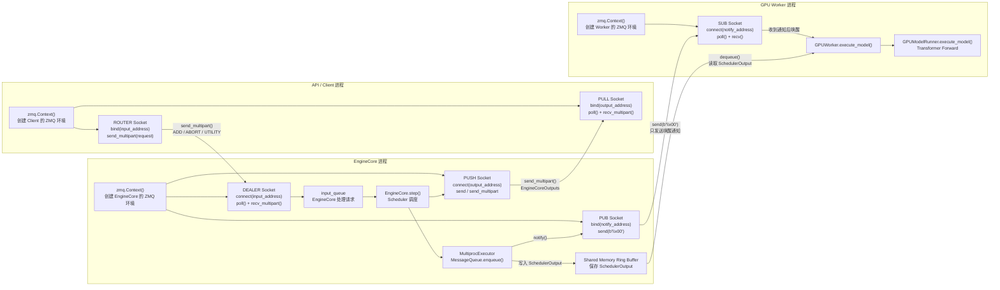

# 进程间通信（IPC）

是 vLLM 自己实现的混合通信机制，不是普通的 `multiprocessing.Queue`。

```
同一台机器
├── 数据传输：Shared Memory Ring Buffer#共享内存环形缓冲区
├── 序列化：pickle#Python 对象转成字节
├── 通知机制：SpinCondition + ZeroMQ IPC#通知 Worker 有新消息
└── 通信模式：Publish/Subscribe#一次发送，所有 Worker 接收

跨机器
├── 数据传输：ZeroMQ TCP
├── 序列化：pickle
└── 通信模式：Publish/Subscribe
```

发送过程：

```
message=(send_method,args,kwargs,output_rank)#普通 Python tuple
serialized=pickle.dumps(message)#对象序列化成字节
shared_memory.write(serialized)#写入共享内存
notify_workers()#通知所有 Worker
```

接收过程：

```
serialized=shared_memory.read()#Worker 从共享内存读取
message=pickle.loads(serialized)#恢复 Python 对象
func=getattr(worker,message[0])#找到 execute_model
func(*message[1],**message[2])#执行函数
```

整体结构：

```
Engine/Executor 进程
└── MessageQueue.enqueue()
    ├── pickle 序列化
    ├── 写入共享内存 Ring Buffer
    └── 广播通知
        ├── Worker 0 进程
        ├── Worker 1 进程
        ├── Worker 2 进程
        └── Worker 3 进程
```

所以核心技术是：

```
IPC
├── Shared Memory#主要传本机数据
├── Ring Buffer#循环复用内存
├── Pickle Protocol#序列化 Python 对象
├── ZeroMQ IPC/TCP#大消息、通知和跨节点通信
└── Pub/Sub#广播给所有 Worker
```

目的：避免每个 step 都通过低效的普通 Python Pipe 单独复制并发送一次给每个 Worker。


# ZMQ



按数据方向理解：

```
请求
API ROUTER.send_multipart()
└── EngineCore DEALER.recv_multipart()

输出
EngineCore PUSH.send_multipart()
└── API PULL.recv_multipart()

模型执行
EngineCore 写入 Shared Memory
├── SchedulerOutput 保存在 SHM
└── PUB.send() 通知 Worker
    └── SUB.recv() 唤醒
        └── Worker 从 SHM 读取 SchedulerOutput
```

各接口的作用：

```
zmq.Context()
└── 管理当前进程中的 ZMQ sockets 和 IO 线程

ctx.socket(...)
└── 创建 ROUTER/DEALER/PUSH/PULL/PUB/SUB socket

bind(address)
└── 当前进程监听该地址

connect(address)
└── 当前进程连接监听方

send()/recv()
└── 发送或接收一个 frame

send_multipart()/recv_multipart()
└── 一条消息包含多个 frame

poll()
└── 阻塞等待 socket 上出现可读消息
```


## zmq.Context()

创建 ZeroMQ 上下文。

```
ctx = zmq.Context()
```

`Context` 是 ZeroMQ 的运行环境，用来创建和管理 socket。

## ctx.socket(zmq.ROUTER)

创建一个 ZeroMQ socket。

```
socket = ctx.socket(zmq.ROUTER)
```

`zmq.ROUTER` 表示 socket 的类型。

`ROUTER` socket 可以处理多个客户端，并区分不同客户端的身份。

## socket.bind(address)

绑定一个地址。

```
socket.bind("tcp://*:5555")
```

通常由服务端使用。

表示：

```
在这个地址和端口上等待其他 socket 连接
```

## socket.connect(address)

连接到一个地址。

```
socket.connect("tcp://127.0.0.1:5555")
```

通常由客户端使用。

表示：

```
连接到已经 bind 的 ZeroMQ socket
```

## socket.send_multipart(frames)

发送多帧消息。

```
socket.send_multipart([
    b"client1",
    b"hello"
])
```

一个消息可以包含多个 frame。

例如：

```
Message
├── Frame 1: client1
└── Frame 2: hello
```

`ROUTER` socket 经常使用多帧消息，因为其中一帧可以保存客户端 identity。

## socket.recv_multipart()

接收多帧消息。

```
frames = socket.recv_multipart()
```

可能得到：

```
[
    b"client1",
    b"hello"
]
```

对于 `ROUTER`：

```
第一帧：客户端 identity
后面的帧：真正的数据
```

## socket.send(data)

发送单帧消息。

```
socket.send(b"hello")
```

适合发送简单数据。

例如：

```
Sender
  |
  | hello
  v
Receiver
```

## socket.recv()

接收单帧消息。

```
data = socket.recv()
```

如果收到：

```
hello
```

那么：

```
data == b"hello"
```

默认情况下，如果没有消息，`recv()` 会等待。

## socket.poll()

等待或检查是否有消息。

```
if socket.poll(1000):
    data = socket.recv()
```

`1000` 表示等待最多约 1000 毫秒。

逻辑：

```
poll()
  |
  v
有消息吗？
 /      \
有       没有
|         |
recv()   继续执行
```

可以避免程序一直阻塞在 `recv()`。

## 整体流程

这些 API 可以连成：

```
zmq.Context()
      |
      v
ctx.socket(...)
      |
      v
bind() / connect()
      |
      v
poll()
      |
      v
recv() / recv_multipart()
      |
      v
处理数据
      |
      v
send() / send_multipart()
```

可以简单记成：

```
Context  = 创建通信环境
Socket   = 创建通信对象
bind     = 等待别人连接
connect  = 主动连接别人
send     = 发送消息
recv     = 接收消息
multipart = 一条消息包含多个 frame
poll     = 检查有没有消息
```


# view(-1)/reshape()/unsqueeze(dim)/tanspose()/permute/contiguous/expand()/repeat()/stack()/cat

有，PyTorch 里常见的 shape / memory 操作可以这样区分。

1）`view()`：改形状，但要求内存通常是 contiguous。
`view()`: Reshapes a tensor without copying data, but usually requires contiguous memory.

```
x = torch.randn(2, 3, 4)
y = x.view(6, 4)
[2, 3, 4]
→
[6, 4]
```

2）`reshape()`：也是改形状，但比 `view()` 更安全；如果内存不连续，它会必要时复制数据。
`reshape()`: Reshapes a tensor and may create a copy when needed.

```
y = x.reshape(6, 4)
```

面试里可以记：

```
view
= 尽量只改 metadata

reshape
= 能 view 就 view
  不能就 copy
```

3）`unsqueeze(dim)`：增加一个长度为 1 的维度。
`unsqueeze(dim)`: Adds a dimension of size 1.

```
x.shape# [3, 4]x.unsqueeze(0).shape# [1, 3, 4]
```

常见用途：

```
单个样本
[seq, hidden]

→ 加 batch 维
[1, seq, hidden]
```

4）`squeeze(dim)`：删除长度为 1 的维度。
`squeeze(dim)`: Removes dimensions whose size is 1.

```
x.shape# [1, 3, 4]x.squeeze(0).shape# [3, 4]
```

5）`transpose()`：交换两个维度。
`transpose()`: Swaps two dimensions.

```
x.shape# [2, 3, 4]x.transpose(1, 2).shape# [2, 4, 3]
```

Transformer 里很常见：

```
[batch, seq, hidden]
→
[batch, hidden, seq]
```

6）`permute()`：可以一次重新排列多个维度。
`permute()`: Reorders multiple dimensions at once.

```
x.shape# [2, 3, 4]
x.permute(2, 0, 1).shape# [4, 2, 3]
```

区别：

```
transpose
= 交换两个维度

permute
= 任意重排多个维度
```

7）`contiguous()`：让 tensor 在内存中重新连续排列。
`contiguous()`: Creates a tensor with contiguous memory layout.

例如：

```
x = torch.randn(2, 3, 4)y = x.transpose(1, 2)
```

这时：

```
y.is_contiguous()# False
```

如果直接：

```
y.view(2, 12)
```

有时会报错。

需要：

```
y = y.contiguous()y = y.view(2, 12)
```

所以常见组合：

```
x = x.transpose(1, 2).contiguous().view(...)
```

8）`flatten()`：把指定维度范围直接压平。
`flatten()`: Flattens a range of dimensions.

```
x.shape# [2, 3, 4]x.flatten(0, 1).shape# [6, 4]
```

这和：

```
x.view(-1, 4)
```

效果类似。

9）`expand()`：扩展维度，但不真正复制数据。
`expand()`: Expands singleton dimensions without physically copying data.

```
x = torch.tensor([[1], [2], [3]])x.shape# [3, 1]y = x.expand(3, 4)
```

得到逻辑上：

```
1 1 1 1
2 2 2 2
3 3 3 3
```

但底层不是复制 4 份。

10）`repeat()`：真正重复数据。
`repeat()`: Physically repeats tensor data.

```
x.repeat(1, 4)
```

区别：

```
expand
= view-based
= 不复制数据

repeat
= 真复制
= 更占内存
```

11）`stack()`：增加新维度后拼接。
`stack()`: Concatenates tensors along a new dimension.

```
a.shape = [3, 4]
b.shape = [3, 4]
torch.stack([a, b]).shape# [2, 3, 4]
```

12）`cat()`：沿已有维度拼接，不增加新维度。
`cat()`: Concatenates tensors along an existing dimension.

```
torch.cat([a, b], dim=0).shape# [6, 4]
```

最容易面试混淆的是这几个：

```
view / reshape
= 改 shape

unsqueeze / squeeze
= 加 / 减 size=1 的维度

transpose / permute
= 调整维度顺序

contiguous
= 调整内存布局

flatten
= 压平维度

expand / repeat
= 扩展数据

stack / cat
= 拼接 tensor
```

你可以重点记这条：

```
transpose / permute
        ↓
可能 non-contiguous
        ↓
contiguous()
        ↓
view()
```

这是 Transformer / attention 代码里最常见的一套组合。
