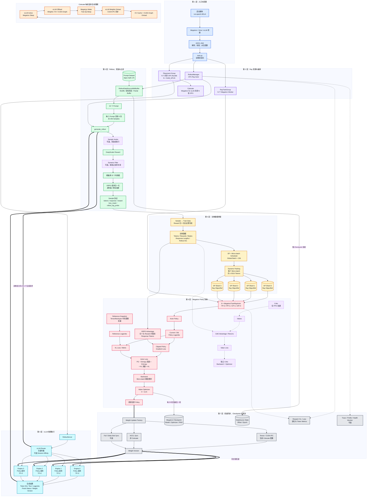

# 执行

## 训练

明白，模型、数据集和 Checkpoint 都放在 `/data/home/xli49/vimedata/` 下：

```
mkdir -p \
  /data/home/xli49/vimedata/models \
  /data/home/xli49/vimedata/datasets \
  /data/home/xli49/vimedata/checkpoints
```

```python
apptainer shell --nv \
  --env PYTHONNOUSERSITE=1 \
  --writable-tmpfs \
  --bind /data/home/xli49/lxy/vime:/root/vime \
  --bind /data/home/xli49/vimedata/models:/root/models \
  --bind /data/home/xli49/vimedata/datasets:/root/datasets \
  --bind /data/home/xli49/vimedata/checkpoints:/root/checkpoints \
  /data/home/xli49/lxy/vime/vime-latest.sif
```


宿主机目录结构：

```
/data/home/xli49/vimedata/
├── models/        # 模型权重
├── datasets/      # 训练和评估数据
└── checkpoints/   # 转换后的权重及训练存档
```

这些挂载目录中的修改会保留。以上命令只创建目录，不会搬迁之前下载的文件。

改成 **H100 × 2，使用宿主机 GPU 1、2**。下面都在 Apptainer 内执行；模型和数据已下载、权重已转换的步骤可以跳过。

**1. 设置 GPU 和环境**

```
cd /root/vime

export CUDA_VISIBLE_DEVICES=1,2
export PYTHONNOUSERSITE=1
export PYTHONPATH=/root/vime:/root/Megatron-LM
export CUDA_DEVICE_MAX_CONNECTIONS=1
export PYTHONUNBUFFERED=1
```

这里加入了 `PYTHONNOUSERSITE=1`，避免再次加载宿主机 `.local` 中不匹配的 FlashInfer。

检查：

```
python - <<'PY'
import os
import torch
import ray
import vllm
import vllm_router
import megatron.training
import transformer_engine.pytorch
import flash_attn
import torch_memory_saver

print("CUDA_VISIBLE_DEVICES:", os.environ["CUDA_VISIBLE_DEVICES"])
print("PyTorch:", torch.__version__)
print("CUDA runtime:", torch.version.cuda)
print("Visible GPUs:", torch.cuda.device_count())
assert torch.cuda.device_count() == 2, "应当只能看到两张 GPU"

for i in range(torch.cuda.device_count()):
    print("逻辑 GPU", i, ":", torch.cuda.get_device_name(i))

print("依赖导入成功")
PY
```

进程内的编号会重新映射：

| 宿主机 GPU | 进程内逻辑 GPU |
| ---------- | -------------- |
| GPU 1      | `cuda:0`       |
| GPU 2      | `cuda:1`       |

`nvidia-smi` 仍可能显示全部四张卡，以 Python 检查结果为准。这里假定宿主机 GPU 1、2 已分配给你的任务。

**2. 下载模型和数据**

```
hf download Qwen/Qwen3-4B \
  --local-dir /root/models/Qwen3-4B

hf download --repo-type dataset zhuzilin/dapo-math-17k \
  --local-dir /root/datasets/dapo-math-17k

hf download --repo-type dataset zhuzilin/aime-2024 \
  --local-dir /root/datasets/aime-2024
```

**3. 转换 Megatron 权重**

使用绝对路径，避免再次从 `vllm` 目录寻找转换脚本：

```
source /root/vime/scripts/models/qwen3-4B.sh

torchrun --standalone --nproc-per-node=2 \
  /root/vime/tools/convert_hf_to_torch_dist.py \
  "${MODEL_ARGS[@]}" \
  --hf-checkpoint /root/models/Qwen3-4B \
  --save /root/checkpoints/Qwen3-4B_torch_dist
```

确认转换成功：

```
ls /root/checkpoints/Qwen3-4B_torch_dist
```

应包含 `latest_checkpointed_iteration.txt` 和权重目录。

**4. 启动两卡 Ray**

Ray 必须在设置好 `CUDA_VISIBLE_DEVICES=1,2` **之后启动**。已经运行的旧 Ray 不会自动采用新的环境变量。

以下使用端口 `6380` 和 `8266` 建立本次训练的 Ray；如果提示端口被占用，先停止继续执行，不要运行全局 `pkill`。

```
ray start --head \
  --port 6380 \
  --num-gpus 2 \
  --dashboard-host 127.0.0.1 \
  --dashboard-port 8266 \
  --disable-usage-stats

export RAY_ADDRESS=127.0.0.1:6380
```

**5. 跑两轮训练**

```
source /root/vime/scripts/models/qwen3-4B.sh

python /root/vime/train.py \
  "${MODEL_ARGS[@]}" \
  --actor-num-nodes 1 \
  --actor-num-gpus-per-node 2 \
  --colocate \
  --hf-checkpoint /root/models/Qwen3-4B \
  --ref-load /root/checkpoints/Qwen3-4B_torch_dist \
  --save /root/checkpoints/Qwen3-4B_smoke \
  --save-interval 1 \
  --prompt-data /root/datasets/dapo-math-17k/dapo-math-17k.jsonl \
  --input-key prompt \
  --label-key label \
  --apply-chat-template \
  --rollout-shuffle \
  --rm-type deepscaler \
  --num-rollout 2 \
  --rollout-batch-size 4 \
  --n-samples-per-prompt 8 \
  --rollout-max-response-len 8192 \
  --rollout-temperature 1 \
  --global-batch-size 32 \
  --balance-data \
  --tensor-model-parallel-size 2 \
  --pipeline-model-parallel-size 1 \
  --context-parallel-size 1 \
  --sequence-parallel \
  --recompute-granularity full \
  --recompute-method uniform \
  --recompute-num-layers 1 \
  --use-dynamic-batch-size \
  --max-tokens-per-gpu 2048 \
  --advantage-estimator grpo \
  --use-kl-loss \
  --kl-loss-coef 0 \
  --kl-loss-type low_var_kl \
  --entropy-coef 0 \
  --eps-clip 0.2 \
  --eps-clip-high 0.28 \
  --optimizer adam \
  --lr 1e-6 \
  --lr-decay-style constant \
  --weight-decay 0.1 \
  --adam-beta1 0.9 \
  --adam-beta2 0.98 \
  --rollout-num-gpus-per-engine 2 \
  --vllm-gpu-memory-utilization 0.6 \
  --vllm-server-concurrency 8 \
  --attention-dropout 0 \
  --hidden-dropout 0 \
  --accumulate-allreduce-grads-in-fp32 \
  --attention-softmax-in-fp32 \
  --attention-backend flash
```

这次的运行配置为：

| 项目         | 配置                         |
| ------------ | ---------------------------- |
| 物理 GPU     | H100 1、2                    |
| Megatron     | 2 个 Worker，TP=2、DP=1      |
| vLLM         | 1 个 Engine，TP=2            |
| 训推共享     | 同一组两张卡，分阶段执行     |
| 每轮样本     | 4 prompts × 8 responses = 32 |
| 每轮训练更新 | 1 次                         |
| 总轮数       | 2                            |
| AIME 评估    | 本次未启用                   |

Checkpoint 会保存到宿主机：

```
/data/home/xli49/vimedata/checkpoints/Qwen3-4B_smoke/
```

这两轮用于验证完整流程；1024 token 的回答可能被截断，奖励全零时也不能据此判断最终训练效果。


## 分析

**目前能确认训练和推理链路确实运行过，但还不能确认训练提升了模型能力。** 我直接检查了你的 checkpoint 和日志：

| 检查项   | 实际结果                                                 |
| -------- | -------------------------------------------------------- |
| 推理生成 | 有生成文本、奖励和响应长度记录                           |
| 训练梯度 | 前两步 `grad_norm` 分别约为 **0.160、0.282**，训练有执行 |
| 权重同步 | 第一步训练后有 `update_weights` 完成记录                 |
| 保存结果 | 存在 `iter_0000099`，最新 checkpoint 指针为 **99**       |
| 效果评估 | `baseline.log` 因 `Errno 107` 失败，**尚无评估分数**     |

另外，[训练日志](/data/home/xli49/vimedata/checkpoints/Qwen3-4B_100rollouts_20261001_043212/logs/train.log)只保留了前两步，不能用它核实完整 100 轮过程。

**下一步：对原始模型和训练后的模型做相同条件的评估。**

先处理之前的 Ray 挂载错误，确保当前容器中的 Ray worker 能正常读取依赖。下面命令在 `Apptainer>` 内运行，使用已经配置好的、可见两张 GPU 的 Ray 环境；不要与训练同时占用这两张卡。

```
cd /root/vime
export PYTHONNOUSERSITE=1
export PYTHONPATH=/root/vime:/root/Megatron-LM
export CUDA_DEVICE_MAX_CONNECTIONS=1
export PYTHONUNBUFFERED=1
export RAY_ADDRESS=local

# 暂时关闭之前怀疑的通信优化
export VLLM_ALLREDUCE_USE_FLASHINFER=0
export VLLM_ALLREDUCE_USE_SYMM_MEM=0

source scripts/models/qwen3-4B.sh

EVAL_DIR="/root/checkpoints/compare_$(date +%Y%m%d_%H%M%S)"
mkdir -p "$EVAL_DIR"
set -o pipefail

eval_model() {
  local checkpoint="$1"
  local name="$2"

  python train.py "${MODEL_ARGS[@]}" \
    --actor-num-nodes 1 --actor-num-gpus-per-node 2 \
    --colocate \
    --hf-checkpoint /root/models/Qwen3-4B \
    --load "$checkpoint" \
    --ref-load /root/checkpoints/Qwen3-4B_torch_dist \
    --finetune --no-load-optim --no-load-rng \
    --prompt-data /root/datasets/dapo-math-17k/dapo-math-17k.jsonl \
    --input-key prompt --label-key label \
    --apply-chat-template --rm-type deepscaler \
    --num-rollout 0 \
    --rollout-batch-size 4 --n-samples-per-prompt 8 \
    --global-batch-size 32 \
    --rollout-max-response-len 8192 \
    --eval-interval 1 \
    --eval-prompt-data aime /root/datasets/aime-2024/aime-2024.jsonl \
    --eval-input-key prompt --eval-label-key label \
    --n-samples-per-eval-prompt 4 \
    --eval-temperature 1 --eval-top-p 1 --eval-top-k -1 \
    --eval-max-response-len 8192 \
    --tensor-model-parallel-size 2 \
    --pipeline-model-parallel-size 1 \
    --context-parallel-size 1 --sequence-parallel \
    --advantage-estimator grpo --lr 1e-6 \
    --rollout-num-gpus-per-engine 2 \
    --vllm-gpu-memory-utilization 0.6 \
    --vllm-server-concurrency 8 \
    --vllm-enforce-eager \
    --vllm-disable-custom-all-reduce \
    --vllm-compilation-config '{"pass_config":{"fuse_allreduce_rms":false}}' \
    --attention-dropout 0 --hidden-dropout 0 \
    --attention-backend flash \
    --log-passrate \
    --save-debug-rollout-data "${EVAL_DIR}/${name}_{rollout_id}.pt" \
    2>&1 | tee "${EVAL_DIR}/${name}.log"
}

eval_model /root/checkpoints/Qwen3-4B_torch_dist baseline &&
eval_model /root/checkpoints/Qwen3-4B_100rollouts_20261001_043212 trained
```

这里 `--num-rollout 0` 只做评估。当前 [train.py (line 25)](/data/home/xli49/lxy/vime/train.py:25) 会先把 `--load` 加载的权重同步给 vLLM，因此第二次评估会使用训练后的权重。保存的 `.pt` 文件包含生成文本和奖励，便于检查具体答题结果。

跑完提取分数：

```
grep -E 'eval/[a-zA-Z]|successfully loaded checkpoint' \
  "$EVAL_DIR/baseline.log" "$EVAL_DIR/trained.log"
```

重点看：

-   **`eval/aime`**：平均奖励；对于当前二值判分，可理解为所有生成答案的正确比例。训练后更高，才有能力提升的初步证据。
-   **`eval/aime-truncated_ratio`**：回答被长度上限截断的比例。你的前两轮训练截断率约 **47%、63%**，评估时也需要关注；调整长度上限时，两组必须一起调整。
-   **重复评估的稳定性**：你的 AIME 文件只有 **30 道题**，每题生成 4 次共 120 个答案。小幅提升可能来自采样波动，建议重复几次，并增加独立测试题。

**不要用 loss 是否接近零判断训练是否有效。** 你的 GRPO 配置会对组内奖励进行中心化，日志里的平均 advantage、`pg_loss` 接近零可以是正常现象；应结合非零梯度、权重更新和独立评估结果判断。

# 架构





## 第一层

### 第一层代码调用 Tree

```
scripts/run-qwen3-4B.sh                                      # 第一层总入口：准备环境、组装参数并提交训练任务
│
├── pkill / ray stop                                         # 清理旧的 vLLM、Ray、Python 进程，防止占用 GPU 和端口
│
├── nvidia-smi topo -m                                       # 检测 NVLink，决定 NCCL_NVLS_ENABLE
│
├── nvidia-smi -L                                            # 检测当前 GPU 数量，得到 NUM_GPUS
│   └── NUM_GPUS=${NUM_GPUS:-${DETECTED_GPUS}}               # 环境变量优先；检测失败时回退为 8
│
├── source scripts/models/qwen3-4B.sh                         # 加载 Qwen3-4B 模型结构参数；关联第 6 层 Megatron
│   └── MODEL_ARGS=(...)                                     # 36 层、hidden=2560、32 heads、8 query groups 等
│
├── CKPT_ARGS=(...)                                          # 配置初始模型、Reference、恢复和保存路径；关联第 6、7 层
│   ├── --hf-checkpoint /root/Qwen3-4B                       # HuggingFace 模型与 tokenizer 来源；关联第 3、4、6 层
│   ├── --ref-load /root/Qwen3-4B_torch_dist                 # Reference 权重来源；关联第 6 层
│   ├── --load /root/Qwen3-4B_vime                           # Megatron 恢复路径；关联第 6、7 层
│   ├── --save /root/Qwen3-4B_vime                           # Checkpoint 输出路径；关联第 7 层
│   └── --save-interval 20                                   # 每 20 个 Rollout 保存；关联第 7 层
│
├── ROLLOUT_ARGS=(...)                                       # 定义训练数据生成方式；关联第 3、5 层
│   ├── --prompt-data dapo-math-17k.jsonl                    # Prompt 数据集；关联第 3 层
│   ├── --input-key prompt / --label-key label               # 数据字段映射；关联第 3 层
│   ├── --apply-chat-template                                # 使用模型 Chat Template；关联第 3 层
│   ├── --rollout-shuffle                                    # 每个 Epoch 打乱 Prompt；关联第 3 层
│   ├── --rm-type deepscaler                                 # 使用 DeepScaler Reward；关联第 3 层
│   ├── --num-rollout 3000                                   # 最多执行 3000 个 Rollout；控制 train.py 主循环
│   ├── --rollout-batch-size 32                              # 每轮取 32 个 Prompt；关联第 3 层
│   ├── --n-samples-per-prompt 8                             # 每个 Prompt 生成 8 个回答；关联第 3 层
│   ├── --rollout-max-response-len 8192                      # 最大生成长度；关联第 4 层
│   ├── --global-batch-size 256                              # 每个训练 Step 使用 256 个样本；关联第 5、6 层
│   └── --balance-data                                       # 在 DP Rank 间平衡计算量；关联第 5 层
│
├── EVAL_ARGS=(...)                                          # 定义评估计划；关联第 3、4、7 层
│   ├── --eval-interval 20                                   # 每 20 轮评估
│   ├── --eval-prompt-data aime ...                          # AIME 评估数据集
│   ├── --n-samples-per-eval-prompt 16                      # 每道题生成 16 个回答
│   └── --eval-max-response-len 16384                        # Eval 最大回答长度
│
├── PERF_ARGS=(...)                                          # 定义训练并行和动态批处理；关联第 5、6 层
│   ├── --tensor-model-parallel-size 2                       # Megatron TP=2；关联第 6 层
│   ├── --pipeline-model-parallel-size 1                     # Megatron PP=1；关联第 6 层
│   ├── --context-parallel-size 1                            # Megatron CP=1；关联第 6 层
│   ├── --sequence-parallel                                  # 启用 Sequence Parallel；关联第 6 层
│   ├── --recompute-granularity full                         # 使用 Activation Recompute；关联第 6 层
│   ├── --use-dynamic-batch-size                             # 按 Token 数动态组成 Micro-batch；关联第 5 层
│   └── --max-tokens-per-gpu 9216                            # 每个 Micro-batch 的 Token 容量；关联第 5 层
│
├── GRPO_ARGS=(...)                                          # 定义强化学习算法；关联第 3、6 层
│   ├── --advantage-estimator grpo                           # 使用 GRPO，因此不创建 Critic
│   ├── --use-kl-loss                                        # 加载 Reference 并计算 KL
│   ├── --kl-loss-coef 0.00                                  # 当前 KL 只统计，不影响梯度
│   ├── --kl-loss-type low_var_kl                            # 使用低方差 KL 估计
│   ├── --entropy-coef 0.00                                  # 当前 Entropy 不影响梯度
│   ├── --eps-clip 0.2                                       # Policy ratio 下界裁剪
│   └── --eps-clip-high 0.28                                 # Policy ratio 上界裁剪
│
├── OPTIMIZER_ARGS=(...)                                     # 定义参数更新方法；关联第 6 层
│   ├── --optimizer adam                                     # 使用 Adam
│   ├── --lr 1e-6                                            # 学习率
│   ├── --lr-decay-style constant                            # 学习率保持不变
│   ├── --weight-decay 0.1                                   # 权重衰减
│   └── --adam-beta1 0.9 / --adam-beta2 0.98                 # Adam 动量参数
│
├── VLLM_ARGS=(...)                                          # 定义推理部署；关联第 4 层
│   ├── --rollout-num-gpus-per-engine 2                      # 每个 vLLM Engine 使用 2 张 GPU
│   └── --vllm-gpu-memory-utilization 0.7                    # vLLM 使用约 70% GPU 显存
│
├── MISC_ARGS=(...)                                          # 定义精度和 Attention 实现；关联第 6 层
│   ├── --attention-dropout 0.0                              # 关闭 Attention Dropout
│   ├── --hidden-dropout 0.0                                 # 关闭 Hidden Dropout
│   ├── --accumulate-allreduce-grads-in-fp32                 # 使用 FP32 累积和规约梯度
│   ├── --attention-softmax-in-fp32                          # Attention Softmax 使用 FP32
│   └── --attention-backend flash                            # 使用 Flash Attention
│
├── ray start --head                                         # 启动 Ray Head；为第 2 层提供 Ray Cluster
│   ├── --num-gpus ${NUM_GPUS}                               # 向 Ray 注册本机 GPU 资源
│   ├── --node-ip-address ${MASTER_ADDR}                     # 设置 Ray Head 地址
│   └── --dashboard-port 8265                                # Ray Job 提交和 Dashboard 端口
│
├── RUNTIME_ENV_JSON                                         # 定义 Ray Job 运行环境
│   ├── PYTHONPATH=/root/Megatron-LM                         # 让 Worker 能导入 Megatron
│   ├── CUDA_DEVICE_MAX_CONNECTIONS=1                        # 配合 Megatron CUDA/NCCL 调度
│   └── NCCL_NVLS_ENABLE=${HAS_NVLINK}                       # 根据 NVLink 检测结果配置 NCCL
│
└── ray job submit -- python3 train.py ...                    # 把训练入口提交到 Ray Cluster
    │
    └── train.py::__main__                                   # Python 侧第一层入口
        │
        ├── parse_args()                                     # 解析、合并、校验并派生统一配置 args
        │   │
        │   ├── configure_logger()                            # 初始化日志；关联第 7 层观测
        │   │
        │   ├── get_vime_extra_args_provider()               # 注册 Vime 自定义参数
        │   │
        │   ├── _pre_parse_mode()                            # 预解析运行模式，决定是否需要 vLLM
        │   │   ├── --train-backend                          # 当前只支持 Megatron
        │   │   ├── --debug-rollout-only                     # 只执行 Rollout 时跳过训练模型
        │   │   ├── --debug-train-only                       # 只训练时跳过 vLLM
        │   │   └── --load-debug-rollout-data                # 从调试数据训练，不启动推理服务
        │   │
        │   ├── vllm_parse_args()                            # 独立解析 vLLM 参数；关联第 4 层
        │   │   └── AsyncEngineArgs.add_cli_args()           # 注册 vLLM Engine 原生参数
        │   │
        │   ├── megatron_parse_args(...)                     # 解析 Megatron 和 Vime 参数；关联第 2～7 层
        │   │   └── get_vime_extra_args_provider()           # 把 Vime 参数注入 Megatron Parser
        │   │
        │   ├── merge(pre, vllm_ns, megatron_args)           # 合并三套参数，形成一个 Namespace
        │   │
        │   ├── vime_validate_args(args)                     # Vime 语义校验和派生配置
        │   │   │
        │   │   ├── _resolve_eval_datasets(args)             # 构造 AIME Eval 配置；关联第 3、7 层
        │   │   │
        │   │   ├── validate(ref_load)                       # use_kl_loss 要求 Reference 路径存在；关联第 6 层
        │   │   │
        │   │   ├── detect(load checkpoint)                  # 判断是新训练还是恢复训练；关联第 7 层
        │   │   │   ├── start_rollout_id = 0                 # 没有合法 Checkpoint 时从 0 开始
        │   │   │   └── start_rollout_id = loaded_id + 1     # 有 Checkpoint 时从下一轮恢复
        │   │   │
        │   │   ├── use_critic = estimator == "ppo"          # 当前 GRPO，因此 use_critic=false；关联第 6 层
        │   │   │
        │   │   ├── derive_colocate_config(args)             # 派生共享 GPU 和 Offload 配置；关联第 2 层
        │   │   │   ├── rollout_num_gpus = actor_num_gpus    # Rollout 与训练使用同一组 GPU
        │   │   │   ├── offload_train = true                 # Rollout 阶段卸载 Megatron
        │   │   │   └── offload_rollout = true               # 训练阶段卸载 vLLM
        │   │   │
        │   │   ├── eval_function_path = rollout_function    # 未单独指定 Eval 函数时复用 Rollout 函数
        │   │   ├── over_sampling_batch_size = 32            # 默认等于 rollout_batch_size；关联第 3 层
        │   │   └── validate(weight update mode)              # 校验 CUDA IPC、NCCL 或 Disk 同步配置；关联第 7 层
        │   │
        │   ├── megatron_validate_args(args)                 # 校验模型结构、并行拓扑和训练参数；关联第 6 层
        │   ├── vllm_validate_args(args)                     # 校验 Engine 并行和服务参数；关联第 4 层
        │   └── return args                                  # 输出统一、合法、已经派生完成的配置
        │
        └── train(args)                                      # 第一层 Driver：用 args 调度后续所有层
            │
            ├── create_placement_groups(args)                # 创建 GPU Placement Group；进入第 2 层
            ├── init_tracking(args)                          # 初始化指标跟踪；进入第 7 层
            ├── create_rollout_manager(args, pg)             # 创建 RolloutManager；进入第 2、3、4 层
            ├── create_training_models(args, ...)            # 创建 Megatron Worker；进入第 2、6 层
            │
            ├── actor_model.update_weights()                 # 初始权重同步到 vLLM；关联第 7→4 层
            │
            └── for rollout_id in range(start, 3000)         # 第一层维护全局训练状态机
                ├── rollout_manager.eval.remote()            # 周期评估；调用第 3、4、7 层
                ├── rollout_manager.generate.remote()        # 生成训练数据；调用第 3、4、5 层
                ├── rollout_manager.offload.remote()         # 卸载 vLLM；调用第 2、4 层
                ├── actor_model.async_train()                # 执行 Policy 训练；调用第 6 层
                ├── actor_model.save_model()                 # 保存模型；调用第 7 层
                ├── rollout_manager.save.remote()            # 保存数据游标；调用第 7 层
                ├── actor_model.update_weights()             # 同步新 Policy；调用第 7→4 层
                └── rollout_manager.onload_kv.remote()       # 恢复 KV Cache/CUDA Graph；调用第 2、4 层
```

### 第一层总结

第一层负责把“我想怎样训练”变成后续模块可以执行的配置。最重要的是三件事：**组合启动参数、校验并推导配置、用 `train.py` 控制执行顺序。**

下面假设：**单机 8 张 GPU，首次训练，使用你图里的 Qwen3-4B 脚本。**

**1. 启动脚本：把模型、数据、算法和资源配置拼在一起**

入口是 [run-qwen3-4B.sh (line 146)](/data/home/xli49/lxy/vime/scripts/run-qwen3-4B.sh:146)。将 `${NUM_GPUS}` 代入 8，关键启动命令等价于：

```
ray job submit --address="http://127.0.0.1:8265" \
  --runtime-env-json="${RUNTIME_ENV_JSON}" \
  -- python3 train.py \
  --actor-num-nodes 1 \
  --actor-num-gpus-per-node 8 \
  --colocate \
  ${MODEL_ARGS[@]} \
  ${CKPT_ARGS[@]} \
  ${ROLLOUT_ARGS[@]} \
  ${OPTIMIZER_ARGS[@]} \
  ${GRPO_ARGS[@]} \
  ${PERF_ARGS[@]} \
  ${EVAL_ARGS[@]} \
  ${VLLM_ARGS[@]} \
  ${MISC_ARGS[@]}
```

这里的 `${ROLLOUT_ARGS[@]}` 等变量是 Bash 数组，展开后就是一串命令行参数。它们的分组方便人阅读，进入 Python 后会汇集到同一个 `args` 对象。

| 配置组           | 关键数值                          | 决定什么                           |
| ---------------- | --------------------------------- | ---------------------------------- |
| `MODEL_ARGS`     | 36 层、Hidden=2560、32 个注意力头 | Megatron 构建什么模型              |
| `ROLLOUT_ARGS`   | 32 个 Prompt，每个 8 个回答       | 每轮生成多少数据                   |
| `PERF_ARGS`      | TP=2、PP=1、CP=1；Token 预算 9216 | 模型如何并行、Micro-batch 如何组织 |
| `GRPO_ARGS`      | `grpo`；KL、Entropy 系数均为 0    | 使用什么训练算法和损失配置         |
| `OPTIMIZER_ARGS` | Adam、学习率 `1e-6`               | 参数如何更新                       |
| `VLLM_ARGS`      | 每个引擎 2 GPU，显存利用率 0.7    | 推理引擎如何部署                   |

**训练端和推理端的并行参数是分别配置的。** 这里两边都是 TP=2，是脚本配置的结果。

------

**2. 先理解三个数量：采样量、训练批次、Token 预算**

脚本中最值得先看的是：

```
--rollout-batch-size 32
--n-samples-per-prompt 8
--global-batch-size 256

--use-dynamic-batch-size
--max-tokens-per-gpu 9216
```

前两个决定每轮采样量：

```
32 个 Prompt × 每个 8 个回答 = 256 个样本
```

`global-batch-size=256` 表示一次优化步骤使用的全局样本量。因此，在默认的一回答对应一个训练样本的路径中：

```
每轮训练步骤数 = 256 ÷ 256 = 1
```

**一个优化步骤内部可以有很多个 Micro-batch**：它们分别执行前向、反向，累积梯度，最后进行一次优化器更新。

`9216` 则是动态 Micro-batch 的 Token 预算，统计 **Prompt + Response**。例如三个样本各有 3000 Token：

```
3 × 3000 = 9000 ≤ 9216，可以装进同一个 Micro-batch
4 × 3000 = 12000 > 9216，需要分开
```

所以，`9216` 不表示每个回答最多生成 9216 Token。回答生成上限由另一个参数决定：

```
--rollout-max-response-len 8192
```

单个超长样本、Padding 等细节后面再看；第一层先分清这三个配置的职责。[批次参数定义 (line 703)](/data/home/xli49/lxy/vime/vime/utils/arguments.py:703)

------

**3. `parse_args()`：分开解析，再合并和校验**

Python 入口很短：

```
if __name__ == "__main__":
    args = parse_args()
    train(args)
```

`--rollout-batch-size 32` 解析后变成：

```
args.rollout_batch_size == 32
```

实际解析流程可以精简为：

```
# 先解析 vLLM 参数
vllm_ns = vllm_parse_args()

# 再解析 Megatron + Vime 参数
args = megatron_parse_args(
    extra_args_provider=add_vime_arguments,
    skip_hf_validate=pre.debug_rollout_only,
)

# 合并到统一 args
for key, value in vars(vllm_ns).items():
    setattr(args, key, value)

# 分别执行校验
vime_validate_args(args)
megatron_validate_args(args)
vllm_validate_args(args)
```

这是正常训练路径的摘录，省略了预解析和调试分支。[完整解析入口 (line 1724)](/data/home/xli49/lxy/vime/vime/utils/arguments.py:1724)

为什么分开解析？因为三个系统各有自己的参数。Megatron 解析器会忽略不属于它的参数，vLLM 参数随后合并进来。

校验也有实际作用。例如，代码会读取 `--hf-checkpoint` 下的模型配置，与 Megatron 参数比较：

```
HF 模型层数 36       ↔ --num-layers 36
HF hidden_size 2560  ↔ --hidden-size 2560
HF 注意力头数 32     ↔ --num-attention-heads 32
```

如果把层数误写成 32，会在配置校验时报告不一致。[模型配置校验 (line 118)](/data/home/xli49/lxy/vime/vime/backends/megatron_utils/arguments.py:118)

------

**4. 解析时还会推导配置：脚本没写，也可能启用**

最重要的推导是 `--colocate`。当前脚本没有启用 `release_train`，也没有显式设置卸载开关，因此以下逻辑生效：

```
if args.colocate:
    # 此处摘录当前脚本走到的分支
    if args.offload_train is None:
        args.offload_train = True

    if args.offload_rollout is None:
        args.offload_rollout = True

    if args.rollout_num_gpus is None:
        args.rollout_num_gpus = (
            args.actor_num_gpus_per_node * args.actor_num_nodes
        )
```

代入数值：

```
rollout_num_gpus = 8 × 1 = 8
offload_train   = True
offload_rollout = True
```

这三个结果直接决定后续的显存生命周期：**训练端和推理端分阶段使用同一组 GPU。** [Colocate 配置推导 (line 2071)](/data/home/xli49/lxy/vime/vime/utils/arguments.py:2071)

另外几个结果是：

| 最终配置                       | 数值及来源                                        |
| ------------------------------ | ------------------------------------------------- |
| 训练 `world_size`              | `1 × 8 = 8`                                       |
| 训练 DP                        | `8 ÷ (TP=2 × PP=1 × CP=1) = 4`                    |
| vLLM TP                        | 每引擎 2 GPU，其余推理并行维度为默认 1，因此 TP=2 |
| 推理引擎数量                   | `8 ÷ 2 = 4`                                       |
| `use_critic`                   | `grpo == ppo` 为 False，因此不创建 Critic         |
| `over_sampling_batch_size`     | 未设置，默认取 `rollout_batch_size=32`            |
| `log_probs_max_tokens_per_gpu` | 未设置，默认取 9216                               |

这里 **DP=4 表示四组训练副本，每组内部两张 GPU 做 TP**。256 个样本平均每组约 64 个，但动态打包与负载均衡后，每组实际样本数可以不同。

还有一个容易误解的关系：

```
if args.num_steps_per_rollout is not None:
    global_batch_size = (
        args.rollout_batch_size
        * args.n_samples_per_prompt
        // args.num_steps_per_rollout
    )
```

当前脚本没有设置 `num_steps_per_rollout`，直接使用显式的 `global_batch_size=256`。

如果加上：

```
--num-steps-per-rollout 2
```

那么要求：

```
global_batch_size = 32 × 8 ÷ 2 = 128
```

此时仍保留 `--global-batch-size 256`，就会触发一致性校验失败。[批次配置推导 (line 2109)](/data/home/xli49/lxy/vime/vime/utils/arguments.py:2109)

------

**5. Checkpoint 参数决定“从头训练还是继续训练”**

这三个路径需要分清：

```
--hf-checkpoint /root/Qwen3-4B
--ref-load      /root/Qwen3-4B_torch_dist
--load         /root/Qwen3-4B_vime/
```

| 参数            | 当前脚本中的职责                                          |
| --------------- | --------------------------------------------------------- |
| `hf-checkpoint` | 提供 HF 模型配置、Tokenizer，以及推理初始化所需资源       |
| `ref-load`      | 提供参考模型权重；也是首次训练时 Actor 初始权重的回退来源 |
| `load`          | 尝试恢复已有训练 Checkpoint                               |

代码首先检查 `load` 目录里是否存在 Megatron 的标记文件：

```
load_is_megatron = (
    args.load is not None
    and os.path.exists(args.load)
    and os.path.exists(
        os.path.join(args.load, "latest_checkpointed_iteration.txt")
    )
)
```

假设首次运行，`load` 目录没有有效 Megatron Checkpoint，也没有可加载的 HF Checkpoint，则会得到：

```
args.load = args.ref_load
args.no_load_optim = True
args.no_load_rng = True
args.finetune = True
args.start_rollout_id = 0
```

含义是：**加载初始模型权重，重新建立优化器状态，从第 0 轮开始。**

如果 `load` 已有有效训练 Checkpoint，则走恢复训练路径，起始轮次由恢复后的训练状态确定。[Checkpoint 判断逻辑 (line 1942)](/data/home/xli49/lxy/vime/vime/utils/arguments.py:1942)

------

**6. `train.py`：根据最终配置控制顺序**

初始化阶段的核心代码是：

```
pgs = create_placement_groups(args)

rollout_manager, num_rollout_per_epoch = create_rollout_manager(
    args, pgs["rollout"]
)

actor_model, critic_model = create_training_models(
    args, pgs, rollout_manager
)

# 第一次采样之前，先同步 Actor 权重
actor_model.update_weights()
```

**首次采样前的权重同步很重要**：Actor 可能恢复了训练 Checkpoint，vLLM 必须先收到对应权重，才能生成这一轮的训练样本。

按当前 GRPO + Colocate 配置，主循环可精简为：

```
for rollout_id in range(args.start_rollout_id, args.num_rollout):
    # 生成数据，并等待生成结束
    rollout_data_ref = ray.get(
        rollout_manager.generate.remote(rollout_id)
    )

    # 释放推理端显存
    ray.get(rollout_manager.offload.remote())

    # 训练，并等待训练结束
    ray.get(
        actor_model.async_train(rollout_id, rollout_data_ref)
    )

    # 此处省略周期保存；训练端按配置自动卸载

    # 恢复推理权重空间，同步更新后的权重
    ray.get(rollout_manager.onload_weights.remote())
    actor_model.update_weights()

    # 恢复推理缓存等资源
    ray.get(rollout_manager.onload_kv.remote())
```

这是按本配置精简后的执行顺序。[训练主循环 (line 49)](/data/home/xli49/lxy/vime/train.py:49)

注意两点：

-   **`async_train` 的名字不代表这里采样与训练重叠。** 外层 `ray.get(...)` 会等待训练完成，再继续同步权重，因此这个入口执行的是同步闭环。
-   **`num_rollout=3000` 是总轮次上限。** 首次运行是 `range(0, 3000)`；如果恢复起点是 100，就执行 `range(100, 3000)`。

当前脚本每完成 20 轮保存、评估一次：对应 `rollout_id=19、39、59…`；第 0 轮采样前默认还会做一次初始评估。这样第一层既确定“如何训练”，也确定“从哪里开始、运行多少轮、何时检查结果”。


## 第二层

第二层负责把第一层的配置变成真正运行的进程，并安排它们使用 GPU。

```python
scripts/run-qwen3-4B.sh
└── ray job submit：提交入口命令
    └── Ray Jobs 服务
        └── JobSupervisor：启动和监控作业
            └── subprocess.Popen(...)
                └── python3 train.py：Driver 进程
                    ├── parse_args()
                    └── train(args)
                        ├── 创建 Placement Group
                        ├── 请求 Ray 创建 RolloutManager Actor
                        ├── 请求 Ray 创建 8 个训练 Actor
                        └── 控制每轮生成、训练、权重同步
```


继续代入这组数值：

```
单机 8 GPU
Megatron：TP=2、PP=1、CP=1 → DP=4
vLLM：每个引擎使用 2 GPU → 4 个推理引擎
Colocate=True
```

重点看五件事：**谁负责调度、如何预留 GPU、如何创建进程、如何共享 GPU、如何等待任务完成。**

**1. 先分清三个角色：Driver、RolloutManager、RayTrainGroup**

入口在 [train.py (line 13)](/data/home/xli49/lxy/vime/train.py:13)：

```
pgs = create_placement_groups(args)

rollout_manager, num_rollout_per_epoch = create_rollout_manager(
    args, pgs["rollout"]
)

actor_model, critic_model = create_training_models(
    args, pgs, rollout_manager
)
```

这三行分别完成资源预留、推理侧创建和训练侧创建。


| 对象                             | 在哪里运行                                                   | 负责什么                                     |
| -------------------------------- | ------------------------------------------------------------ | -------------------------------------------- |
| Driver，即执行 `train.py` 的进程 | Ray Job 的入口进程， ray start --head ... --dashboard-port=8265， 启动 Ray 集群相关服务，让它能够接收作业、安排进程。 | 控制生成、训练、保存、同步的顺序             |
| `RolloutManager`                 | 独立的 CPU Ray Actor 进程                                    | 管理数据源、推理服务和生成任务，整理训练数据 |
| `RayTrainGroup`                  | Driver 中的普通 Python 对象                                  | 管理并调用 8 个训练 Actor                    |
| `MegatronTrainRayActor`          | 8 个独立的 Ray Actor 进程                                    | 每个绑定一张 GPU，参与 Megatron 分布式训练   |

**`RayTrainGroup` 自己不是训练进程。** 它持有训练 Actor 的远程句柄，负责向这些进程发命令。

`RolloutManager` 则确实是远程 Actor：==让 Ray 创建一个独立的 RolloutManager 进程，并拿到调用它的句柄。==

```
@ray.remote
class RolloutManager:
    ...
```

创建时申请的资源是, 字典指定这个进程申请的资源：

```
rollout_manager_options = {
    "num_cpus": 1,
    "num_gpus": 0,
    # 省略运行环境配置
}

rollout_manager = RolloutManager.options(
    **rollout_manager_options
).remote(args, pg)
```

它自己不申请 GPU，但会创建、管理使用 GPU 的 vLLM 服务。[创建代码 (line 227)](/data/home/xli49/lxy/vime/vime/ray/placement_group.py:227)

------

**2. Placement Group：先预留这 8 张 GPU**

Placement Group，简称 PG，是 Ray 的一组资源预留。这里每个 Bundle 包含：

```
{"GPU": 1, "CPU": 1}
```

代码如下：

```
bundles = [
    {"GPU": 1, "CPU": 1}
    for _ in range(num_gpus)
]

pg = placement_group(bundles, strategy="PACK")
```

代入 `num_gpus=8`：

```
PG
├─ Bundle 0：1 GPU + 1 CPU
├─ Bundle 1：1 GPU + 1 CPU
├─ ...
└─ Bundle 7：1 GPU + 1 CPU
```

`PACK` 表示尽量把这些资源集中安排在较少的节点上。本例是单机，所以都安排在这一台机器。

随后代码等待整组资源可用：

```
ready_ref = pg.ready()

while not ray.wait([ready_ref], timeout=30)[0]:
    # 打印已注册 GPU 数量和可用 GPU 数量
    ...
```

如果申请 8 GPU，但 Ray 集群里只有 4 GPU 可用，就会在这里等待，后面的训练进程尚未创建。[PG 创建代码 (line 42)](/data/home/xli49/lxy/vime/vime/ray/placement_group.py:42)

**为什么 Colocate 只申请 8 张，而不是 16 张？**

代码决定总量的方式是：

```
actor_num_gpus = (
    args.actor_num_nodes * args.actor_num_gpus_per_node
)

if args.colocate:
    return max(actor_num_gpus, args.rollout_num_gpus), 0

return actor_num_gpus + args.rollout_num_gpus, actor_num_gpus
```

当前配置：

```
训练需要：1 × 8 = 8 GPU
推理需要：8 GPU

Colocate：max(8, 8) = 8 GPU
```

训练端和推理端从同一组 GPU 槽位开始分配。若分别给训练和推理各配置 8 GPU，并关闭 Colocate，则会预留 `8+8=16 GPU`。[布局计算 (line 100)](/data/home/xli49/lxy/vime/vime/ray/placement_group.py:100)

这里还会用临时 `InfoActor` 查询每个 Bundle 实际对应的节点和 GPU ID，排序后再创建正式进程。因此，**Bundle 编号与物理 GPU 编号需要通过映射确认**。

------

**3. 训练侧：8 个 Actor，组成 4 组 TP 副本**

训练进程数由下面这行决定：

```
world_size = self._num_nodes * self._num_gpus_per_node
```

代入：

```
world_size = 1 × 8 = 8
```

然后逐个创建：

```
for rank in range(world_size):
    actor = TrainRayActor.options(
        num_cpus=num_gpus_per_actor,
        num_gpus=num_gpus_per_actor,
        scheduling_strategy=PlacementGroupSchedulingStrategy(
            placement_group=pg,
            placement_group_bundle_index=reordered_bundle_indices[rank],
        ),
    ).remote(world_size, rank, master_addr, master_port)

    if rank == 0:
        master_addr, master_port = ray.get(
            actor.get_master_addr_and_port.remote()
        )

    self._actor_handlers.append(actor)
```

这段代码做了三件重要的事：

-   创建 `rank=0…7` 共 8 个独立进程。
-   每个 rank 固定安排到对应的 GPU Bundle。
-   rank 0 选出分布式通信的地址和端口，后面的 rank 使用同一个地址。

[训练 Actor 创建代码 (line 115)](/data/home/xli49/lxy/vime/vime/ray/actor_group.py:115)

每个进程还会设置：

```
os.environ["WORLD_SIZE"] = str(self._world_size)
os.environ["RANK"] = str(self._rank)
os.environ["MASTER_ADDR"] = self.master_addr
os.environ["MASTER_PORT"] = str(self.master_port)
```

随后初始化 PyTorch 分布式通信，再由 Megatron 建立 TP、DP 等通信组。

假设物理 GPU 映射为 `0…7`，当前配置的对应关系是：

| GPU  | 训练进程  | Megatron 分组   | 推理阶段使用者 |
| ---- | --------- | --------------- | -------------- |
| 0、1 | rank 0、1 | DP 0，内部 TP=2 | vLLM Engine 0  |
| 2、3 | rank 2、3 | DP 1，内部 TP=2 | vLLM Engine 1  |
| 4、5 | rank 4、5 | DP 2，内部 TP=2 | vLLM Engine 2  |
| 6、7 | rank 6、7 | DP 3，内部 TP=2 | vLLM Engine 3  |

**一组里的两张 GPU 合作运行一份模型；四个 DP 组处理不同的数据，训练时同步梯度。**

所以，8 个训练 Actor 不等于 8 份完整模型；这里是 **4 份模型副本，每份分在 2 张 GPU 上**。

Ray 负责进程创建、位置安排和任务调用；Megatron/PyTorch 的通信组负责训练中的张量与梯度通信。

------

**4. Colocate 的核心：调度允许共存，显存按阶段切换**

这里有个很容易误解的参数：

```
# 创建 RayTrainGroup 时传入
num_gpus_per_actor=0.4
```

它使每个训练 Actor 实际向 Ray 申请：

```
num_gpus=0.4
```

推理引擎管理 Actor 则申请：

```
num_gpus = 0.2

rollout_engine = RolloutRayActor.options(
    num_gpus=num_gpus,
    ...
).remote(
    ...,
    base_gpu_id=base_gpu_id,
    num_gpus_per_engine=2,
)
```

**`0.4` 和 `0.2` 是 Ray 的调度额度，不会把显存切成 40% 和 20%。**

例如 GPU 0 对应的 Bundle 容量是 1：

```
训练 rank 0 申请：0.4
Engine 0 管理 Actor 申请：0.2

0.4 + 0.2 = 0.6 ≤ 1
```

这样 Ray 允许两者安排到同一个 Bundle。

但 Engine 0 实际运行的是 TP=2。代码会显式设置推理服务的可见 GPU：

```
kwargs["_visible_devices"] = ",".join(
    str(base + i) for i in range(local_num_gpus)
)
```

代入 `base=0、local_num_gpus=2`：

```
CUDA_VISIBLE_DEVICES="0,1"
```

因此，**管理 Actor 申请的调度额度，与整个 vLLM 引擎实际使用的 GPU 数量，要分开理解。** [推理 Actor 创建 (line 124)](/data/home/xli49/lxy/vime/vime/backends/vllm_utils/engine_group.py:124)、[GPU 可见性配置 (line 745)](/data/home/xli49/lxy/vime/vime/backends/vllm_utils/vllm_engine.py:745)

真正避免显存冲突的是执行阶段的切换：

```
生成阶段：vLLM 活跃，Megatron 休眠
    ↓
卸载 vLLM 显存资源
    ↓
训练阶段：Megatron 唤醒，训练后休眠
    ↓
恢复 vLLM 权重空间，同步新权重，再恢复缓存
    ↓
下一轮生成
```

训练 Actor 内部就实现了这个流程：

```
if self.args.offload_train:
    self.wake_up()

# 读取数据并执行训练
...

if self.args.offload_train:
    self.sleep()
```

休眠后 Actor 进程仍然存在，后续通过远程调用唤醒。[训练端切换代码 (line 341)](/data/home/xli49/lxy/vime/vime/backends/megatron_utils/actor.py:341)

------

**5. `.remote()` 发任务，`ray.get()` 等结果**

这是理解 Ray 编排最重要的调用方式。

例如：

```
ref = rollout_manager.generate.remote(rollout_id)
```

含义是：

```
Driver 向 RolloutManager 进程提交 generate 任务
立即拿到一个 ObjectRef，表示未来的结果
```

再执行：

```
result = ray.get(ref)
```

Driver 才会等待任务完成，并取回结果。

训练组则向全部 8 个进程提交任务：

```
return [
    actor.train.remote(rollout_id, rollout_data_ref)
    for actor in self._actor_handlers
]
```

返回的是 **8 个 ObjectRef**。Driver 中：

```
ray.get(
    actor_model.async_train(rollout_id, rollout_data_ref)
)
```

会等待这 8 个训练 Actor 都完成。

所以当前主循环的顺序是：

```
# 等生成完成
rollout_data_ref = ray.get(
    rollout_manager.generate.remote(rollout_id)
)

# 等推理端卸载完成
ray.get(rollout_manager.offload.remote())

# 等全部训练进程完成
ray.get(
    actor_model.async_train(rollout_id, rollout_data_ref)
)
```

**虽然任务通过远程接口提交，Driver 在关键位置等待，因此当前入口执行的是同步的“生成 → 训练”闭环。**

启动时也遵守这个顺序：先创建推理服务并卸载，再初始化训练模型；训练端初始化后休眠，随后恢复推理端并同步 Actor 权重，为第一次采样做好准备。


第三层

第四层

第五层

第六层

第七层

