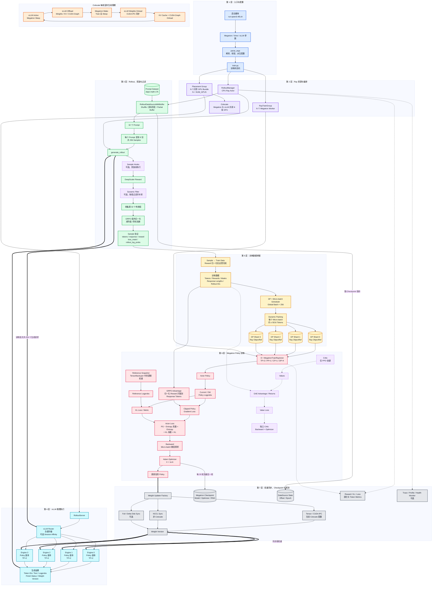

# 执行

## 训练

明白，模型、数据集和 Checkpoint 都放在 `/data/home/xli49/vimedata/` 下：

```
mkdir -p \
  /data/home/xli49/vimedata/models \
  /data/home/xli49/vimedata/datasets \
  /data/home/xli49/vimedata/checkpoints
```

```python
apptainer shell --nv \
  --env PYTHONNOUSERSITE=1 \
  --writable-tmpfs \
  --bind /data/home/xli49/lxy/vime:/root/vime \
  --bind /data/home/xli49/vimedata/models:/root/models \
  --bind /data/home/xli49/vimedata/datasets:/root/datasets \
  --bind /data/home/xli49/vimedata/checkpoints:/root/checkpoints \
  /data/home/xli49/lxy/vime/vime-latest.sif
```


宿主机目录结构：

```
/data/home/xli49/vimedata/
├── models/        # 模型权重
├── datasets/      # 训练和评估数据
└── checkpoints/   # 转换后的权重及训练存档
```

这些挂载目录中的修改会保留。以上命令只创建目录，不会搬迁之前下载的文件。

改成 **H100 × 2，使用宿主机 GPU 1、2**。下面都在 Apptainer 内执行；模型和数据已下载、权重已转换的步骤可以跳过。

**1. 设置 GPU 和环境**

```
cd /root/vime

export CUDA_VISIBLE_DEVICES=1,2
export PYTHONNOUSERSITE=1
export PYTHONPATH=/root/vime:/root/Megatron-LM
export CUDA_DEVICE_MAX_CONNECTIONS=1
export PYTHONUNBUFFERED=1
```

这里加入了 `PYTHONNOUSERSITE=1`，避免再次加载宿主机 `.local` 中不匹配的 FlashInfer。

检查：

```
python - <<'PY'
import os
import torch
import ray
import vllm
import vllm_router
import megatron.training
import transformer_engine.pytorch
import flash_attn
import torch_memory_saver

print("CUDA_VISIBLE_DEVICES:", os.environ["CUDA_VISIBLE_DEVICES"])
print("PyTorch:", torch.__version__)
print("CUDA runtime:", torch.version.cuda)
print("Visible GPUs:", torch.cuda.device_count())
assert torch.cuda.device_count() == 2, "应当只能看到两张 GPU"

for i in range(torch.cuda.device_count()):
    print("逻辑 GPU", i, ":", torch.cuda.get_device_name(i))

print("依赖导入成功")
PY
```

进程内的编号会重新映射：

| 宿主机 GPU | 进程内逻辑 GPU |
| ---------- | -------------- |
| GPU 1      | `cuda:0`       |
| GPU 2      | `cuda:1`       |

`nvidia-smi` 仍可能显示全部四张卡，以 Python 检查结果为准。这里假定宿主机 GPU 1、2 已分配给你的任务。

**2. 下载模型和数据**

```
hf download Qwen/Qwen3-4B \
  --local-dir /root/models/Qwen3-4B

hf download --repo-type dataset zhuzilin/dapo-math-17k \
  --local-dir /root/datasets/dapo-math-17k

hf download --repo-type dataset zhuzilin/aime-2024 \
  --local-dir /root/datasets/aime-2024
```

**3. 转换 Megatron 权重**

使用绝对路径，避免再次从 `vllm` 目录寻找转换脚本：

```
source /root/vime/scripts/models/qwen3-4B.sh

torchrun --standalone --nproc-per-node=2 \
  /root/vime/tools/convert_hf_to_torch_dist.py \
  "${MODEL_ARGS[@]}" \
  --hf-checkpoint /root/models/Qwen3-4B \
  --save /root/checkpoints/Qwen3-4B_torch_dist
```

确认转换成功：

```
ls /root/checkpoints/Qwen3-4B_torch_dist
```

应包含 `latest_checkpointed_iteration.txt` 和权重目录。

**4. 启动两卡 Ray**

Ray 必须在设置好 `CUDA_VISIBLE_DEVICES=1,2` **之后启动**。已经运行的旧 Ray 不会自动采用新的环境变量。

以下使用端口 `6380` 和 `8266` 建立本次训练的 Ray；如果提示端口被占用，先停止继续执行，不要运行全局 `pkill`。

```
ray start --head \
  --port 6380 \
  --num-gpus 2 \
  --dashboard-host 127.0.0.1 \
  --dashboard-port 8266 \
  --disable-usage-stats

export RAY_ADDRESS=127.0.0.1:6380
```

**5. 跑两轮训练**

```
source /root/vime/scripts/models/qwen3-4B.sh

python /root/vime/train.py \
  "${MODEL_ARGS[@]}" \
  --actor-num-nodes 1 \
  --actor-num-gpus-per-node 2 \
  --colocate \
  --hf-checkpoint /root/models/Qwen3-4B \
  --ref-load /root/checkpoints/Qwen3-4B_torch_dist \
  --save /root/checkpoints/Qwen3-4B_smoke \
  --save-interval 1 \
  --prompt-data /root/datasets/dapo-math-17k/dapo-math-17k.jsonl \
  --input-key prompt \
  --label-key label \
  --apply-chat-template \
  --rollout-shuffle \
  --rm-type deepscaler \
  --num-rollout 2 \
  --rollout-batch-size 4 \
  --n-samples-per-prompt 8 \
  --rollout-max-response-len 8192 \
  --rollout-temperature 1 \
  --global-batch-size 32 \
  --balance-data \
  --tensor-model-parallel-size 2 \
  --pipeline-model-parallel-size 1 \
  --context-parallel-size 1 \
  --sequence-parallel \
  --recompute-granularity full \
  --recompute-method uniform \
  --recompute-num-layers 1 \
  --use-dynamic-batch-size \
  --max-tokens-per-gpu 2048 \
  --advantage-estimator grpo \
  --use-kl-loss \
  --kl-loss-coef 0 \
  --kl-loss-type low_var_kl \
  --entropy-coef 0 \
  --eps-clip 0.2 \
  --eps-clip-high 0.28 \
  --optimizer adam \
  --lr 1e-6 \
  --lr-decay-style constant \
  --weight-decay 0.1 \
  --adam-beta1 0.9 \
  --adam-beta2 0.98 \
  --rollout-num-gpus-per-engine 2 \
  --vllm-gpu-memory-utilization 0.6 \
  --vllm-server-concurrency 8 \
  --attention-dropout 0 \
  --hidden-dropout 0 \
  --accumulate-allreduce-grads-in-fp32 \
  --attention-softmax-in-fp32 \
  --attention-backend flash
```

这次的运行配置为：

| 项目         | 配置                         |
| ------------ | ---------------------------- |
| 物理 GPU     | H100 1、2                    |
| Megatron     | 2 个 Worker，TP=2、DP=1      |
| vLLM         | 1 个 Engine，TP=2            |
| 训推共享     | 同一组两张卡，分阶段执行     |
| 每轮样本     | 4 prompts × 8 responses = 32 |
| 每轮训练更新 | 1 次                         |
| 总轮数       | 2                            |
| AIME 评估    | 本次未启用                   |

Checkpoint 会保存到宿主机：

```
/data/home/xli49/vimedata/checkpoints/Qwen3-4B_smoke/
```

这两轮用于验证完整流程；1024 token 的回答可能被截断，奖励全零时也不能据此判断最终训练效果。


## 分析

**目前能确认训练和推理链路确实运行过，但还不能确认训练提升了模型能力。** 我直接检查了你的 checkpoint 和日志：

| 检查项   | 实际结果                                                 |
| -------- | -------------------------------------------------------- |
| 推理生成 | 有生成文本、奖励和响应长度记录                           |
| 训练梯度 | 前两步 `grad_norm` 分别约为 **0.160、0.282**，训练有执行 |
| 权重同步 | 第一步训练后有 `update_weights` 完成记录                 |
| 保存结果 | 存在 `iter_0000099`，最新 checkpoint 指针为 **99**       |
| 效果评估 | `baseline.log` 因 `Errno 107` 失败，**尚无评估分数**     |

另外，[训练日志](/data/home/xli49/vimedata/checkpoints/Qwen3-4B_100rollouts_20261001_043212/logs/train.log)只保留了前两步，不能用它核实完整 100 轮过程。

**下一步：对原始模型和训练后的模型做相同条件的评估。**

先处理之前的 Ray 挂载错误，确保当前容器中的 Ray worker 能正常读取依赖。下面命令在 `Apptainer>` 内运行，使用已经配置好的、可见两张 GPU 的 Ray 环境；不要与训练同时占用这两张卡。

```
cd /root/vime
export PYTHONNOUSERSITE=1
export PYTHONPATH=/root/vime:/root/Megatron-LM
export CUDA_DEVICE_MAX_CONNECTIONS=1
export PYTHONUNBUFFERED=1
export RAY_ADDRESS=local

# 暂时关闭之前怀疑的通信优化
export VLLM_ALLREDUCE_USE_FLASHINFER=0
export VLLM_ALLREDUCE_USE_SYMM_MEM=0

source scripts/models/qwen3-4B.sh

EVAL_DIR="/root/checkpoints/compare_$(date +%Y%m%d_%H%M%S)"
mkdir -p "$EVAL_DIR"
set -o pipefail

eval_model() {
  local checkpoint="$1"
  local name="$2"

  python train.py "${MODEL_ARGS[@]}" \
    --actor-num-nodes 1 --actor-num-gpus-per-node 2 \
    --colocate \
    --hf-checkpoint /root/models/Qwen3-4B \
    --load "$checkpoint" \
    --ref-load /root/checkpoints/Qwen3-4B_torch_dist \
    --finetune --no-load-optim --no-load-rng \
    --prompt-data /root/datasets/dapo-math-17k/dapo-math-17k.jsonl \
    --input-key prompt --label-key label \
    --apply-chat-template --rm-type deepscaler \
    --num-rollout 0 \
    --rollout-batch-size 4 --n-samples-per-prompt 8 \
    --global-batch-size 32 \
    --rollout-max-response-len 8192 \
    --eval-interval 1 \
    --eval-prompt-data aime /root/datasets/aime-2024/aime-2024.jsonl \
    --eval-input-key prompt --eval-label-key label \
    --n-samples-per-eval-prompt 4 \
    --eval-temperature 1 --eval-top-p 1 --eval-top-k -1 \
    --eval-max-response-len 8192 \
    --tensor-model-parallel-size 2 \
    --pipeline-model-parallel-size 1 \
    --context-parallel-size 1 --sequence-parallel \
    --advantage-estimator grpo --lr 1e-6 \
    --rollout-num-gpus-per-engine 2 \
    --vllm-gpu-memory-utilization 0.6 \
    --vllm-server-concurrency 8 \
    --vllm-enforce-eager \
    --vllm-disable-custom-all-reduce \
    --vllm-compilation-config '{"pass_config":{"fuse_allreduce_rms":false}}' \
    --attention-dropout 0 --hidden-dropout 0 \
    --attention-backend flash \
    --log-passrate \
    --save-debug-rollout-data "${EVAL_DIR}/${name}_{rollout_id}.pt" \
    2>&1 | tee "${EVAL_DIR}/${name}.log"
}

eval_model /root/checkpoints/Qwen3-4B_torch_dist baseline &&
eval_model /root/checkpoints/Qwen3-4B_100rollouts_20261001_043212 trained
```

这里 `--num-rollout 0` 只做评估。当前 [train.py (line 25)](/data/home/xli49/lxy/vime/train.py:25) 会先把 `--load` 加载的权重同步给 vLLM，因此第二次评估会使用训练后的权重。保存的 `.pt` 文件包含生成文本和奖励，便于检查具体答题结果。

跑完提取分数：

```
grep -E 'eval/[a-zA-Z]|successfully loaded checkpoint' \
  "$EVAL_DIR/baseline.log" "$EVAL_DIR/trained.log"
```

重点看：

-   **`eval/aime`**：平均奖励；对于当前二值判分，可理解为所有生成答案的正确比例。训练后更高，才有能力提升的初步证据。
-   **`eval/aime-truncated_ratio`**：回答被长度上限截断的比例。你的前两轮训练截断率约 **47%、63%**，评估时也需要关注；调整长度上限时，两组必须一起调整。
-   **重复评估的稳定性**：你的 AIME 文件只有 **30 道题**，每题生成 4 次共 120 个答案。小幅提升可能来自采样波动，建议重复几次，并增加独立测试题。

**不要用 loss 是否接近零判断训练是否有效。** 你的 GRPO 配置会对组内奖励进行中心化，日志里的平均 advantage、`pg_loss` 接近零可以是正常现象；应结合非零梯度、权重更新和独立评估结果判断。





# 第一层

## 第一层代码调用 Tree

```
scripts/run-qwen3-4B.sh                                      # 第一层总入口：准备环境、组装参数并提交训练任务
│
├── pkill / ray stop                                         # 清理旧的 vLLM、Ray、Python 进程，防止占用 GPU 和端口
│
├── nvidia-smi topo -m                                       # 检测 NVLink，决定 NCCL_NVLS_ENABLE
│
├── nvidia-smi -L                                            # 检测当前 GPU 数量，得到 NUM_GPUS
│   └── NUM_GPUS=${NUM_GPUS:-${DETECTED_GPUS}}               # 环境变量优先；检测失败时回退为 8
│
├── source scripts/models/qwen3-4B.sh                         # 加载 Qwen3-4B 模型结构参数；关联第 6 层 Megatron
│   └── MODEL_ARGS=(...)                                     # 36 层、hidden=2560、32 heads、8 query groups 等
│
├── CKPT_ARGS=(...)                                          # 配置初始模型、Reference、恢复和保存路径；关联第 6、7 层
│   ├── --hf-checkpoint /root/Qwen3-4B                       # HuggingFace 模型与 tokenizer 来源；关联第 3、4、6 层
│   ├── --ref-load /root/Qwen3-4B_torch_dist                 # Reference 权重来源；关联第 6 层
│   ├── --load /root/Qwen3-4B_vime                           # Megatron 恢复路径；关联第 6、7 层
│   ├── --save /root/Qwen3-4B_vime                           # Checkpoint 输出路径；关联第 7 层
│   └── --save-interval 20                                   # 每 20 个 Rollout 保存；关联第 7 层
│
├── ROLLOUT_ARGS=(...)                                       # 定义训练数据生成方式；关联第 3、5 层
│   ├── --prompt-data dapo-math-17k.jsonl                    # Prompt 数据集；关联第 3 层
│   ├── --input-key prompt / --label-key label               # 数据字段映射；关联第 3 层
│   ├── --apply-chat-template                                # 使用模型 Chat Template；关联第 3 层
│   ├── --rollout-shuffle                                    # 每个 Epoch 打乱 Prompt；关联第 3 层
│   ├── --rm-type deepscaler                                 # 使用 DeepScaler Reward；关联第 3 层
│   ├── --num-rollout 3000                                   # 最多执行 3000 个 Rollout；控制 train.py 主循环
│   ├── --rollout-batch-size 32                              # 每轮取 32 个 Prompt；关联第 3 层
│   ├── --n-samples-per-prompt 8                             # 每个 Prompt 生成 8 个回答；关联第 3 层
│   ├── --rollout-max-response-len 8192                      # 最大生成长度；关联第 4 层
│   ├── --global-batch-size 256                              # 每个训练 Step 使用 256 个样本；关联第 5、6 层
│   └── --balance-data                                       # 在 DP Rank 间平衡计算量；关联第 5 层
│
├── EVAL_ARGS=(...)                                          # 定义评估计划；关联第 3、4、7 层
│   ├── --eval-interval 20                                   # 每 20 轮评估
│   ├── --eval-prompt-data aime ...                          # AIME 评估数据集
│   ├── --n-samples-per-eval-prompt 16                      # 每道题生成 16 个回答
│   └── --eval-max-response-len 16384                        # Eval 最大回答长度
│
├── PERF_ARGS=(...)                                          # 定义训练并行和动态批处理；关联第 5、6 层
│   ├── --tensor-model-parallel-size 2                       # Megatron TP=2；关联第 6 层
│   ├── --pipeline-model-parallel-size 1                     # Megatron PP=1；关联第 6 层
│   ├── --context-parallel-size 1                            # Megatron CP=1；关联第 6 层
│   ├── --sequence-parallel                                  # 启用 Sequence Parallel；关联第 6 层
│   ├── --recompute-granularity full                         # 使用 Activation Recompute；关联第 6 层
│   ├── --use-dynamic-batch-size                             # 按 Token 数动态组成 Micro-batch；关联第 5 层
│   └── --max-tokens-per-gpu 9216                            # 每个 Micro-batch 的 Token 容量；关联第 5 层
│
├── GRPO_ARGS=(...)                                          # 定义强化学习算法；关联第 3、6 层
│   ├── --advantage-estimator grpo                           # 使用 GRPO，因此不创建 Critic
│   ├── --use-kl-loss                                        # 加载 Reference 并计算 KL
│   ├── --kl-loss-coef 0.00                                  # 当前 KL 只统计，不影响梯度
│   ├── --kl-loss-type low_var_kl                            # 使用低方差 KL 估计
│   ├── --entropy-coef 0.00                                  # 当前 Entropy 不影响梯度
│   ├── --eps-clip 0.2                                       # Policy ratio 下界裁剪
│   └── --eps-clip-high 0.28                                 # Policy ratio 上界裁剪
│
├── OPTIMIZER_ARGS=(...)                                     # 定义参数更新方法；关联第 6 层
│   ├── --optimizer adam                                     # 使用 Adam
│   ├── --lr 1e-6                                            # 学习率
│   ├── --lr-decay-style constant                            # 学习率保持不变
│   ├── --weight-decay 0.1                                   # 权重衰减
│   └── --adam-beta1 0.9 / --adam-beta2 0.98                 # Adam 动量参数
│
├── VLLM_ARGS=(...)                                          # 定义推理部署；关联第 4 层
│   ├── --rollout-num-gpus-per-engine 2                      # 每个 vLLM Engine 使用 2 张 GPU
│   └── --vllm-gpu-memory-utilization 0.7                    # vLLM 使用约 70% GPU 显存
│
├── MISC_ARGS=(...)                                          # 定义精度和 Attention 实现；关联第 6 层
│   ├── --attention-dropout 0.0                              # 关闭 Attention Dropout
│   ├── --hidden-dropout 0.0                                 # 关闭 Hidden Dropout
│   ├── --accumulate-allreduce-grads-in-fp32                 # 使用 FP32 累积和规约梯度
│   ├── --attention-softmax-in-fp32                          # Attention Softmax 使用 FP32
│   └── --attention-backend flash                            # 使用 Flash Attention
│
├── ray start --head                                         # 启动 Ray Head；为第 2 层提供 Ray Cluster
│   ├── --num-gpus ${NUM_GPUS}                               # 向 Ray 注册本机 GPU 资源
│   ├── --node-ip-address ${MASTER_ADDR}                     # 设置 Ray Head 地址
│   └── --dashboard-port 8265                                # Ray Job 提交和 Dashboard 端口
│
├── RUNTIME_ENV_JSON                                         # 定义 Ray Job 运行环境
│   ├── PYTHONPATH=/root/Megatron-LM                         # 让 Worker 能导入 Megatron
│   ├── CUDA_DEVICE_MAX_CONNECTIONS=1                        # 配合 Megatron CUDA/NCCL 调度
│   └── NCCL_NVLS_ENABLE=${HAS_NVLINK}                       # 根据 NVLink 检测结果配置 NCCL
│
└── ray job submit -- python3 train.py ...                    # 把训练入口提交到 Ray Cluster
    │
    └── train.py::__main__                                   # Python 侧第一层入口
        │
        ├── parse_args()                                     # 解析、合并、校验并派生统一配置 args
        │   │
        │   ├── configure_logger()                            # 初始化日志；关联第 7 层观测
        │   │
        │   ├── get_vime_extra_args_provider()               # 注册 Vime 自定义参数
        │   │
        │   ├── _pre_parse_mode()                            # 预解析运行模式，决定是否需要 vLLM
        │   │   ├── --train-backend                          # 当前只支持 Megatron
        │   │   ├── --debug-rollout-only                     # 只执行 Rollout 时跳过训练模型
        │   │   ├── --debug-train-only                       # 只训练时跳过 vLLM
        │   │   └── --load-debug-rollout-data                # 从调试数据训练，不启动推理服务
        │   │
        │   ├── vllm_parse_args()                            # 独立解析 vLLM 参数；关联第 4 层
        │   │   └── AsyncEngineArgs.add_cli_args()           # 注册 vLLM Engine 原生参数
        │   │
        │   ├── megatron_parse_args(...)                     # 解析 Megatron 和 Vime 参数；关联第 2～7 层
        │   │   └── get_vime_extra_args_provider()           # 把 Vime 参数注入 Megatron Parser
        │   │
        │   ├── merge(pre, vllm_ns, megatron_args)           # 合并三套参数，形成一个 Namespace
        │   │
        │   ├── vime_validate_args(args)                     # Vime 语义校验和派生配置
        │   │   │
        │   │   ├── _resolve_eval_datasets(args)             # 构造 AIME Eval 配置；关联第 3、7 层
        │   │   │
        │   │   ├── validate(ref_load)                       # use_kl_loss 要求 Reference 路径存在；关联第 6 层
        │   │   │
        │   │   ├── detect(load checkpoint)                  # 判断是新训练还是恢复训练；关联第 7 层
        │   │   │   ├── start_rollout_id = 0                 # 没有合法 Checkpoint 时从 0 开始
        │   │   │   └── start_rollout_id = loaded_id + 1     # 有 Checkpoint 时从下一轮恢复
        │   │   │
        │   │   ├── use_critic = estimator == "ppo"          # 当前 GRPO，因此 use_critic=false；关联第 6 层
        │   │   │
        │   │   ├── derive_colocate_config(args)             # 派生共享 GPU 和 Offload 配置；关联第 2 层
        │   │   │   ├── rollout_num_gpus = actor_num_gpus    # Rollout 与训练使用同一组 GPU
        │   │   │   ├── offload_train = true                 # Rollout 阶段卸载 Megatron
        │   │   │   └── offload_rollout = true               # 训练阶段卸载 vLLM
        │   │   │
        │   │   ├── eval_function_path = rollout_function    # 未单独指定 Eval 函数时复用 Rollout 函数
        │   │   ├── over_sampling_batch_size = 32            # 默认等于 rollout_batch_size；关联第 3 层
        │   │   └── validate(weight update mode)              # 校验 CUDA IPC、NCCL 或 Disk 同步配置；关联第 7 层
        │   │
        │   ├── megatron_validate_args(args)                 # 校验模型结构、并行拓扑和训练参数；关联第 6 层
        │   ├── vllm_validate_args(args)                     # 校验 Engine 并行和服务参数；关联第 4 层
        │   └── return args                                  # 输出统一、合法、已经派生完成的配置
        │
        └── train(args)                                      # 第一层 Driver：用 args 调度后续所有层
            │
            ├── create_placement_groups(args)                # 创建 GPU Placement Group；进入第 2 层
            ├── init_tracking(args)                          # 初始化指标跟踪；进入第 7 层
            ├── create_rollout_manager(args, pg)             # 创建 RolloutManager；进入第 2、3、4 层
            ├── create_training_models(args, ...)            # 创建 Megatron Worker；进入第 2、6 层
            │
            ├── actor_model.update_weights()                 # 初始权重同步到 vLLM；关联第 7→4 层
            │
            └── for rollout_id in range(start, 3000)         # 第一层维护全局训练状态机
                ├── rollout_manager.eval.remote()            # 周期评估；调用第 3、4、7 层
                ├── rollout_manager.generate.remote()        # 生成训练数据；调用第 3、4、5 层
                ├── rollout_manager.offload.remote()         # 卸载 vLLM；调用第 2、4 层
                ├── actor_model.async_train()                # 执行 Policy 训练；调用第 6 层
                ├── actor_model.save_model()                 # 保存模型；调用第 7 层
                ├── rollout_manager.save.remote()            # 保存数据游标；调用第 7 层
                ├── actor_model.update_weights()             # 同步新 Policy；调用第 7→4 层
                └── rollout_manager.onload_kv.remote()       # 恢复 KV Cache/CUDA Graph；调用第 2、4 层
```

## 第一层总结

第一层可以分成三个职责区域：

```
Shell 启动入口
    ↓
参数解析与配置派生
    ↓
全局训练 Driver
```

### 1. 准备运行环境

Shell 脚本负责：

-   清理旧进程；
-   检测 GPU 和 NVLink；
-   设置 Ray、NCCL 和 Megatron 所需的环境变量；
-   启动 Ray Head；
-   把 `train.py` 作为 Ray Job 提交。

这部分让后续代码获得一个可用的分布式运行环境。

### 2. 收集所有静态配置

第一层集中定义：

-   Qwen3-4B 模型结构；
-   Checkpoint 路径；
-   Prompt 和 Eval 数据集；
-   Rollout 数量和采样参数；
-   Megatron 并行拓扑；
-   GRPO 算法；
-   Optimizer；
-   vLLM Engine 配置；
-   保存和评估周期。

这些参数描述“整个任务应该怎样运行”，但还没有真正创建模型或生成数据。

### 3. 解析、校验并派生配置

`parse_args()` 把 Vime、Megatron 和 vLLM 三套参数合并成统一的 `args`。

对于当前 8 GPU 配置，它会进一步得到：

```
actor_num_gpus       = 8
rollout_num_gpus     = 8
colocate             = true
offload_train        = true
offload_rollout      = true

Megatron World Size  = 8
TP                    = 2
PP                    = 1
CP                    = 1
DP                    = 4

vLLM GPU / Engine    = 2
vLLM Engine Count    = 4

Rollout Prompts       = 32
Samples / Prompt      = 8
Training Samples      = 256
Global Batch Size     = 256
Train Steps / Rollout = 1

Advantage Estimator   = GRPO
use_critic            = false
```

### 4. 决定新训练还是恢复训练

第一层检查 `--load`：

-   如果存在合法 Megatron Checkpoint，从已保存的 rollout id 下一轮继续；
-   如果不存在，则使用 Reference/HF 权重初始化并令 `start_rollout_id=0`。

因此原图中的 `rollout_id = 0 ... 2999` 只适用于新训练。恢复训练可能从任意中间位置开始。

### 5. 维护跨层训练状态机

`train(args)` 属于第一层 Driver。它自己不实现推理、Reward 或反向传播，而是按固定顺序调用后续层：

```
Eval
→ Rollout
→ 卸载 vLLM
→ Policy Train
→ Checkpoint
→ 同步 Policy 权重
→ 恢复 vLLM KV Cache
→ 下一轮
```

第一层因此拥有全局控制权，后续层负责完成具体工作。

## 第一层和哪些层有关

| 后续层                     | 第一层提供什么                           | 调用入口                           |
| -------------------------- | ---------------------------------------- | ---------------------------------- |
| 第 2 层：Ray 编排          | GPU 数量、节点数、Colocate、Offload      | `create_placement_groups()`        |
| 第 3 层：Rollout 与 Reward | Prompt、采样数量、Reward 类型、Eval 数据 | `rollout_manager.generate()`       |
| 第 4 层：vLLM 推理         | Engine 数量、TP、显存比例、生成参数      | `create_rollout_manager()`         |
| 第 5 层：数据桥接          | Global batch、动态 Packing、Token 上限   | `generate()` 返回 DP Shards        |
| 第 6 层：Megatron 训练     | 模型结构、并行配置、GRPO、Optimizer      | `actor_model.async_train()`        |
| 第 7 层：同步与持久化      | Checkpoint、数据游标、权重同步、Metrics  | `save_model()`、`update_weights()` |

第一层的核心输出是：

```
一个运行中的 Ray Job
+
一份统一且经过校验的 args
+
一个驱动第 2～7 层的 train(args) 状态机
```

对应的主要源码是 [run-qwen3-4B.sh (line 1)](/data/home/xli49/lxy/vime/scripts/run-qwen3-4B.sh:1)、[qwen3-4B.sh (line 1)](/data/home/xli49/lxy/vime/scripts/models/qwen3-4B.sh:1)、[arguments.py (line 1724)](/data/home/xli49/lxy/vime/vime/utils/arguments.py:1724) 和 [train.py (line 9)](/data/home/xli49/lxy/vime/train.py:9)。

###### 
